# AWS Uppgift 1 (v42): Compute och kom igång

**Namn:** Idris Altun

**Kurs:** AWS, MOV25

**Datum:** 2026-10-19

**Repo:** https://github.com/80idralt/aws/tree/master/v42

## Sammanfattning

Novatrix AB ska flytta sin webbplats till AWS och den här veckan tog jag första steget. Jag satte upp en budget med larm innan jag startade något. Sedan skapade jag en EC2-server i Stockholm, loggade in med SSH, installerade Apache och la upp en enkel Novatrix-sida som går att nå på serverns publika IP.

För VG gjorde jag samma sak från kod i stället. Ett user data-skript och två PowerShell-skript med AWS CLI bygger hela miljön och river den igen. Jag har testat att bygga upp den från ett tomt konto tre gånger.

## Innehåll

1. [Delmoment 1: Kursrepo på GitHub](#delmoment-1-kursrepo-på-github)
2. [Delmoment 2: Starta en EC2-instans](#delmoment-2-starta-en-ec2-instans)
3. [Delmoment 3: SSH och webbserver](#delmoment-3-ssh-och-webbserver)
4. [Delmoment 4: Driftsätt Novatrix-sidan](#delmoment-4-driftsätt-novatrix-sidan)
5. [Delmoment 5: Verifiera att sidan nås](#delmoment-5-verifiera-att-sidan-nås)
6. [Delmoment 6: Kostnadskontroll](#delmoment-6-kostnadskontroll)
7. [VG: hela miljön från kod](#vg-hela-miljön-från-kod)
8. [Så återskapar du miljön](#så-återskapar-du-miljön)

## Delmoment 1: Kursrepo på GitHub

Repot `80idralt/aws` är publikt och har en mapp per vecka. I `v42` ligger den här texten, Novatrix-sidan `index.html`, skärmbilderna i `bilder/` och mina tre VG-skript.

Nyckelfilen `novatrix-key.pem` ligger bara på min dator. I `.gitignore` står `*.pem` så att den inte kan råka följa med i en commit. Eftersom repot är publikt har jag också suddat bort mitt kontonummer, min hem-IP och sökvägar från min dator på några av bilderna.

## Delmoment 2: Starta en EC2-instans

### Inloggning

Jag har MFA på både root och på min IAM-användare `admin-idris`. Root använder jag inte till vardags. Den kan göra allt i kontot, till exempel stänga det eller byta betalkort. Den går inte heller att begränsa. Om någon kommer över root-inloggningen har de hela kontot.

Allt arbete gör jag därför som `admin-idris`, både i konsolen och i AWS CLI. En IAM-användare kan jag spärra eller ta bort om något händer, utan att kontot påverkas. Den kan också begränsas till bara det den behöver, vilket är det vi går igenom i v43. Dessutom syns det i CloudTrail att det är `admin-idris` som har skapat och tagit bort saker.

### Instansen

Jag startade servern i konsolen genom att gå in på EC2 och klicka på Launch instances. Regionen är Europe (Stockholm) eftersom den ligger närmast användarna.

| Inställning | Val | Varför |
|---|---|---|
| Namn | `novatrix-web` | Man ser direkt vad servern är till för |
| AMI | Amazon Linux 2023 | AWS egen Linux, ingår i free tier |
| Instanstyp | `t3.micro` | Räcker för en enkel sida och ingår i free tier |
| Key pair | `novatrix-key` (RSA, .pem) | Nyckeln jag loggar in med |
| Security group | `novatrix-web-sg` | Brandväggen runt servern |
| Publik IP | Enable | Annars går servern inte att nå från internet |

I security groupen öppnade jag bara två portar:

| Port | Till för | Tillåts från |
|---|---|---|
| 22 (SSH) | Logga in på servern | Bara min egen IP (`/32`) |
| 80 (HTTP) | Webbsidan | Alla (`0.0.0.0/0`) |

AWS varnar när en regel är öppen för `0.0.0.0/0`. För port 80 är det meningen eftersom alla ska kunna se sidan. SSH vill jag däremot inte ha öppet för hela internet, så den regeln gäller bara min IP.

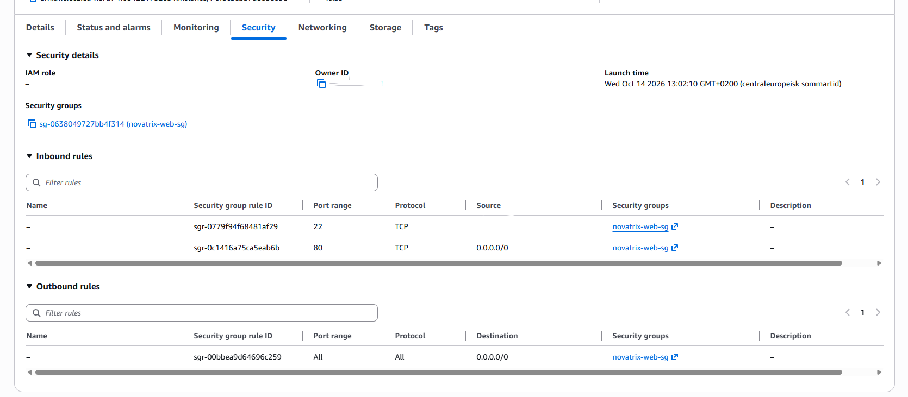

Servern fick IP-adressen `13.60.55.87`. Jag väntade tills den stod på Running och 3/3 checks passed innan jag gick vidare.

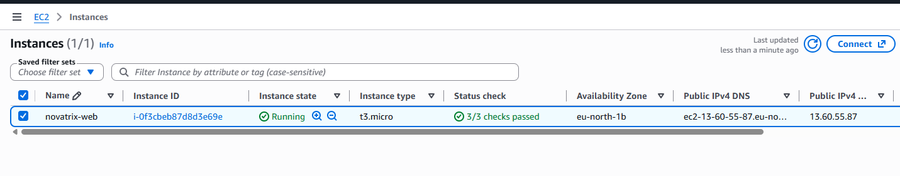

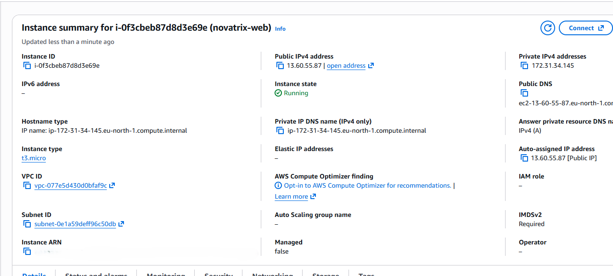

## Delmoment 3: SSH och webbserver

SSH vägrar använda en nyckel som andra konton på datorn kan läsa. Jag började därför med att låsa nyckeln med `icacls` och loggade sedan in som `ec2-user`:

```powershell
cd $HOME\.ssh
icacls .\novatrix-key.pem /inheritance:r
icacls .\novatrix-key.pem /grant:r "$($env:USERNAME):R"
ssh -i .\novatrix-key.pem ec2-user@13.60.55.87
```

Väl inne kollade jag att jag var rätt användare på rätt server och hur mycket disk den har:

```
[ec2-user@ip-172-31-34-145 ~]$ whoami
ec2-user
[ec2-user@ip-172-31-34-145 ~]$ hostname
ip-172-31-34-145.eu-north-1.compute.internal
[ec2-user@ip-172-31-34-145 ~]$ df -h
Filesystem        Size  Used Avail Use% Mounted on
...
/dev/nvme0n1p1    8.0G  1.6G  6.4G  20% /
...
```

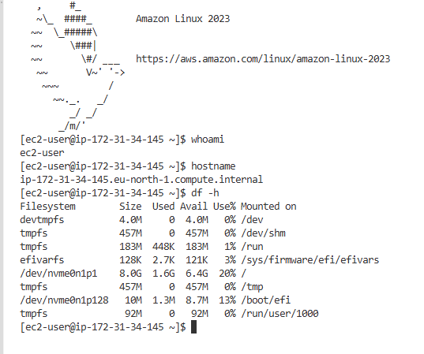

På Amazon Linux heter Apache `httpd`. Jag körde allt med `sudo` eftersom det ändrar i systemet. `enable` behövs för att webbservern ska starta av sig själv om servern startas om.

```bash
sudo yum update -y
sudo yum install httpd -y
sudo systemctl start httpd
sudo systemctl enable httpd
sudo systemctl status httpd
```

```
Loaded: loaded (/usr/lib/systemd/system/httpd.service; enabled; preset: disabled)
Active: active (running) since Wed 2026-10-14 11:18:44 UTC
httpd[26547]: Server configured, listening on: port 80
```

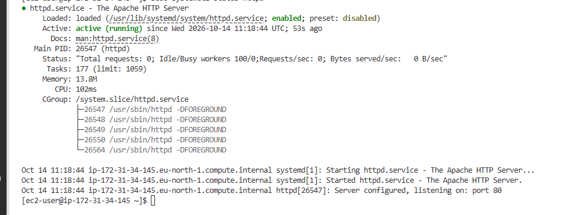

När jag gick in på `http://13.60.55.87` kom Apaches testsida upp. Då visste jag att trafiken kom hela vägen in till webbservern.

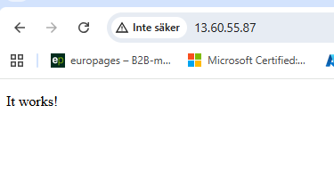

## Delmoment 4: Driftsätt Novatrix-sidan

Apache visar filen `/var/www/html/index.html`. Jag använde samma kommando som läraren visade men skrev en hel sida i stället för bara en rubrik:

```bash
sudo bash -c 'echo "<!DOCTYPE html>
<html lang=sv>
...
</html>" > /var/www/html/index.html'
```

Hela sidan ligger i [index.html](index.html). Jag fick undvika dubbla citattecken i HTML-koden eftersom de annars avslutar `echo`.

```
[ec2-user@ip-172-31-34-145 ~]$ curl -s http://localhost | grep "<h1>"
<h1>Novatrix AB</h1>
```

## Delmoment 5: Verifiera att sidan nås

Sidan syns på `http://13.60.55.87`. Att det står "Inte säker" beror på att sidan körs på http utan certifikat.

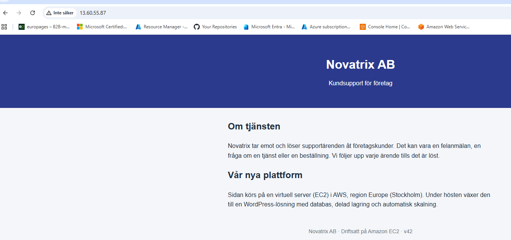

Jag testade också med `curl` från min egen dator. Då går anropet via internet på samma sätt som för en vanlig besökare:

```
PS> curl.exe -I http://13.60.55.87
HTTP/1.1 200 OK
Server: Apache/2.4.69 (Amazon Linux)
Content-Length: 1122
Content-Type: text/html; charset=UTF-8
```

Svaret är `200 OK`. `Content-Length: 1122` är lika stor som min `index.html`, så det är min sida som skickas och inte Apaches testsida.

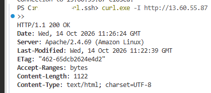

## Delmoment 6: Kostnadskontroll

Budgeten satte jag upp först av allt, innan jag startade något som kostar. Jag använde mallen Monthly cost budget i Budgets med 10 USD i månaden. Larmen går till min e-post:

| Larm | Går när |
|---|---|
| Actual cost > 85 % | Jag har förbrukat 8,50 USD |
| Actual cost > 100 % | Jag har förbrukat 10 USD |
| Forecasted cost > 100 % | AWS räknar med att jag går över 10 USD under månaden |

Prognoslarmet tycker jag är det viktigaste. Det kommer innan pengarna är slut, så jag hinner stänga av det jag har glömt.

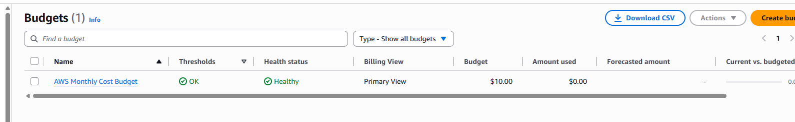

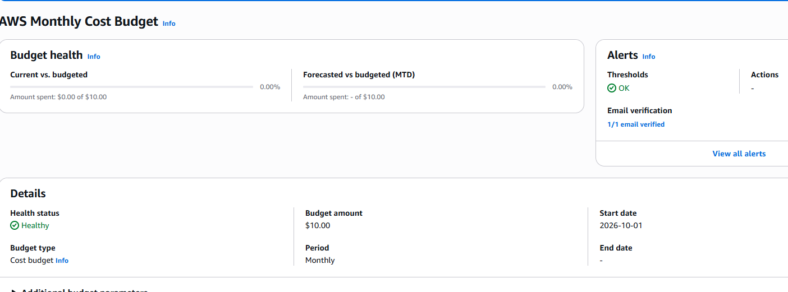

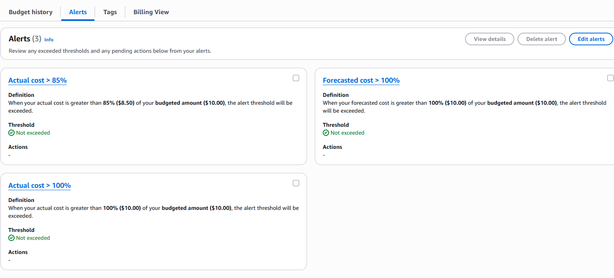

## VG: hela miljön från kod

I G klickade jag fram servern och installerade allt för hand. För VG ville jag kunna bygga samma miljö med ett kommando och riva den lika enkelt. Jag tog först bort servern och security groupen från G. Skripten skapar dem sedan igen med samma namn.

### User data och AWS CLI

Jag använder båda eftersom de gör olika saker. User data är det som körs på servern när den startar, alltså samma kommandon som jag körde via SSH. AWS CLI gör det jag klickade fram i konsolen, det vill säga security groupen och instansen. Med bara user data hade jag fortfarande behövt klicka fram servern.

Det blev tre filer. `user-data.sh` körs på servern. `deploy.ps1` och `destroy.ps1` kör jag på min dator för att bygga och riva.

AWS CLI installerade jag med winget. Jag loggar in med `aws login` som `admin-idris`. Då får CLI:n en inloggning som går ut efter några timmar och inga fasta nycklar sparas på datorn.

```powershell
winget install --id Amazon.AWSCLI -e
aws configure set region eu-north-1
aws login
```

### user-data.sh

```bash
#!/bin/bash
# Novatrix v42 VG: körs av servern själv vid första starten.
# User data körs som root, därför behövs inte sudo.
# Loggen hamnar i /var/log/cloud-init-output.log på servern.

# Stanna vid första felet och skriv varje kommando i loggen
set -euxo pipefail

# Uppdatera paketen och installera webbservern
yum update -y
yum install -y httpd

# Starta webbservern nu och vid varje omstart
systemctl start httpd
systemctl enable httpd

# Hämta Novatrix-sidan från repot på GitHub
curl -fsSL -o /var/www/html/index.html https://raw.githubusercontent.com/80idralt/aws/master/v42/index.html
```

| Rad | Gör |
|---|---|
| `#!/bin/bash` | Säger att det är ett bash-skript. Måste stå först. |
| `set -euxo pipefail` | Skriptet stannar vid första fel och skriver ut varje kommando i loggen |
| `yum update -y` | Uppdaterar paketen |
| `yum install -y httpd` | Installerar Apache |
| `systemctl start httpd` | Startar Apache |
| `systemctl enable httpd` | Gör att Apache startar igen efter en omstart |
| `curl -fsSL -o` | Hämtar `index.html` från mitt repo. `-f` gör att en felsida från GitHub inte sparas som sidan. |

Jag behöver inte `sudo` här eftersom user data körs som root. Sidan hämtas från GitHub i stället för att stå i skriptet. Då finns den bara på ett ställe och nästa server får automatiskt den senaste versionen jag har pushat.

### deploy.ps1

```powershell
# Novatrix v42 VG: bygger hela miljön från kod.
# Kräver: inloggad med "aws login", key pair novatrix-key finns i kontot.

$ErrorActionPreference = "Stop"
$PSNativeCommandUseErrorActionPreference = $true
$env:AWS_CLI_FILE_ENCODING = "UTF-8"

# Inställningar
$Namn     = "novatrix-web"
$SgNamn   = "novatrix-web-sg"
$Nyckel   = "novatrix-key"
$Typ      = "t3.micro"
$Ami      = "resolve:ssm:/aws/service/ami-amazon-linux-latest/al2023-ami-kernel-default-x86_64"
$UserData = Join-Path $PSScriptRoot "user-data.sh"
$Taggar   = "{Key=Name,Value=$Namn},{Key=Project,Value=novatrix}"

# 1. Stoppa om miljön redan finns
$Finns = aws ec2 describe-security-groups --filters "Name=group-name,Values=$SgNamn" --query "SecurityGroups[0].GroupId" --output text
if ($Finns -ne "None") {
    Write-Host "$SgNamn finns redan. Kör destroy.ps1 först."
    exit 1
}

# 2. Security group: SSH bara från min IP just nu, HTTP från alla
$MinIp = (Invoke-RestMethod "https://checkip.amazonaws.com").Trim()
$SgId = aws ec2 create-security-group --group-name $SgNamn `
    --description "SSH fran min IP, HTTP fran alla" `
    --tag-specifications "ResourceType=security-group,Tags=[$Taggar]" `
    --query GroupId --output text
aws ec2 authorize-security-group-ingress --group-id $SgId --protocol tcp --port 22 --cidr "$MinIp/32" | Out-Null
aws ec2 authorize-security-group-ingress --group-id $SgId --protocol tcp --port 80 --cidr "0.0.0.0/0" | Out-Null
Write-Host "Security group $SgNamn skapad ($SgId)"

# 3. Starta instansen med user data
$InstansId = aws ec2 run-instances `
    --image-id $Ami `
    --instance-type $Typ `
    --key-name $Nyckel `
    --security-group-ids $SgId `
    --user-data "file://$UserData" `
    --tag-specifications "ResourceType=instance,Tags=[$Taggar]" `
    --query "Instances[0].InstanceId" --output text
Write-Host "Instans $InstansId startad, väntar på att den ska köra..."

# 4. Vänta tills den kör och hämta den publika IP:n
aws ec2 wait instance-running --instance-ids $InstansId
$Ip = aws ec2 describe-instances --instance-ids $InstansId `
    --query "Reservations[0].Instances[0].PublicIpAddress" --output text

Write-Host ""
Write-Host "Klart. Sidan finns på http://$Ip"
Write-Host "User data behöver 1-2 minuter till innan sidan svarar."
```

Raderna överst gör att skriptet stannar direkt om något AWS-kommando misslyckas. Annars kunde det fortsätta och lämna en halvfärdig miljö efter sig. Under Inställningar står samma val som jag gjorde i konsolen i G.

Steg 1 kollar om security groupen redan finns. Gör den det avbryter skriptet så att jag inte får dubbletter. I steg 2 hämtar skriptet min IP från `checkip.amazonaws.com` och öppnar SSH bara för den. Min IP hemma byts ofta. Med G-lösningen hade jag fått gå in i konsolen och ändra regeln för hand varje gång.

Steg 3 startar servern. AMI:n hämtas med `resolve:ssm` så att det alltid blir den senaste Amazon Linux 2023 och inte ett id som blir gammalt. Här skickas också `user-data.sh` med. Steg 4 väntar tills servern kör och skriver ut adressen.

### destroy.ps1

```powershell
# Novatrix v42 VG: river allt som deploy.ps1 skapade.

$ErrorActionPreference = "Stop"
$PSNativeCommandUseErrorActionPreference = $true

$Namn   = "novatrix-web"
$SgNamn = "novatrix-web-sg"

# 1. Terminera instansen (letar på namnet, hoppar över redan borttagna)
$Instanser = aws ec2 describe-instances `
    --filters "Name=tag:Name,Values=$Namn" `
              "Name=instance-state-name,Values=pending,running,stopping,stopped" `
    --query "Reservations[].Instances[].InstanceId" --output text

if ($Instanser) {
    $Lista = $Instanser -split "\s+"
    aws ec2 terminate-instances --instance-ids $Lista | Out-Null
    Write-Host "Terminerar $Instanser, väntar tills den är borta..."
    aws ec2 wait instance-terminated --instance-ids $Lista
    Write-Host "Instansen är borttagen"
} else {
    Write-Host "Ingen instans att ta bort"
}

# 2. Ta bort security groupen (går först när instansen är borta)
$SgId = aws ec2 describe-security-groups --filters "Name=group-name,Values=$SgNamn" `
    --query "SecurityGroups[0].GroupId" --output text

if ($SgId -ne "None") {
    aws ec2 delete-security-group --group-id $SgId | Out-Null
    Write-Host "Security group $SgNamn borttagen ($SgId)"
} else {
    Write-Host "Ingen security group att ta bort"
}

Write-Host ""
Write-Host "Klart. Novatrix-miljön är riven och kostar inget längre."
```

Destroy gör samma sak som deploy fast baklänges. Security groupen går inte att ta bort så länge servern använder den, så skriptet väntar tills servern är helt borta först. Det letar efter namnet och inte efter ett id, eftersom servern får nytt id varje gång. Key pair och budget låter det vara.

### Verifiering

Jag har byggt miljön från ett tomt konto tre gånger. Servern fick ny IP varje gång men resultatet var detsamma. Det här är den senaste körningen, gjord med skripten som de ser ut i repot.

```
PS> .\deploy.ps1
Security group novatrix-web-sg skapad (sg-0bb72be1493d23bd1)
Instans i-03724b2d298232e67 startad, väntar på att den ska köra...

Klart. Sidan finns på http://16.171.152.248
User data behöver 1-2 minuter till innan sidan svarar.
```

För att se att user data hade körts utan att logga in på servern läste jag dess startlogg med CLI:n. Raden med `PYTHONUTF8` behövdes för att Windows skulle klara alla tecken i loggen.

```powershell
$env:PYTHONUTF8 = "1"
$Id = aws ec2 describe-instances --filters "Name=tag:Name,Values=novatrix-web" "Name=instance-state-name,Values=running" --query "Reservations[0].Instances[0].InstanceId" --output text
aws ec2 get-console-output --instance-id $Id --latest --output text | Select-String "finished at|\+ curl"
```

```
cloud-init[1945]: + curl -fsSL -o /var/www/html/index.html https://raw.githubusercontent.com/80idralt/aws/master/v42/index.html
cloud-init[1945]: Cloud-init v. 22.2.2 finished at Thu, 15 Oct 2026 09:06:04 +0000.
```

Raden som börjar med `+` kommer från `set -x` och visar att sista kommandot i skriptet kördes. Cloud-init var klart 43 sekunder efter start.

```
PS> curl.exe -I http://16.171.152.248
HTTP/1.1 200 OK
Server: Apache/2.4.69 (Amazon Linux)
Last-Modified: Thu, 15 Oct 2026 09:06:04 GMT
Content-Length: 1122
```

`Last-Modified` har samma tid som när cloud-init blev klart. Sidan kom alltså på plats när user data hämtade den från GitHub.

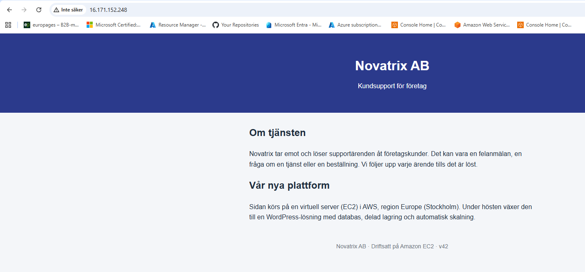

Efter testet rev jag allt igen:

```
PS> .\destroy.ps1
Terminerar i-03724b2d298232e67, väntar tills den är borta...
Instansen är borttagen
Security group novatrix-web-sg borttagen (sg-0bb72be1493d23bd1)

Klart. Novatrix-miljön är riven och kostar inget längre.
```

Miljön behöver inte stå och dra pengar mellan gångerna eftersom den finns som kod. När vi bygger vidare nästa vecka kör jag `deploy.ps1` igen.

### Inför CloudFormation i v46

Mina skript beskriver steg för steg vad som ska hända. Det är därför jag har behövt skriva en egen kontroll mot dubbletter och ett destroy-skript som river i rätt ordning. Med CloudFormation i v46 beskriver man i stället hur miljön ska se ut. AWS räknar då själv ut ordningen och vet vad som hör ihop, så att riva blir ett enda kommando. Mycket av det jag har nu kan följa med dit, till exempel `user-data.sh`, AMI-uppslaget och min IP som parameter.

## Så återskapar du miljön

Du behöver PowerShell 7, AWS CLI version 2, en IAM-användare som får skapa EC2-resurser och ett key pair i regionen.

**1. Hämta repot**

Klona repot och gå in i mappen för v42, där skripten ligger:

```powershell
git clone https://github.com/80idralt/aws.git
cd aws\v42
```

**2. Välj region**

Skripten skapar allt i den region AWS CLI är inställd på. Jag använder Stockholm:

```powershell
aws configure set region eu-north-1
```

Det här behöver bara göras en gång per dator.

**3. Logga in**

En webbläsare öppnas där du loggar in med din IAM-användare. Inloggningen gäller några timmar. Om ett kommando senare säger att sessionen har gått ut kör du det här igen.

```powershell
aws login
```

**4. Bygg miljön**

Skriptet skapar security groupen och startar servern. När det är klart skriver det ut serverns adress.

```powershell
.\deploy.ps1
```

**5. Kontrollera att sidan svarar**

Vänta en minut eller två så att user data hinner installera allt. Byt sedan IP-adressen nedan mot den som deploy skrev ut:

```powershell
curl.exe -I http://13.51.198.120
```

Svaret ska börja med `HTTP/1.1 200 OK`. Du kan också öppna adressen i webbläsaren och se Novatrix-sidan.

**6. Riv miljön**

När du är klar tar du bort servern och security groupen så att inget fortsätter att kosta:

```powershell
.\destroy.ps1
```

Om någon annan ska köra det här finns det tre saker att ändra:

| Värde | Var | Varför |
|---|---|---|
| Key pair `novatrix-key` | `$Nyckel` i `deploy.ps1` | Varje konto har sina egna nycklar |
| Region `eu-north-1` | `aws configure set region` | Om miljön ska ligga i en annan region |
| Adressen till `index.html` | Sista raden i `user-data.sh` | Den pekar på mitt repo |

Min IP och AMI-id behöver inte ändras eftersom skriptet tar fram dem själv. Om du ändrar `index.html` måste du pusha innan du kör deploy, annars får servern den gamla sidan.
