# AWS Uppgift 2 (v43): IAM och identitet

**Namn:** Idris Altun

**Kurs:** AWS, MOV25

**Datum:** 2026-10-26

**Repo:** https://github.com/80idralt/aws/tree/master/v43

## Sammanfattning

Den här veckan har jag bestämt vem och vad som får göra vad i Novatrix AWS-konto. Människorna är uppdelade i två grupper, drift och utveckling. Webbservern har ingen nyckel. Den får sina rättigheter från en IAM-roll.

För VG byggde jag en kedja med två roller. Servern har den första rollen och får låna den andra bara när den ska lägga en backup. Ingen av rollerna kan mer än sin egen uppgift.

Jag gjorde allt först i konsolen för att förstå hur delarna hänger ihop. Sedan rev jag det och byggde samma sak med ett skript. Skriptet har byggt allt från ett tomt konto två gånger.

## Innehåll

1. [Delmoment 1: Repo](#delmoment-1-repo)
2. [Delmoment 2: Användare och grupper](#delmoment-2-användare-och-grupper)
3. [Delmoment 3: Policies enligt least privilege](#delmoment-3-policies-enligt-least-privilege)
4. [Delmoment 4: Behörigheter mellan tjänster](#delmoment-4-behörigheter-mellan-tjänster)
5. [Delmoment 5: Verifiering](#delmoment-5-verifiering)
6. [Så återskapar du miljön](#så-återskapar-du-miljön)
7. [Inför kommande veckor](#inför-kommande-veckor)
8. [Bilaga: policyerna](#bilaga-policyerna)
9. [Bilaga: skripten](#bilaga-skripten)

## Delmoment 1: Repo

I mappen `v43` ligger:

- `policies/` med sju JSON-filer. Varje fil är en regel om vad någon får göra.
- `deploy.ps1` som bygger allt.
- `destroy.ps1` som river allt.
- `hej.txt` som är testfilen servern ska läsa.

Några av reglerna innehåller kontonumret. Det vill jag inte ha i ett publikt repo. Därför står det `KONTONUMMER` i filerna. Skriptet byter ut ordet mot det riktiga numret när det körs. I testutskrifterna har jag bytt ut numret på samma sätt.

## Delmoment 2: Användare och grupper

Hela uppsättningen ser ut så här:

```
MÄNNISKOR
  grupp novatrix-drift ........ användare drift-test
  grupp novatrix-utveckling ... användare dev-test

SERVERN novatrix-web
  har roll 1 novatrix-ec2-s3-read
    läser data-bucketen
    får låna roll 2 novatrix-backup-write
      lägger backuper i backup-bucketen
```

Människorna ligger i grupper och servern har roller. Både grupperna och rollerna har policies, alltså regler om vad de får göra.

Reglerna sitter på grupperna och inte på personerna. Får Novatrix en ny driftperson lägger jag in personen i gruppen. Slutar någon tar jag bort personen ur gruppen och då försvinner åtkomsten direkt.

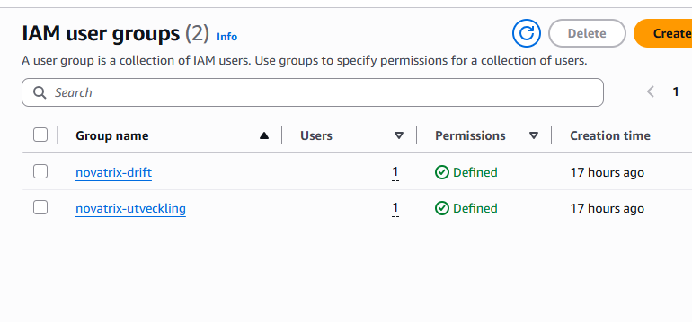

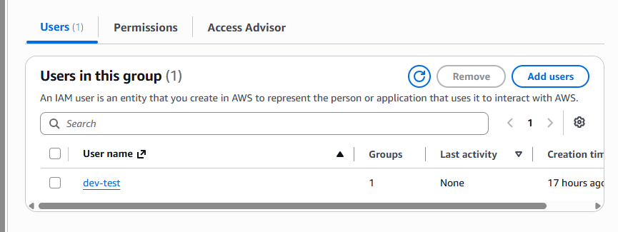

Testanvändarna har inget lösenord. De finns bara för att jag ska kunna testa gruppernas regler. En användare som ingen kan logga in som kan inte heller missbrukas.

Mitt eget konto `admin-idris` ligger inte i någon av grupperna. Det har MFA. Root använder jag inte.

## Delmoment 3: Policies enligt least privilege

I AWS är allt förbjudet från början. En policy öppnar bara det som står i den. Alla policies ligger som JSON-filer i [policies/](policies/):

| Fil | Sitter på | Tillåter |
|---|---|---|
| [drift.json](policies/drift.json) | Gruppen novatrix-drift | Se servrar. Starta, stoppa och starta om Novatrix servrar. |
| [utveckling.json](policies/utveckling.json) | Gruppen novatrix-utveckling | Se servrar. Läsa filer i data-bucketen. |
| [trust-ec2.json](policies/trust-ec2.json) | Roll 1 | Att servrar får låna roll 1 |
| [s3-read.json](policies/s3-read.json) | Roll 1 | Läsa filer i data-bucketen |
| [assume-backup.json](policies/assume-backup.json) | Roll 1 | Låna roll 2 |
| [trust-backup.json](policies/trust-backup.json) | Roll 2 | Att bara roll 1 får låna roll 2 |
| [s3-backup.json](policies/s3-backup.json) | Roll 2 | Lägga filer i backup-mappen |

| Grupp | Får | Får inte |
|---|---|---|
| Drift | Se servrar. Starta, stoppa och starta om Novatrix servrar. | Skapa eller radera servrar |
| Utveckling | Se servrar. Läsa filer i data-bucketen. | Röra servrarna. Ändra eller radera filer. |

Drift sköter servrarna och behöver kunna starta om dem. Men ingen ska kunna radera produktionen av misstag. Drift får dessutom bara röra servrar som är märkta med `Project=novatrix`. Skulle kontot få andra servrar kan drift inte röra dem.

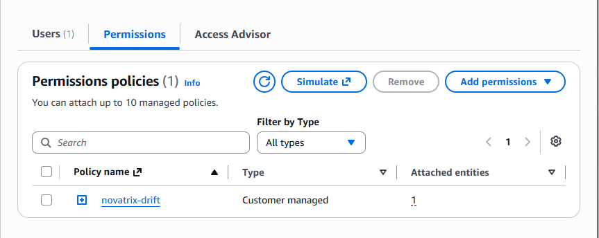

Utveckling behöver mest kunna titta och testa. Därför får de bara läsa.

Det finns en stjärna i båda reglerna, för att få se servrar. Stjärnor bör undvikas, men här går det inte på något annat sätt eftersom AWS inte kan begränsa "se servrar" till en viss server. Det är bara läsning.

Jag valde bort AWS färdiga regel `AmazonS3ReadOnlyAccess`. Den ger läsrätt till alla buckets i kontot, även backup-bucketen. Mina egna regler pekar ut exakt vilken bucket det gäller.

Grupperna har customer managed policies. De är fristående, så samma policy kan kopplas till fler grupper om Novatrix växer. Rollernas policies är inline. Varje regel hör till exakt en roll och pekar på exakt en bucket eller roll, så de ska aldrig återanvändas. Det är det undantag där inline passar.

## Delmoment 4: Behörigheter mellan tjänster

### Roll 1

Webbservern ska läsa en fil i S3. Det enkla vore att lägga en nyckel på servern. Men en nyckel kan läcka och fungerar sedan tills någon byter den.

I stället har servern en roll. En roll är som ett passerkort som servern lånar. Kortet gäller bara en begränsad tid och byts ut automatiskt. Det finns ingen nyckel på servern som kan stjälas.

Roll 1 heter `novatrix-ec2-s3-read`. Den får bara läsa i data-bucketen.

En roll har två delar. Trust policyn säger vem som får låna rollen. För roll 1 säger den att bara tjänsten EC2 får låna den, alltså mina servrar. Ingen person och ingen annan tjänst kan ta den.

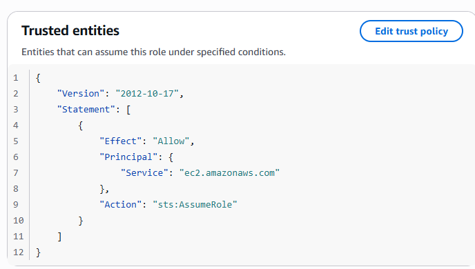

Permissions säger vad rollen får göra. Roll 1 har två egna regler, en för att läsa data-bucketen och en för att låna roll 2.

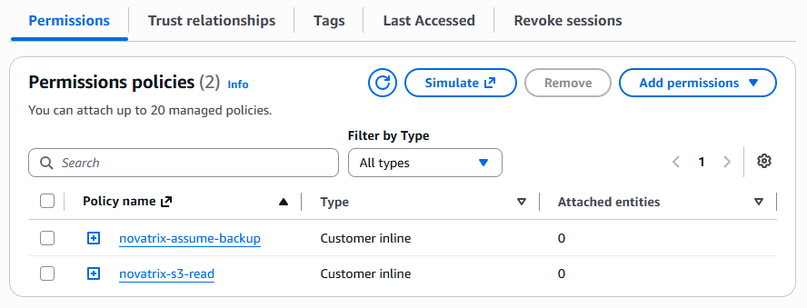

En server kan inte bära en roll direkt. Rollen läggs i en instance profile med samma namn. Det är den som kopplas till servern. I konsolen skapades den automatiskt när jag skapade rollen. I skriptet gör jag det själv med `aws iam create-instance-profile` och `aws ec2 associate-iam-instance-profile`.

### VG: kedjan med roll 2

Servern ska också kunna lägga backuper i en egen bucket. Jag kunde ha gett roll 1 rätt att skriva där. I stället finns en roll 2, `novatrix-backup-write`, som bara den som redan har roll 1 får låna. Det är kedjan.

Det här är regeln på roll 2 som säger vem som får låna den. Den pekar på roll 1:

```json
"Principal": {
    "AWS": "arn:aws:iam::KONTONUMMER:role/novatrix-ec2-s3-read"
}
```

Roll 2 har bara en regel, att lägga filer i backup-mappen.

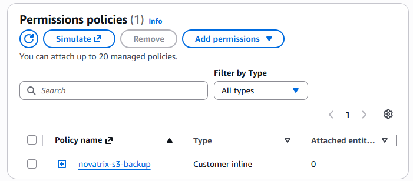

Varför två roller i stället för en:

- Roll 1 kan inte skriva någonstans. Roll 2 kan inte läsa eller radera något.
- Roll 2 kan aldrig sättas direkt på en server.
- Varje gång servern lånar roll 2 syns det i loggen CloudTrail. Då går det att se när backuper har gjorts.

Kedjan skyddar inte mot allt. Tar sig någon in på servern kan den personen också lägga filer i backup-mappen. Men personen kan inte läsa backuperna eller radera dem.

### Rollerna jag har skapat och varför

Least privilege betyder att varje roll bara får det den behöver för sin uppgift och inget mer. Här är alla fyra, både grupperna för människorna och rollerna för servern.

| Namn | Vem | Får | Får inte |
|---|---|---|---|
| novatrix-drift | Driftpersonal | Se servrar. Starta, stoppa och starta om Novatrix servrar. | Skapa eller radera servrar. Röra S3. |
| novatrix-utveckling | Utvecklare | Se servrar. Läsa filer i data-bucketen. | Röra servrarna. Skriva eller radera filer. |
| novatrix-ec2-s3-read | Webbservern | Läsa filer i data-bucketen. Låna roll 2. | Skriva någonstans. Läsa backup-bucketen. |
| novatrix-backup-write | Bara roll 1 | Lägga filer i backup-mappen | Läsa, lista eller radera något |

Varför var och en finns:

- `novatrix-drift` finns för att driftpersonalen ska kunna sköta servrarna när något krånglar. Starta om räcker för det. Att radera eller skapa servrar ingår inte i deras vardag, så det får de inte.
- `novatrix-utveckling` finns för att utvecklarna ska kunna se hur miljön ser ut och läsa filerna de jobbar med. De ska inte kunna ändra produktionen, så de får bara läsa.
- `novatrix-ec2-s3-read` finns för att webbservern ska kunna hämta sina filer från S3 utan en nyckel. Den behöver bara läsa, så den får inte skriva.
- `novatrix-backup-write` finns för att servern ska kunna lämna backuper. Den får bara lägga in filer. Den som kommer åt rollen kan alltså inte läsa eller förstöra backuperna.

### Skripten

Allt byggs med ett kommando:

```powershell
aws login
.\deploy.ps1
```

Skriptet gör samma sak som jag klickade fram i konsolen, i samma ordning. Det skapar bucketarna, grupperna med sina användare, roll 1, roll 2 och till sist servern. Servern byggs med skriptet från v42.

`.\destroy.ps1` river allt i omvänd ordning. Servern måste bort först eftersom den har roll 1.

Båda skripten står i sin helhet i [Bilaga: skripten](#bilaga-skripten).

### Så växer modellen

Får Novatrix en ny anställd behövs ingen ny regel. Personen läggs i rätt grupp och får gruppens rättigheter direkt.

Startar Novatrix fler servrar med taggen `Project=novatrix` kan drift sköta dem utan att något ändras. Alla webbservrar kan också ha samma roll 1. Det blir viktigt i v47 när flera servrar ska starta automatiskt.

Behöver ett nytt team eller en ny tjänst egna rättigheter blir det en ny JSON-fil och några nya rader i skriptet. Jag kopierar ett befintligt block och byter namn.

Det finns två svagheter. Varje team är uppräknat för hand i skriptet. Med två team gör det inget, men med många hade det blivit rörigt. Skriptet förutsätter också ett tomt konto. Jag kan inte köra det igen bara för att lägga till en person, för då stannar det på det som redan finns. Det löser CloudFormation i v46. Där jämför AWS mallen med det som redan finns och skapar bara det som saknas.

## Delmoment 5: Verifiering

### Bygget

Första körningen gjordes på ett tomt konto:

```
PS> .\deploy.ps1
Bucketar skapade, hej.txt uppladdad
Grupper och testanvändare skapade
Roll 1 novatrix-ec2-s3-read skapad
Roll 2 novatrix-backup-write och kedjan skapade
Security group novatrix-web-sg skapad (sg-0fe7ee44fe7a657cc)
Instans i-0bd1ff8244fbf524b startad, väntar på att den ska köra...

Klart. Sidan finns på http://16.171.2.117
User data behöver 1-2 minuter till innan sidan svarar.
Roll 1 kopplad till servern i-0bd1ff8244fbf524b
```

### Det som finns i kontot

Med AWS CLI listade jag vad skriptet har skapat. `--query` gör att bara namnen skrivs ut, så kontonumret syns inte.

```powershell
aws iam list-groups --query "Groups[?starts_with(GroupName,'novatrix')].GroupName" --output table
aws iam get-group --group-name novatrix-drift --query "Users[].UserName" --output table
aws iam get-group --group-name novatrix-utveckling --query "Users[].UserName" --output table
aws iam list-attached-group-policies --group-name novatrix-drift `
    --query "AttachedPolicies[].PolicyName" --output table
aws iam list-attached-group-policies --group-name novatrix-utveckling `
    --query "AttachedPolicies[].PolicyName" --output table
aws iam list-roles --query "Roles[?starts_with(RoleName,'novatrix')].RoleName" --output table
aws iam list-role-policies --role-name novatrix-ec2-s3-read --output table
aws iam list-role-policies --role-name novatrix-backup-write --output table
```

```
-------------------------
|      ListGroups       |
+-----------------------+
|  novatrix-drift       |
|  novatrix-utveckling  |
+-----------------------+

----------------
|   GetGroup   |
+--------------+
|  drift-test  |
+--------------+

--------------
|  GetGroup  |
+------------+
|  dev-test  |
+------------+

---------------------------
|ListAttachedGroupPolicies|
+-------------------------+
|  novatrix-drift         |
+-------------------------+

---------------------------
|ListAttachedGroupPolicies|
+-------------------------+
|  novatrix-utveckling    |
+-------------------------+

---------------------------
|        ListRoles        |
+-------------------------+
|  novatrix-backup-write  |
|  novatrix-ec2-s3-read   |
+-------------------------+

------------------------------
|      ListRolePolicies      |
+----------------------------+
||        PolicyNames       ||
|+--------------------------+|
||  novatrix-assume-backup  ||
||  novatrix-s3-read        ||
|+--------------------------+|

--------------------------
|    ListRolePolicies    |
+------------------------+
||      PolicyNames     ||
|+----------------------+|
||  novatrix-s3-backup  ||
|+----------------------+|
```

Sammanfattat:

| Grupp eller roll | Medlem | Policy |
|---|---|---|
| novatrix-drift | drift-test | novatrix-drift |
| novatrix-utveckling | dev-test | novatrix-utveckling |
| novatrix-ec2-s3-read | | novatrix-s3-read, novatrix-assume-backup |
| novatrix-backup-write | | novatrix-s3-backup |

Grupperna har sina policies kopplade som fristående policies. Rollernas policies är inbakade i rollen, därför listas de med ett annat kommando.

### Grupperna

Jag testade grupperna med Policy Simulator. Den svarar vad som skulle hända om användaren försökte göra något. `allowed` betyder tillåtet. `implicitDeny` betyder nekat eftersom ingen regel tillåter det.

Så här ser svaret ut för drift:

```
+-------------------------+----------------+
|  ec2:RebootInstances    |  allowed       |
|  ec2:StopInstances      |  allowed       |
|  ec2:TerminateInstances |  implicitDeny  |
|  ec2:RunInstances       |  implicitDeny  |
+-------------------------+----------------+
```

| Test | Drift | Utveckling |
|---|---|---|
| Se servrar | Tillåtet | Tillåtet |
| Starta om server | Tillåtet | Nekat |
| Stoppa server | Tillåtet | Nekat |
| Radera server | Nekat | Nekat |

För utveckling testade jag också data-bucketen. Läsa `hej.txt` var tillåtet. Skriva och radera var nekat.

I konsolrundan loggade jag också in som testanvändarna i ett privat fönster. drift-test kunde starta om servern:

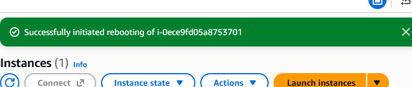

Men när drift-test försökte radera servern blev det nekat:

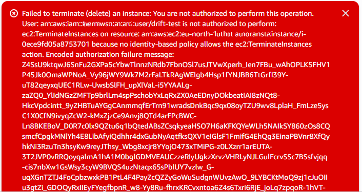

dev-test fick inte ens starta om den:

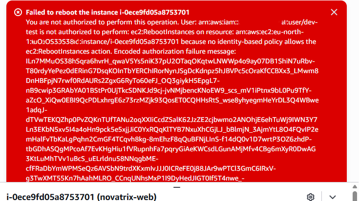

Kontonumret är suddat på bilderna.

### Servern

Innan servern hade någon roll fick den inte göra någonting:

```
aws: [ERROR]: An error occurred (NoCredentials): Unable to locate credentials.
```

Bucketarna ligger i Stockholm. Data-bucketen innehåller testfilen som skriptet laddade upp.

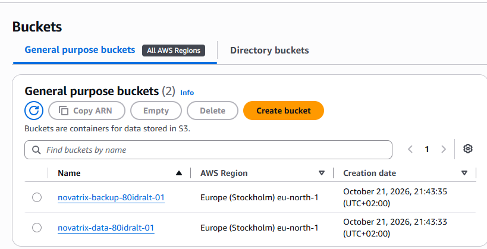

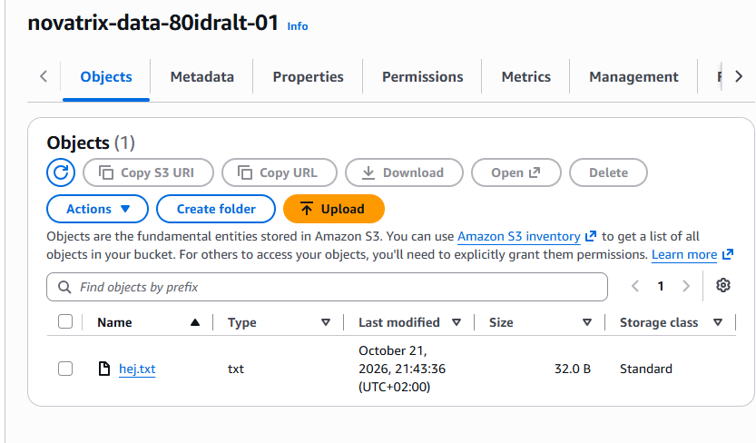

Med roll 1 visste servern vem den var. Den kunde lista och läsa testfilen men inte skriva:

```
[ec2-user@ip-172-31-43-10 ~]$ aws sts get-caller-identity --query Arn --output text
arn:aws:sts::KONTONUMMER:assumed-role/novatrix-ec2-s3-read/i-0bd1ff8244fbf524b
[ec2-user@ip-172-31-43-10 ~]$ aws s3 ls s3://novatrix-data-80idralt-01
2026-10-21 19:33:09         32 hej.txt
[ec2-user@ip-172-31-43-10 ~]$ aws s3 cp s3://novatrix-data-80idralt-01/hej.txt -
Hej från Novatrix data-bucket
[ec2-user@ip-172-31-43-10 ~]$ aws s3 cp test.txt s3://novatrix-data-80idralt-01/
upload failed: ... (AccessDenied) when calling the PutObject operation
```

Ett vanligt test är `aws s3 ls` utan bucketnamn, alltså en lista över alla buckets i kontot. Hos mig nekas det med flit. Roll 1 får bara se sin egen bucket, så servern får inte veta vilka andra buckets som finns.

### Kedjan

På servern lånade jag roll 2 och testade vad den får göra:

| Test | Med roll | Resultat |
|---|---|---|
| Låna roll 2 | Roll 1 | Lyckades |
| Lägga backup i backup-mappen | Roll 2 | Lyckades |
| Lägga fil utanför backup-mappen | Roll 2 | Nekad |
| Se vad som finns i backup-bucketen | Roll 2 | Nekad |
| Radera backupen | Roll 2 | Nekad |
| Lägga backup utan att låna roll 2 | Roll 1 | Nekad |

Det sista testet visar att servern måste låna roll 2 för att få skriva backuper.

Backupen som servern lade via roll 2 syns i backup-bucketen. Jag ser den eftersom jag är inloggad som admin. Roll 2 själv fick inte se den.

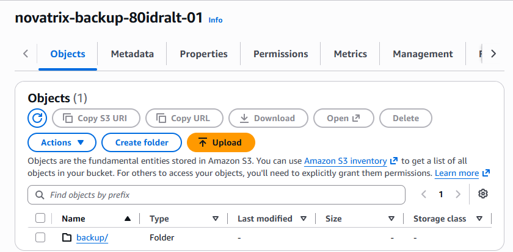

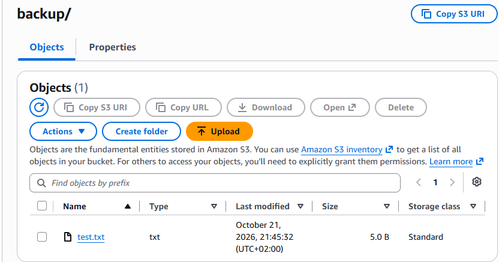

### Riva och bygga igen

Jag rev allt med `.\destroy.ps1` och kontrollerade att inga roller, grupper eller buckets fanns kvar. Sedan körde jag `.\deploy.ps1` igen på det tomma kontot. Allt byggdes på nytt och servern kunde läsa filen och lägga backuper på samma sätt som första gången.

Efter testet rev jag bara servern. Grupperna, rollerna och bucketarna kostar inget och står kvar till kommande veckor.

## Så återskapar du miljön

Du behöver PowerShell 7, AWS CLI version 2 och en IAM-användare som får skapa IAM-, S3- och EC2-resurser. Key pair `novatrix-key` måste finnas i regionen, eftersom servern byggs med skriptet från v42.

```powershell
git clone https://github.com/80idralt/aws.git
cd aws\v43
aws configure set region eu-north-1
aws login
.\deploy.ps1
```

När du är klar river du allt med `.\destroy.ps1`.

Det här måste bytas om någon annan ska köra skripten:

- Bucketnamnen, eftersom de måste vara unika i hela AWS. De står i `deploy.ps1`, `destroy.ps1` och i JSON-filerna där `80idralt` står.
- Key pair, om ditt heter något annat. Det står i `v42\deploy.ps1`.

Kontonumret behöver inte bytas. Skriptet hämtar det själv och byter ut `KONTONUMMER` i filerna.

Skriptet förutsätter ett tomt konto. Körs det en gång till stannar det på första saken som redan finns, eftersom AWS inte tillåter två roller eller buckets med samma namn. Då kör man `.\destroy.ps1` först.

## Inför kommande veckor

Backup-bucketen ska användas för databasbackuper i v45. Data-bucketen används igen i v46.

I v46 skapas rollen `novatrix-ec2-s3-read` med CloudFormation. Innan dess måste jag ta bort min roll med samma namn, annars krockar de.

## Bilaga: policyerna

Här är alla sju policyerna som de ligger i [policies/](policies/).

### drift.json

Sitter på gruppen novatrix-drift.

```json
{
    "Version": "2012-10-17",
    "Statement": [
        {
            "Sid": "SeInstanser",
            "Effect": "Allow",
            "Action": "ec2:Describe*",
            "Resource": "*"
        },
        {
            "Sid": "StyraNovatrixServrar",
            "Effect": "Allow",
            "Action": [
                "ec2:StartInstances",
                "ec2:StopInstances",
                "ec2:RebootInstances"
            ],
            "Resource": "arn:aws:ec2:eu-north-1:*:instance/*",
            "Condition": {
                "StringEquals": {
                    "aws:ResourceTag/Project": "novatrix"
                }
            }
        }
    ]
}
```

### utveckling.json

Sitter på gruppen novatrix-utveckling.

```json
{
    "Version": "2012-10-17",
    "Statement": [
        {
            "Sid": "SeInstanser",
            "Effect": "Allow",
            "Action": "ec2:Describe*",
            "Resource": "*"
        },
        {
            "Sid": "ListaDatabucketen",
            "Effect": "Allow",
            "Action": "s3:ListBucket",
            "Resource": "arn:aws:s3:::novatrix-data-80idralt-01"
        },
        {
            "Sid": "LasaFilerIDatabucketen",
            "Effect": "Allow",
            "Action": "s3:GetObject",
            "Resource": "arn:aws:s3:::novatrix-data-80idralt-01/*"
        }
    ]
}
```

### trust-ec2.json

Trust policyn för roll 1. Bara EC2 får låna rollen.

```json
{
    "Version": "2012-10-17",
    "Statement": [
        {
            "Effect": "Allow",
            "Principal": {
                "Service": "ec2.amazonaws.com"
            },
            "Action": "sts:AssumeRole"
        }
    ]
}
```

### s3-read.json

Inbakad i roll 1 som novatrix-s3-read. Läsa data-bucketen.

```json
{
    "Version": "2012-10-17",
    "Statement": [
        {
            "Effect": "Allow",
            "Action": "s3:ListBucket",
            "Resource": "arn:aws:s3:::novatrix-data-80idralt-01"
        },
        {
            "Effect": "Allow",
            "Action": "s3:GetObject",
            "Resource": "arn:aws:s3:::novatrix-data-80idralt-01/*"
        }
    ]
}
```

### assume-backup.json

Inbakad i roll 1 som novatrix-assume-backup. Låna roll 2.

```json
{
    "Version": "2012-10-17",
    "Statement": [
        {
            "Effect": "Allow",
            "Action": "sts:AssumeRole",
            "Resource": "arn:aws:iam::KONTONUMMER:role/novatrix-backup-write"
        }
    ]
}
```

### trust-backup.json

Trust policyn för roll 2. Bara roll 1 får låna rollen.

```json
{
    "Version": "2012-10-17",
    "Statement": [
        {
            "Effect": "Allow",
            "Principal": {
                "AWS": "arn:aws:iam::KONTONUMMER:role/novatrix-ec2-s3-read"
            },
            "Action": "sts:AssumeRole"
        }
    ]
}
```

### s3-backup.json

Inbakad i roll 2 som novatrix-s3-backup. Lägga filer i backup-mappen.

```json
{
    "Version": "2012-10-17",
    "Statement": [
        {
            "Effect": "Allow",
            "Action": "s3:PutObject",
            "Resource": "arn:aws:s3:::novatrix-backup-80idralt-01/backup/*"
        }
    ]
}
```

## Bilaga: skripten

Skripten som de ligger i repot. Servern byggs och rivs med skripten från [v42](../v42/).

### deploy.ps1

```powershell
# Novatrix v43 VG: bygger hela IAM-modellen från kod.
# Kräver: inloggad med "aws login", key pair novatrix-key finns i kontot.

$ErrorActionPreference = "Stop"
$PSNativeCommandUseErrorActionPreference = $true
$env:AWS_CLI_FILE_ENCODING = "UTF-8"

# Inställningar
$Region       = "eu-north-1"
$Mapp         = Join-Path $PSScriptRoot "policies"
$DataBucket   = "novatrix-data-80idralt-01"
$BackupBucket = "novatrix-backup-80idralt-01"

# Kontonumret hämtas här, så att det aldrig behöver stå i repot
$Konto = aws sts get-caller-identity --query Account --output text

# 1. Bucketarna. Ny bucket blockerar allmän åtkomst från start.
aws s3api create-bucket --bucket $DataBucket --region $Region `
    --create-bucket-configuration LocationConstraint=$Region | Out-Null
aws s3api create-bucket --bucket $BackupBucket --region $Region `
    --create-bucket-configuration LocationConstraint=$Region | Out-Null
aws s3 cp (Join-Path $PSScriptRoot "hej.txt") "s3://$DataBucket/hej.txt" | Out-Null
Write-Host "Bucketar skapade, hej.txt uppladdad"

# 2. Människorna: policy först, sedan grupp, sedan användare
$DriftArn = aws iam create-policy --policy-name novatrix-drift `
    --policy-document "file://$Mapp/drift.json" --query Policy.Arn --output text
aws iam create-group --group-name novatrix-drift | Out-Null
aws iam attach-group-policy --group-name novatrix-drift --policy-arn $DriftArn
aws iam create-user --user-name drift-test | Out-Null
aws iam add-user-to-group --user-name drift-test --group-name novatrix-drift

$UtvArn = aws iam create-policy --policy-name novatrix-utveckling `
    --policy-document "file://$Mapp/utveckling.json" --query Policy.Arn --output text
aws iam create-group --group-name novatrix-utveckling | Out-Null
aws iam attach-group-policy --group-name novatrix-utveckling --policy-arn $UtvArn
aws iam create-user --user-name dev-test | Out-Null
aws iam add-user-to-group --user-name dev-test --group-name novatrix-utveckling
Write-Host "Grupper och testanvändare skapade"

# 3. Roll 1: webbservern läser data-bucketen
aws iam create-role --role-name novatrix-ec2-s3-read `
    --assume-role-policy-document "file://$Mapp/trust-ec2.json" | Out-Null
aws iam put-role-policy --role-name novatrix-ec2-s3-read `
    --policy-name novatrix-s3-read --policy-document "file://$Mapp/s3-read.json"

# Omslaget som låter en server bära rollen (konsolen gjorde det automatiskt)
aws iam create-instance-profile --instance-profile-name novatrix-ec2-s3-read | Out-Null
aws iam add-role-to-instance-profile --instance-profile-name novatrix-ec2-s3-read `
    --role-name novatrix-ec2-s3-read
Write-Host "Roll 1 novatrix-ec2-s3-read skapad"

# 4. Roll 2 och kedjan. KONTONUMMER i filerna byts mot det riktiga numret här.
$TrustBackup  = (Get-Content "$Mapp/trust-backup.json" -Raw).Replace("KONTONUMMER", $Konto)
$AssumeBackup = (Get-Content "$Mapp/assume-backup.json" -Raw).Replace("KONTONUMMER", $Konto)

# IAM behöver några sekunder innan en ny roll kan pekas ut i en annan rolls trust
Start-Sleep -Seconds 10

aws iam create-role --role-name novatrix-backup-write `
    --assume-role-policy-document $TrustBackup | Out-Null
aws iam put-role-policy --role-name novatrix-backup-write `
    --policy-name novatrix-s3-backup --policy-document "file://$Mapp/s3-backup.json"

# Sista länken: roll 1 får låna roll 2
aws iam put-role-policy --role-name novatrix-ec2-s3-read `
    --policy-name novatrix-assume-backup --policy-document $AssumeBackup
Write-Host "Roll 2 novatrix-backup-write och kedjan skapade"


# 5. Servern byggs med v42-skriptet, sedan får den roll 1
& (Join-Path $PSScriptRoot "..\v42\deploy.ps1")

$InstansId = aws ec2 describe-instances `
    --filters "Name=tag:Name,Values=novatrix-web" "Name=instance-state-name,Values=running" `
    --query "Reservations[0].Instances[0].InstanceId" --output text
aws ec2 associate-iam-instance-profile --instance-id $InstansId `
    --iam-instance-profile Name=novatrix-ec2-s3-read | Out-Null
Write-Host "Roll 1 kopplad till servern $InstansId"
```

### destroy.ps1

```powershell
# Novatrix v43 VG: river allt som deploy.ps1 skapade, i omvänd ordning.
# Kräver: inloggad med "aws login".

$ErrorActionPreference = "Stop"
$PSNativeCommandUseErrorActionPreference = $true

$DataBucket   = "novatrix-data-80idralt-01"
$BackupBucket = "novatrix-backup-80idralt-01"
$Konto = aws sts get-caller-identity --query Account --output text

# 1. Servern först, den bär roll 1
& (Join-Path $PSScriptRoot "..\v42\destroy.ps1")

# 2. Rollerna: ta ur rollen ur omslaget, ta bort omslaget, sedan lapparna, sist rollen
aws iam remove-role-from-instance-profile --instance-profile-name novatrix-ec2-s3-read `
    --role-name novatrix-ec2-s3-read
aws iam delete-instance-profile --instance-profile-name novatrix-ec2-s3-read

aws iam delete-role-policy --role-name novatrix-ec2-s3-read --policy-name novatrix-s3-read
aws iam delete-role-policy --role-name novatrix-ec2-s3-read --policy-name novatrix-assume-backup
aws iam delete-role --role-name novatrix-ec2-s3-read

aws iam delete-role-policy --role-name novatrix-backup-write --policy-name novatrix-s3-backup
aws iam delete-role --role-name novatrix-backup-write
Write-Host "Rollerna borttagna"


# 3. Människorna: ur gruppen, bort med användaren, av med lappen, bort med gruppen, sist lappen
aws iam remove-user-from-group --user-name drift-test --group-name novatrix-drift
aws iam delete-user --user-name drift-test
aws iam detach-group-policy --group-name novatrix-drift `
    --policy-arn "arn:aws:iam::${Konto}:policy/novatrix-drift"
aws iam delete-group --group-name novatrix-drift
aws iam delete-policy --policy-arn "arn:aws:iam::${Konto}:policy/novatrix-drift"

aws iam remove-user-from-group --user-name dev-test --group-name novatrix-utveckling
aws iam delete-user --user-name dev-test
aws iam detach-group-policy --group-name novatrix-utveckling `
    --policy-arn "arn:aws:iam::${Konto}:policy/novatrix-utveckling"
aws iam delete-group --group-name novatrix-utveckling
aws iam delete-policy --policy-arn "arn:aws:iam::${Konto}:policy/novatrix-utveckling"
Write-Host "Grupper, testanvändare och deras policies borttagna"

# 4. Bucketarna. --force tömmer dem först.
aws s3 rb "s3://$DataBucket" --force | Out-Null
aws s3 rb "s3://$BackupBucket" --force | Out-Null
Write-Host "Bucketarna borttagna"

Write-Host ""
Write-Host "Klart. Allt från v43 är rivet."
```
