# AWS Uppgift 3 (v44): Nätverk och säkerhet

**Namn:** Idris Altun

**Kurs:** AWS, MOV25

**Datum:** 2026-10-29

**Repo:** https://github.com/80idralt/aws/tree/master/v44

## Sammanfattning

Fram till nu har Novatrix webbserver stått i AWS färdiga standardnätverk. Där är alla subnät publika. Det finns ingen plats att gömma en databas på.

Den här veckan har jag byggt ett eget nätverk. Det har ett publikt subnät för webbservern och två privata subnät där databasen ska stå nästa vecka. Trafiken stoppas i flera lager. En NACL sitter på hela det publika subnätet och en security group sitter på varje server.

För VG har jag lagt till en bastion. Det är en liten extra server som är den enda vägen in med SSH. Webbservern tar inte längre emot SSH från internet alls, inte ens från min egen adress.

Jag byggde allt först i konsolen för att förstå hur delarna hänger ihop. Sedan rev jag det och skrev två skript som bygger och river samma sak. Skripten har byggt allt två gånger med samma resultat.

## Innehåll

1. [Delmoment 1: Repo](#delmoment-1-repo)
2. [Delmoment 2: VPC:t](#delmoment-2-vpct)
3. [Delmoment 3: Säkra trafiken](#delmoment-3-säkra-trafiken)
4. [Delmoment 4: Placera lösningen](#delmoment-4-placera-lösningen)
5. [VG: Defense in depth](#vg-defense-in-depth)
6. [Delmoment 5: Verifiering](#delmoment-5-verifiering)
7. [Så återskapar du miljön](#så-återskapar-du-miljön)
8. [Bilaga: skripten](#bilaga-skripten)

## Delmoment 1: Repo

I mappen `v44` ligger:

- `deploy.ps1` som bygger nätverket och servrarna.
- `destroy.ps1` som river allt igen.
- `bilder/` med nätverksskissen och skärmbilder från konsolen.

Webbservern använder samma startskript som i v42, `v42/user-data.sh`. Det installerar webbservern och hämtar Novatrix-sidan från GitHub. Servern får också rollen `novatrix-ec2-s3-read` från v43.

## Delmoment 2: VPC:t

### Skiss

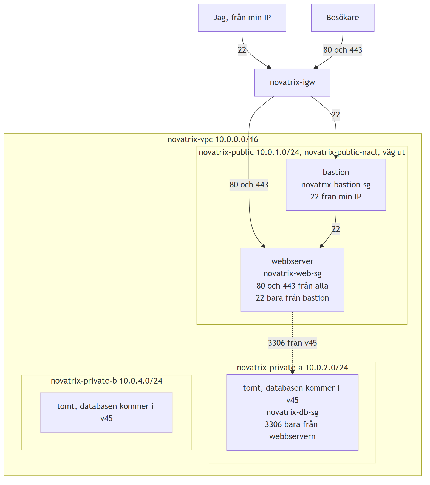

Jag kommer in med SSH till bastionen och hoppar därifrån vidare till webbservern. Besökarna går direkt till webbservern på port 80 och 443. De privata subnäten har ingen pil från internet, eftersom det inte finns någon väg dit. Den streckade pilen är databastrafiken som kommer i v45.

Skissen visar också var låsen sitter. NACL:en står på det publika subnätet och gäller allt som finns där. "Väg ut" betyder att subnätet har route tablen `novatrix-public-rt` med vägen till internet gatewayen. Security groups står på varje server. Under varje server står vilka portar den tar emot och från vem. Databasens lås `novatrix-db-sg` finns redan, fast databasen inte gör det än.

Samma nätverk syns i resource map i VPC-konsolen. Den ritar upp hela nätverket och visar vad som hänger ihop med vad. Här har jag markerat det publika subnätet. Strecket går från `novatrix-public` via route tablen `novatrix-public-rt` till internet gatewayen `novatrix-igw`.

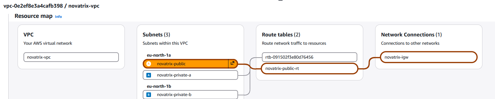

Bilden läses från vänster till höger. Längst till vänster är VPC:t, alltså hela nätverket. Sedan kommer de tre subnäten, sorterade efter zon. Två ligger i eu-north-1a och ett i eu-north-1b. Efter dem kommer de två route tables. Längst till höger är internet gatewayen, som är dörren ut mot internet.

Servrarna syns inte i resource map. De syns längre ner under delmoment 4.

De två privata subnäten är tomma än så länge. Där ska databasen stå i v45. När jag markerar ett av dem i resource map går strecket bara till standardtabellen och tar slut där. Det finns ingen väg vidare till internet gatewayen.

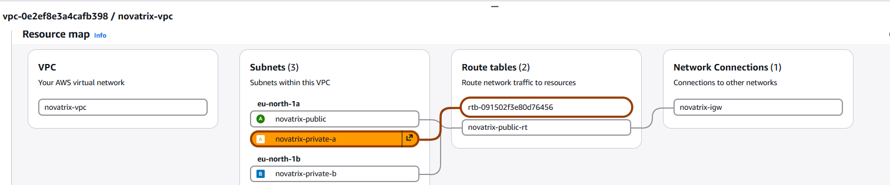

Det är det som är hela poängen med nätverket. Webben ligger där den måste nås utifrån. Databasen ska ligga där ingen utifrån kan nå den.

### Nätverket

| Del | Namn | Adresser | Zon |
|---|---|---|---|
| VPC | novatrix-vpc | 10.0.0.0/16 | |
| Publikt subnät | novatrix-public | 10.0.1.0/24 | eu-north-1a |
| Privat subnät | novatrix-private-a | 10.0.2.0/24 | eu-north-1a |
| Privat subnät | novatrix-private-b | 10.0.4.0/24 | eu-north-1b |
| Internet gateway | novatrix-igw | | |
| Route table | novatrix-public-rt | | |

Jag tänker på VPC:t som ett hus. Subnäten är rummen. Internet gatewayen är ytterdörren.

Ett subnät blir inte publikt för att det heter public. Det är route tablen som avgör. `novatrix-public-rt` har en väg ut, `0.0.0.0/0` till internet gatewayen. Den är bara kopplad till `novatrix-public`. De privata subnäten använder VPC:ts standardtabell. Den har bara vägen `local`, alltså trafik inne i huset. Därför finns det ingen väg mellan de privata subnäten och internet.

Det finns två privata subnät i två olika zoner. Databasen i v45 kräver det.

Subnäten med adresser och zoner. De tre utan namn hör till AWS standardnätverk och har inget med mitt nätverk att göra.

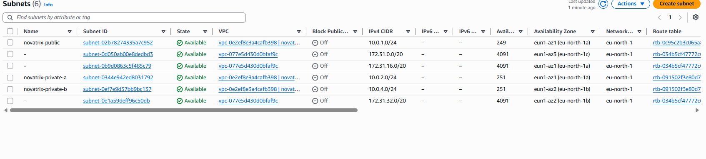

Route tablen för det publika subnätet:

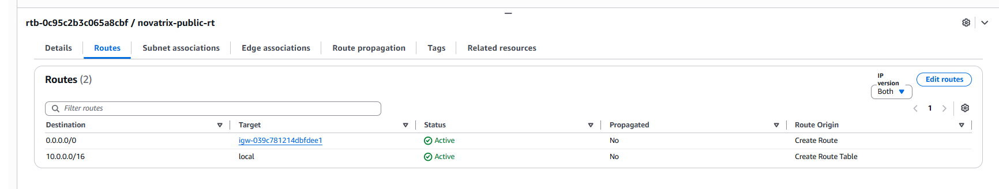

## Delmoment 3: Säkra trafiken

Det finns två sorters lås i AWS. De fungerar olika.

**Security group** sitter på varje server. Den minns trafik den har släppt in. Därför släpps svaret ut automatiskt. Jag behöver bara skriva vad som får komma in.

**NACL** sitter på ett helt subnät. Den minns ingenting. Varje paket bedöms för sig, både in och ut.

### Security groups

| Grupp | Port | Från | Varför |
|---|---|---|---|
| novatrix-web-sg | 80 | Alla | Webbsidan |
| novatrix-web-sg | 443 | Alla | Webbsidan med kryptering |
| novatrix-web-sg | 22 | novatrix-bastion-sg | SSH bara via bastion |
| novatrix-bastion-sg | 22 | Min IP | Enda vägen in för mig |
| novatrix-db-sg | 3306 | novatrix-web-sg | Bara webbservern får prata med databasen |

Allt annat stoppas, eftersom en security group bara har tillåt-regler.

Två av reglerna pekar på en annan security group i stället för en IP-adress. Det betyder "den som bär det här låset". Webbservern godtar SSH bara från den som bär bastionens lås. Databasen godtar bara den som bär webbserverns lås. Byts webbservern ut eller blir de fler fungerar det ändå, eftersom regeln inte hänger på en adress.

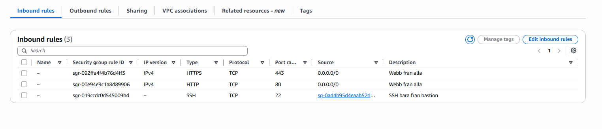

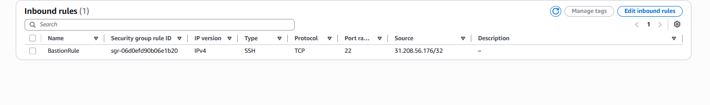

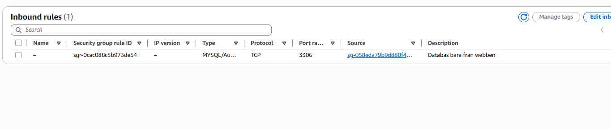

### NACL

`novatrix-public-nacl` sitter på det publika subnätet.

| Riktning | Regel | Port | Från eller till | Varför |
|---|---|---|---|---|
| In | 100 | 80 | Alla | Webbsidan |
| In | 110 | 443 | Alla | Webbsidan med kryptering |
| In | 120 | 22 | Min IP | SSH till bastion |
| In | 130 | 1024-65535 | Alla | Svar på det servrarna själva hämtar |
| Ut | 100 | 80 | Alla | Servrarna hämtar paket |
| Ut | 110 | 443 | Alla | Servrarna hämtar paket och webbsidan från GitHub |
| Ut | 120 | 1024-65535 | Alla | Svar till besökare |

Sist i båda listorna finns en regel som nekar allt annat.

Portarna 1024-65535 var det svåraste att förstå. När någon öppnar webbsidan skickar besökarens dator frågan till port 80. Den skriver också ett slumpat returnummer på frågan, någonstans mellan 1024 och 65535. Svaret ska tillbaka till det numret. NACL:en minns inte att frågan kom in. Utan regel ut 120 skulle svaret stoppas och sidan aldrig laddas. Regel in 130 behövs av samma skäl åt andra hållet, när servern själv hämtar något från internet.

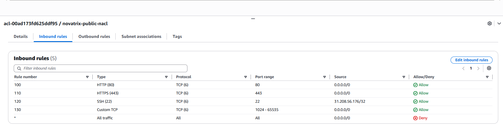

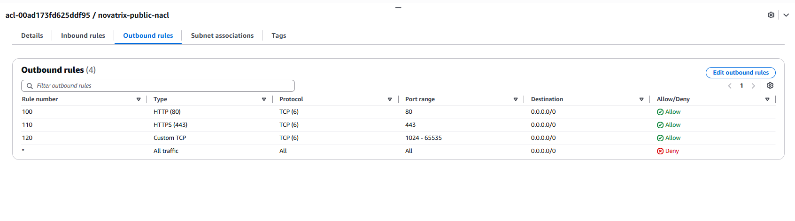

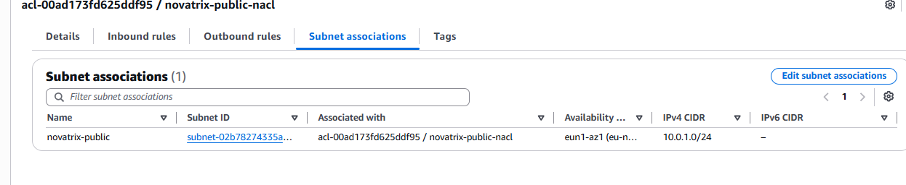

## Delmoment 4: Placera lösningen

Båda servrarna står i `novatrix-public`. Webbservern måste nås från internet. Bastionen måste nås från min dator.

### Ny server i stället för AMI

En server kan inte byta VPC efter att den har skapats. Det vanliga sättet att flytta den är att göra en AMI, alltså en kopia av serverns disk. Kopian startas sedan i det nya subnätet.

Jag gjorde inte så. Min server från v42 och v43 var redan riven, eftersom jag river allt som kostar när en vecka är klar. I stället startade jag en ny server i `novatrix-public` med samma startskript som i v42. Det installerar webbservern och hämtar samma Novatrix-sida, så resultatet blir detsamma som en flytt. Servern fick också samma roll som i v43.

Det betyder att det inte fanns någon gammal server, AMI eller snapshot att städa bort efteråt. Det är dessutom så skriptet gör, så webbservern kan alltid byggas om från repot.

### Servrarna

| Server | Subnät | Security group | Roll |
|---|---|---|---|
| novatrix-web | novatrix-public | novatrix-web-sg | novatrix-ec2-s3-read |
| novatrix-bastion | novatrix-public | novatrix-bastion-sg | Ingen |

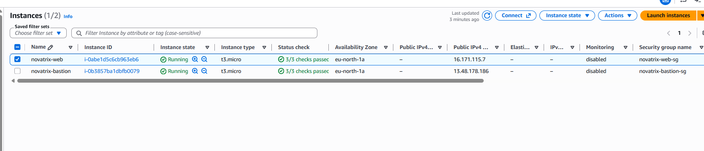

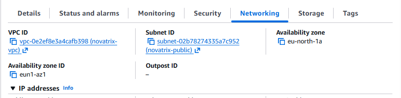

Bastionen har ingen roll och inget startskript. Den ska bara vara en dörr. Ju mindre den kan, desto mindre kan någon göra om den skulle bli kapad.

De två privata subnäten står tomma. De är förberedda för databasen. Där finns redan låset `novatrix-db-sg` som bara släpper in webbservern.

## VG: Defense in depth

### Lagren och vad de skyddar mot

Tanken är att ett enda skydd aldrig ska räcka för att stoppa ett angrepp. Om ett lager släpper igenom något ska nästa stoppa det.

| Lager | Vad det gör | Skyddar mot |
|---|---|---|
| Route table och internet gateway | Bara `novatrix-public` har en väg till internet. Vägen ligger i en egen route table, inte i standardtabellen. | Att något i de privata subnäten kan nås utifrån eller själv skicka data ut till internet |
| Segmentering | Databasen får ett privat subnät utan väg till internet | Att någon på internet når databasen direkt, även om ett lösenord läcker |
| NACL | Släpper bara in 80, 443 och SSH från min IP till hela det publika subnätet | Portskanning. En tjänst som av misstag lyssnar på en annan port. En security group som råkat öppnas för brett. |
| Security groups | Varje server släpper bara in det den behöver | Att någon loggar in direkt på webbservern. Att något annat än webbservern når databasen. |
| Bastion | Den enda servern som tar emot SSH utifrån | Fler öppna SSH-dörrar än nödvändigt. Om bastionen kapas finns ingen roll där som kan nå S3. |
| IAM-roll från v43 | Webbservern läser S3 utan nyckel | Att en nyckel stjäls från servern och används någon annanstans |

Jag såg lagren arbeta var för sig när jag testade. NACL:en släpper fortfarande in SSH från min IP till hela subnätet. Ändå blev det stopp när jag försökte gå direkt till webbservern. Det var webbserverns security group som stoppade, eftersom den bara godtar bastionen.

### Bastionen

Innan bastionen fanns hade webbservern två jobb. Den visade sidan för hela världen och var samtidigt dörren för inloggning. Kom någon åt min nyckel stod den personen direkt på servern med rollen till S3.

Nu loggar jag in på bastionen först och hoppar vidare därifrån till webbserverns privata adress. Det görs i ett enda kommando:

```powershell
$Nyckel  = "$HOME\.ssh\novatrix-key.pem"
$Bastion = "ec2-user@13.48.45.75"
ssh -i $Nyckel `
    -o "ProxyCommand=C:\Windows\System32\OpenSSH\ssh.exe -i $Nyckel -W %h:%p $Bastion" `
    ec2-user@10.0.1.70
```

Den inre delen inom citattecknen loggar in på bastionen och öppnar en tunnel. Den yttre delen går genom tunneln till webbservern. För webbservern ser det ut som att anslutningen kommer från bastionen.

Min privata nyckel ligger kvar på min egen dator hela tiden. Den kopieras aldrig till bastionen. Tunneln gör att inloggningen på webbservern ändå görs med nyckeln från min dator. Skulle någon ta sig in på bastionen finns det alltså ingen nyckel där att stjäla och använda för att hoppa vidare.

### Kostnad

VPC, subnät, route table, internet gateway, NACL och security groups kostar ingenting. Det som kostar är servrarna och deras publika IP-adresser. Bastionen är en extra server, men en t3.micro är billig. Den behöver inte heller vara igång när ingen jobbar på servrarna.

Jag har inte byggt någon NAT gateway. Den hade gett de privata subnäten en väg ut, men den kostar pengar varje timme. Databasen behöver inte nå internet.

### Så växer nätverket

Behöver Novatrix fler webbservrar startas de i samma subnät med samma security group. Databasens regel pekar på gruppen och inte på en adress, så de nya servrarna kommer åt databasen direkt.

Behövs ett nytt subnät eller en ny tjänst kopierar jag ett block i skriptet och byter namn och adress. VPC:t har plats för många fler subnät.

En sak saknas än. De privata subnäten har ingen egen NACL, de använder VPC:ts standard som släpper igenom allt. Där vilar skyddet på att subnäten saknar väg ut och på databasens security group. När databasen kommer i v45 vore det rimligt att ge dem en egen NACL som bara släpper in 3306 från det publika subnätet.

## Delmoment 5: Verifiering

### Bygget

```
PS> .\deploy.ps1
VPC skapat: vpc-04a09632c65bd10bb
Subnät skapade
Internet gateway skapad och kopplad: igw-0b8930774288ce849
Route table skapad och kopplad till novatrix-public
Security groups skapade: bastion, web och db
NACL skapad och kopplad till novatrix-public
Servrar startade, väntar på att de ska köra...

Klart.
Webbsidan:  http://51.20.128.203 (user data behöver 1-2 minuter till)
Bastion:    13.48.45.75
Webbens privata IP, nås via bastion: 10.0.1.70
```

### Det som släpps igenom

Webbsidan visas på den publika adressen:

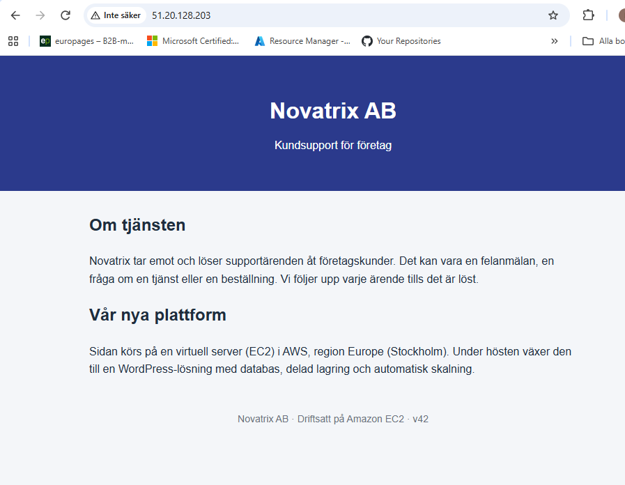

SSH via bastionen fungerar. På webbservern visar `echo $SSH_CLIENT` varifrån jag kom. Adressen 10.0.1.89 är bastionens privata adress, inte min. Rollen från v43 fungerar också i det nya nätverket:

```
[ec2-user@ip-10-0-1-70 ~]$ echo $SSH_CLIENT
10.0.1.89 41310 22
[ec2-user@ip-10-0-1-70 ~]$ aws s3 ls s3://novatrix-data-80idralt-01
2026-10-21 19:43:36         32 hej.txt
```

Att sidan visas bevisar också att servern själv kom ut. Startskriptet hämtade sidan från GitHub på port 443 och svaret kom tillbaka på de höga portarna.

### Det som stoppas

Direkt SSH till webbservern från min egen adress:

```
PS> ssh -o ConnectTimeout=10 -i $HOME\.ssh\novatrix-key.pem ec2-user@51.20.128.203
ssh: connect to host 51.20.128.203 port 22: Connection timed out
```

SSH till bastionen från en annan adress. Jag använde AWS CloudShell, som har en helt annan IP än min:

```
~ $ ssh -o ConnectTimeout=10 ec2-user@13.48.45.75
ssh: connect to host 13.48.45.75 port 22: Connection timed out
```

Timeout betyder att ingen svarade alls. Paketet stoppades innan det kom fram. Om nätverket hade släppt igenom mig utan rätt nyckel hade svaret i stället varit `Permission denied`.

I konsolrundan testade jag också ping och en port som inte är öppen:

```
PS> Test-NetConnection 16.171.115.7 -Port 8080
WARNING: TCP connect to (16.171.115.7 : 8080) failed
WARNING: Ping to 16.171.115.7 failed with status: TimedOut
```

Port 3306 är databasens port. Den ska aldrig gå att nå från internet, inte ens när databasen finns. Jag testade den mot webbservern från min dator:

```
PS> Test-NetConnection 51.20.66.173 -Port 3306
WARNING: TCP connect to (51.20.66.173 : 3306) failed
WARNING: Ping to 51.20.66.173 failed with status: TimedOut

RemotePort             : 3306
PingSucceeded          : False
TcpTestSucceeded       : False
```

`TcpTestSucceeded : False` betyder att porten är stängd. Varken NACL:en eller webbserverns security group släpper in 3306 utifrån.

| Test | Väntat | Resultat |
|---|---|---|
| Webbsidan på port 80 | Släpps | Sidan visas |
| SSH till bastion från min IP | Släpps | Inloggad |
| SSH via bastion till webbservern | Släpps | Inloggad, kom från 10.0.1.89 |
| Webbservern läser S3 med rollen | Släpps | hej.txt listas |
| SSH direkt till webbservern från min IP | Stoppas | Timeout |
| SSH till bastion från CloudShell | Stoppas | Timeout |
| Port 3306, databasens port | Stoppas | TcpTestSucceeded False |
| Port 8080 | Stoppas | Failed |
| Ping | Stoppas | Timeout |

### Två varv

Jag körde `deploy.ps1`, testade, körde `destroy.ps1` och sedan allt en gång till. Andra varvet fick nya id och adresser men samma resultat. Via bastionen kom jag in på webbservern även där.

Senare flyttade jag inställningarna till variabler överst i `deploy.ps1`. Då körde jag skriptet ett tredje varv. Det byggde allt utan fel och det var där jag gjorde testet på port 3306.

Efter sista `destroy.ps1` kontrollerade jag att inget som kostar låg kvar. Det fanns inga servrar, inga diskar och bara AWS standardnätverk.

## Så återskapar du miljön

```powershell
aws login
.\deploy.ps1
```

Skriptet gör samma sak som jag klickade fram i konsolen och i samma ordning. Först byggs VPC:t, subnäten, internet gatewayen och route tablen. Sedan kommer security groups, NACL:en och sist servrarna.

Varje steg följer samma mönster. Något skapas, id:t sparas i en variabel och variabeln används i nästa steg. I konsolen valde jag `novatrix-vpc` i en lista. I skriptet gör variabeln `$VpcId` samma sak.

Ordningen går inte att ändra. Ett subnät kan inte skapas innan VPC:t finns. Webbserverns security group pekar på bastionens, så bastionens måste finnas först. Servrarna kommer sist, eftersom de behöver både subnätet och sina security groups.

Jag ser att varje steg lyckades på två sätt. Varje block skriver en rad när det är klart, till exempel `Subnät skapade`. Överst i skriptet står dessutom två rader som gör att skriptet stannar direkt om ett kommando misslyckas. Då kommer ett rött felmeddelande och inget mer byggs. Det kan alltså inte bli halvbyggt utan att jag märker det.

`.\destroy.ps1` river allt i omvänd ordning. Det letar upp allt på namnet, eftersom id:na är nya varje gång. Servrarna tas bort först, eftersom de sitter i subnätet. Bland security groups tas db bort först, sedan web och sist bastion. En grupp som en annan grupp pekar på går inte att ta bort.

Det här behövs innan skriptet körs:

- Ett key pair som heter `novatrix-key`.
- Rollen `novatrix-ec2-s3-read` från v43.

Överst i `deploy.ps1` står inställningarna som variabler: nyckelns namn, servertypen, rollen, vilken Amazon Linux som används och var startskriptet ligger. Ska en kollega bygga i ett annat konto är det bara de raderna som behöver bytas. Id:n behöver aldrig bytas, eftersom skriptet får nya id från AWS varje gång och sparar dem själv.

Min IP behöver inte ändras i skriptet. Skriptet hämtar den adress jag har just då. Byter jag nätverk efteråt slutar SSH till bastionen fungera. Det är meningen. Då kör jag skripten igen från den nya adressen.

Skriptet förutsätter att nätverket inte redan finns. Kör man `deploy.ps1` två gånger utan `destroy.ps1` emellan blir det två nätverk med samma namn. CloudFormation i v46 löser det. Där jämför AWS mallen med det som redan finns.

Båda skripten står i sin helhet i [Bilaga: skripten](#bilaga-skripten).

## Bilaga: skripten

### deploy.ps1

```powershell
# Novatrix v44 VG: bygger nätverket och servrarna från kod.
# Kräver: inloggad med "aws login", key pair novatrix-key och rollen från v43.

$ErrorActionPreference = "Stop"
$PSNativeCommandUseErrorActionPreference = $true
$env:AWS_CLI_FILE_ENCODING = "UTF-8"

# Inställningar, det här är det man byter om man bygger i ett annat konto
$Nyckel   = "novatrix-key"
$Typ      = "t3.micro"
$Roll     = "novatrix-ec2-s3-read"
$Ami      = "resolve:ssm:/aws/service/ami-amazon-linux-latest/al2023-ami-kernel-default-x86_64"
$UserData = Join-Path $PSScriptRoot "..\v42\user-data.sh"

# Min IP just nu, för SSH
$MinIp = (Invoke-RestMethod "https://checkip.amazonaws.com").Trim()

# 1. VPC
$VpcId = aws ec2 create-vpc --cidr-block 10.0.0.0/16 --query Vpc.VpcId --output text
aws ec2 create-tags --resources $VpcId --tags Key=Name,Value=novatrix-vpc
Write-Host "VPC skapat: $VpcId"

# 2. Subnät, ett publikt och två privata
$PublicId = aws ec2 create-subnet --vpc-id $VpcId --cidr-block 10.0.1.0/24 `
    --availability-zone eu-north-1a --query Subnet.SubnetId --output text
aws ec2 create-tags --resources $PublicId --tags Key=Name,Value=novatrix-public

$PrivAId = aws ec2 create-subnet --vpc-id $VpcId --cidr-block 10.0.2.0/24 `
    --availability-zone eu-north-1a --query Subnet.SubnetId --output text
aws ec2 create-tags --resources $PrivAId --tags Key=Name,Value=novatrix-private-a

$PrivBId = aws ec2 create-subnet --vpc-id $VpcId --cidr-block 10.0.4.0/24 `
    --availability-zone eu-north-1b --query Subnet.SubnetId --output text
aws ec2 create-tags --resources $PrivBId --tags Key=Name,Value=novatrix-private-b
Write-Host "Subnät skapade"

# 3. Internet gateway, skapa och koppla till VPC:t
$IgwId = aws ec2 create-internet-gateway --query InternetGateway.InternetGatewayId --output text
aws ec2 create-tags --resources $IgwId --tags Key=Name,Value=novatrix-igw
aws ec2 attach-internet-gateway --internet-gateway-id $IgwId --vpc-id $VpcId
Write-Host "Internet gateway skapad och kopplad: $IgwId"

# 4. Route table med väg ut, bara för det publika subnätet
$RtId = aws ec2 create-route-table --vpc-id $VpcId --query RouteTable.RouteTableId --output text
aws ec2 create-tags --resources $RtId --tags Key=Name,Value=novatrix-public-rt
aws ec2 create-route --route-table-id $RtId --destination-cidr-block 0.0.0.0/0 --gateway-id $IgwId | Out-Null
aws ec2 associate-route-table --route-table-id $RtId --subnet-id $PublicId | Out-Null
Write-Host "Route table skapad och kopplad till novatrix-public"

# 5. Security groups. Bastion först, eftersom webben pekar på den.
$BastionSg = aws ec2 create-security-group --group-name novatrix-bastion-sg `
    --description "SSH fran min IP" --vpc-id $VpcId --query GroupId --output text
aws ec2 authorize-security-group-ingress --group-id $BastionSg --protocol tcp --port 22 --cidr "$MinIp/32" | Out-Null

$WebSg = aws ec2 create-security-group --group-name novatrix-web-sg `
    --description "Webb fran alla, SSH bara fran bastion" --vpc-id $VpcId --query GroupId --output text
aws ec2 authorize-security-group-ingress --group-id $WebSg --protocol tcp --port 80 --cidr 0.0.0.0/0 | Out-Null
aws ec2 authorize-security-group-ingress --group-id $WebSg --protocol tcp --port 443 --cidr 0.0.0.0/0 | Out-Null
aws ec2 authorize-security-group-ingress --group-id $WebSg --protocol tcp --port 22 --source-group $BastionSg | Out-Null

$DbSg = aws ec2 create-security-group --group-name novatrix-db-sg `
    --description "MySQL bara fran webben" --vpc-id $VpcId --query GroupId --output text
aws ec2 authorize-security-group-ingress --group-id $DbSg --protocol tcp --port 3306 --source-group $WebSg | Out-Null
Write-Host "Security groups skapade: bastion, web och db"

# 6. NACL för det publika subnätet, regler åt båda håll
$NaclId = aws ec2 create-network-acl --vpc-id $VpcId --query NetworkAcl.NetworkAclId --output text
aws ec2 create-tags --resources $NaclId --tags Key=Name,Value=novatrix-public-nacl

# In
aws ec2 create-network-acl-entry --network-acl-id $NaclId --ingress --rule-number 100 --protocol tcp --port-range From=80,To=80 --cidr-block 0.0.0.0/0 --rule-action allow
aws ec2 create-network-acl-entry --network-acl-id $NaclId --ingress --rule-number 110 --protocol tcp --port-range From=443,To=443 --cidr-block 0.0.0.0/0 --rule-action allow
aws ec2 create-network-acl-entry --network-acl-id $NaclId --ingress --rule-number 120 --protocol tcp --port-range From=22,To=22 --cidr-block "$MinIp/32" --rule-action allow
aws ec2 create-network-acl-entry --network-acl-id $NaclId --ingress --rule-number 130 --protocol tcp --port-range From=1024,To=65535 --cidr-block 0.0.0.0/0 --rule-action allow

# Ut
aws ec2 create-network-acl-entry --network-acl-id $NaclId --egress --rule-number 100 --protocol tcp --port-range From=80,To=80 --cidr-block 0.0.0.0/0 --rule-action allow
aws ec2 create-network-acl-entry --network-acl-id $NaclId --egress --rule-number 110 --protocol tcp --port-range From=443,To=443 --cidr-block 0.0.0.0/0 --rule-action allow
aws ec2 create-network-acl-entry --network-acl-id $NaclId --egress --rule-number 120 --protocol tcp --port-range From=1024,To=65535 --cidr-block 0.0.0.0/0 --rule-action allow

# Byt ut standard-NACL:en på det publika subnätet mot vår
$KopplingId = aws ec2 describe-network-acls --filters "Name=association.subnet-id,Values=$PublicId" `
    --query "NetworkAcls[0].Associations[?SubnetId=='$PublicId'].NetworkAclAssociationId" --output text
aws ec2 replace-network-acl-association --association-id $KopplingId --network-acl-id $NaclId | Out-Null
Write-Host "NACL skapad och kopplad till novatrix-public"

# 7. Servrarna. Webben får rollen från v43 och samma user data som i v42.
$WebId = aws ec2 run-instances --image-id $Ami --instance-type $Typ --key-name $Nyckel `
    --subnet-id $PublicId --security-group-ids $WebSg --associate-public-ip-address `
    --iam-instance-profile Name=$Roll --user-data "file://$UserData" `
    --tag-specifications "ResourceType=instance,Tags=[{Key=Name,Value=novatrix-web},{Key=Project,Value=novatrix}]" `
    --query "Instances[0].InstanceId" --output text

# Bastion: ingen roll och ingen user data, den ska bara vara en dörr
$BastionId = aws ec2 run-instances --image-id $Ami --instance-type $Typ --key-name $Nyckel `
    --subnet-id $PublicId --security-group-ids $BastionSg --associate-public-ip-address `
    --tag-specifications "ResourceType=instance,Tags=[{Key=Name,Value=novatrix-bastion},{Key=Project,Value=novatrix}]" `
    --query "Instances[0].InstanceId" --output text
Write-Host "Servrar startade, väntar på att de ska köra..."

aws ec2 wait instance-running --instance-ids $WebId $BastionId

$WebIp     = aws ec2 describe-instances --instance-ids $WebId --query "Reservations[0].Instances[0].PublicIpAddress" --output text
$WebPrivat = aws ec2 describe-instances --instance-ids $WebId --query "Reservations[0].Instances[0].PrivateIpAddress" --output text
$BastionIp = aws ec2 describe-instances --instance-ids $BastionId --query "Reservations[0].Instances[0].PublicIpAddress" --output text

Write-Host ""
Write-Host "Klart."
Write-Host "Webbsidan:  http://$WebIp (user data behöver 1-2 minuter till)"
Write-Host "Bastion:    $BastionIp"
Write-Host "Webbens privata IP, nås via bastion: $WebPrivat"
```

### destroy.ps1

```powershell
# Novatrix v44 VG: river allt som deploy.ps1 skapade, i omvänd ordning.
# Kräver: inloggad med "aws login".

$ErrorActionPreference = "Stop"
$PSNativeCommandUseErrorActionPreference = $true

# Hitta VPC:t på namnet
$VpcId = aws ec2 describe-vpcs --filters "Name=tag:Name,Values=novatrix-vpc" --query "Vpcs[0].VpcId" --output text
if ($VpcId -eq "None") {
    Write-Host "Inget novatrix-vpc finns, inget att riva."
    exit 0
}

# 1. Servrarna först, de sitter i subnätet. Hoppa över den som redan är borta.
$WebId = aws ec2 describe-instances --filters "Name=tag:Name,Values=novatrix-web" "Name=instance-state-name,Values=pending,running,stopping,stopped,shutting-down" `
    --query "Reservations[0].Instances[0].InstanceId" --output text
if ($WebId -ne "None") {
    aws ec2 terminate-instances --instance-ids $WebId | Out-Null
    Write-Host "Terminerar webbservern, väntar..."
    aws ec2 wait instance-terminated --instance-ids $WebId
}

$BastionId = aws ec2 describe-instances --filters "Name=tag:Name,Values=novatrix-bastion" "Name=instance-state-name,Values=pending,running,stopping,stopped,shutting-down" `
    --query "Reservations[0].Instances[0].InstanceId" --output text
if ($BastionId -ne "None") {
    aws ec2 terminate-instances --instance-ids $BastionId | Out-Null
    Write-Host "Terminerar bastion, väntar..."
    aws ec2 wait instance-terminated --instance-ids $BastionId
}
Write-Host "Servrarna borta"

# 2. Security groups. db pekar på web, web pekar på bastion, så db först.
$DbSg = aws ec2 describe-security-groups --filters "Name=group-name,Values=novatrix-db-sg" --query "SecurityGroups[0].GroupId" --output text
aws ec2 delete-security-group --group-id $DbSg
$WebSg = aws ec2 describe-security-groups --filters "Name=group-name,Values=novatrix-web-sg" --query "SecurityGroups[0].GroupId" --output text
aws ec2 delete-security-group --group-id $WebSg
$BastionSg = aws ec2 describe-security-groups --filters "Name=group-name,Values=novatrix-bastion-sg" --query "SecurityGroups[0].GroupId" --output text
aws ec2 delete-security-group --group-id $BastionSg
Write-Host "Security groups borta"

# 3. Subnäten. Då släpper också kopplingarna till route table och NACL.
$PublicId = aws ec2 describe-subnets --filters "Name=tag:Name,Values=novatrix-public" --query "Subnets[0].SubnetId" --output text
aws ec2 delete-subnet --subnet-id $PublicId
$PrivAId = aws ec2 describe-subnets --filters "Name=tag:Name,Values=novatrix-private-a" --query "Subnets[0].SubnetId" --output text
aws ec2 delete-subnet --subnet-id $PrivAId
$PrivBId = aws ec2 describe-subnets --filters "Name=tag:Name,Values=novatrix-private-b" --query "Subnets[0].SubnetId" --output text
aws ec2 delete-subnet --subnet-id $PrivBId
Write-Host "Subnäten borta"

# 4. Route table och NACL
$RtId = aws ec2 describe-route-tables --filters "Name=tag:Name,Values=novatrix-public-rt" --query "RouteTables[0].RouteTableId" --output text
aws ec2 delete-route-table --route-table-id $RtId

$NaclId = aws ec2 describe-network-acls --filters "Name=tag:Name,Values=novatrix-public-nacl" --query "NetworkAcls[0].NetworkAclId" --output text
aws ec2 delete-network-acl --network-acl-id $NaclId
Write-Host "Route table och NACL borta"

# 5. Internet gateway: lossa från VPC:t, sedan ta bort
$IgwId = aws ec2 describe-internet-gateways --filters "Name=tag:Name,Values=novatrix-igw" --query "InternetGateways[0].InternetGatewayId" --output text
aws ec2 detach-internet-gateway --internet-gateway-id $IgwId --vpc-id $VpcId
aws ec2 delete-internet-gateway --internet-gateway-id $IgwId
Write-Host "Internet gateway borta"

# 6. Sist själva VPC:t
aws ec2 delete-vpc --vpc-id $VpcId
Write-Host ""
Write-Host "Klart. Nätverket och servrarna från v44 är rivna. IAM och bucketar från v43 står kvar."
```
