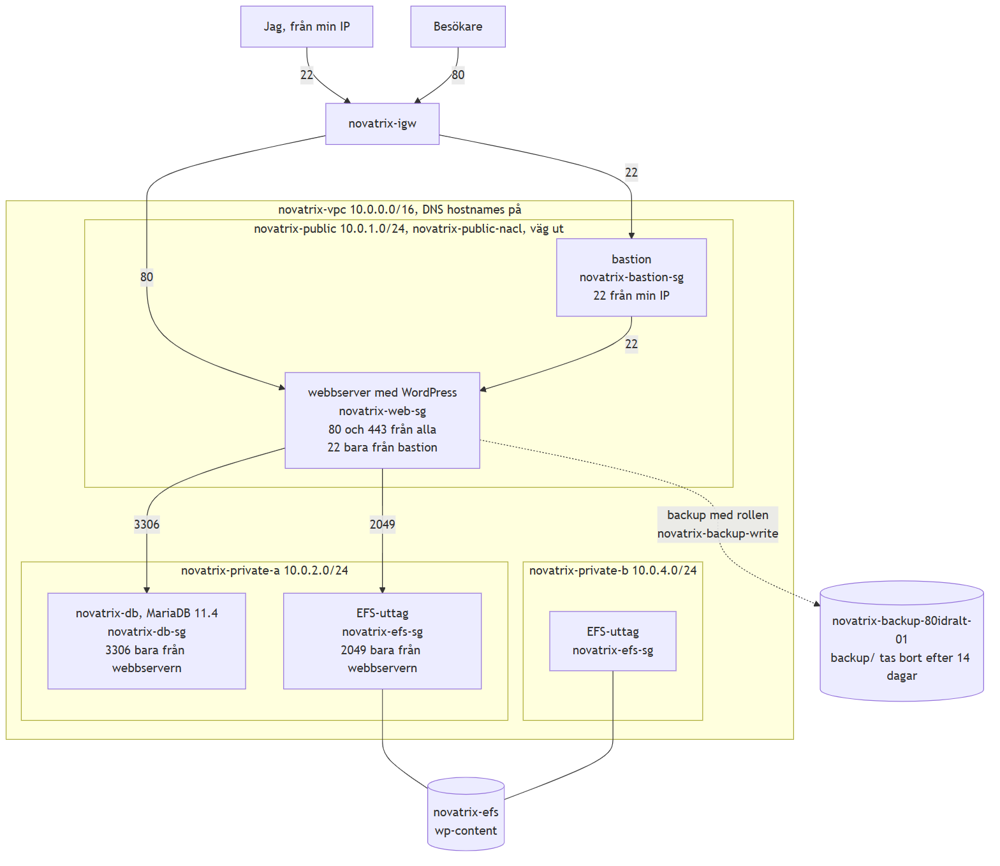
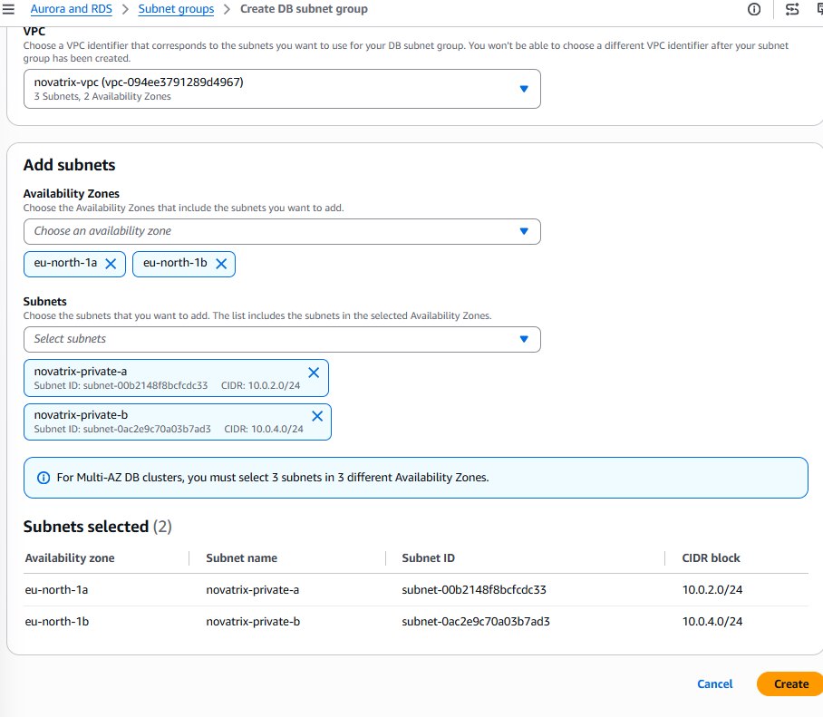
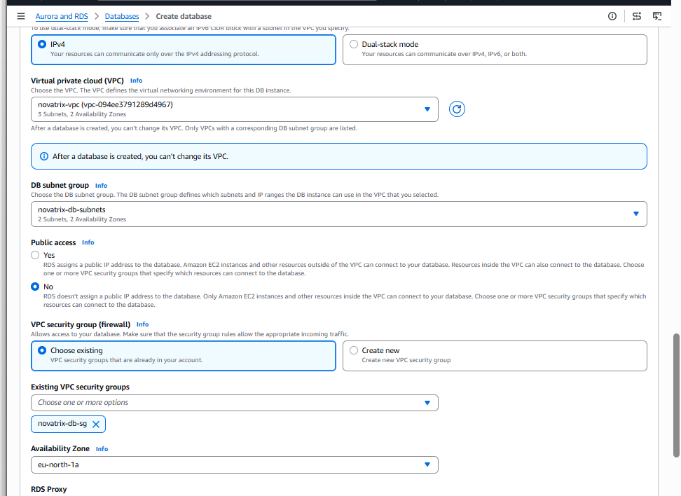
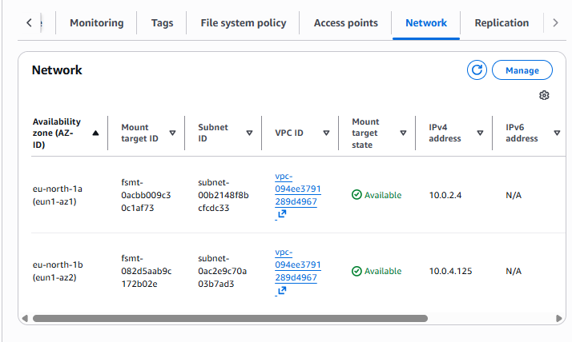
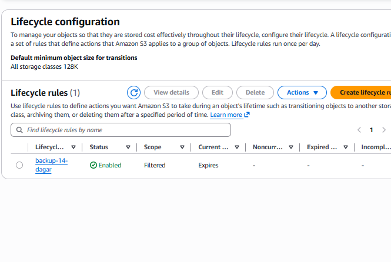
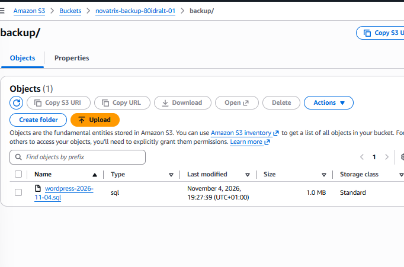
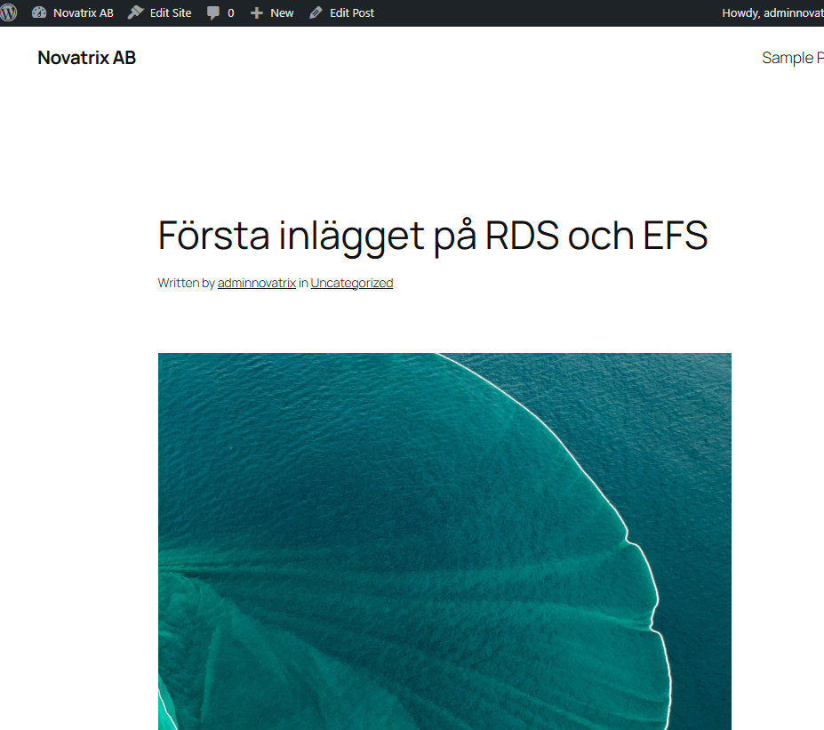
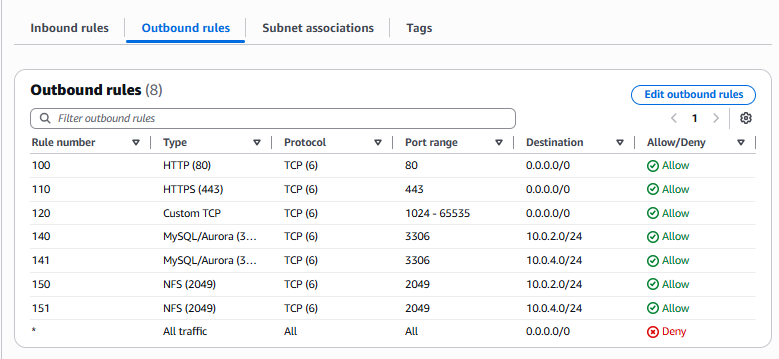
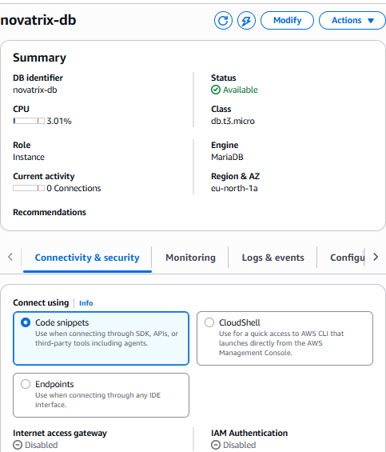
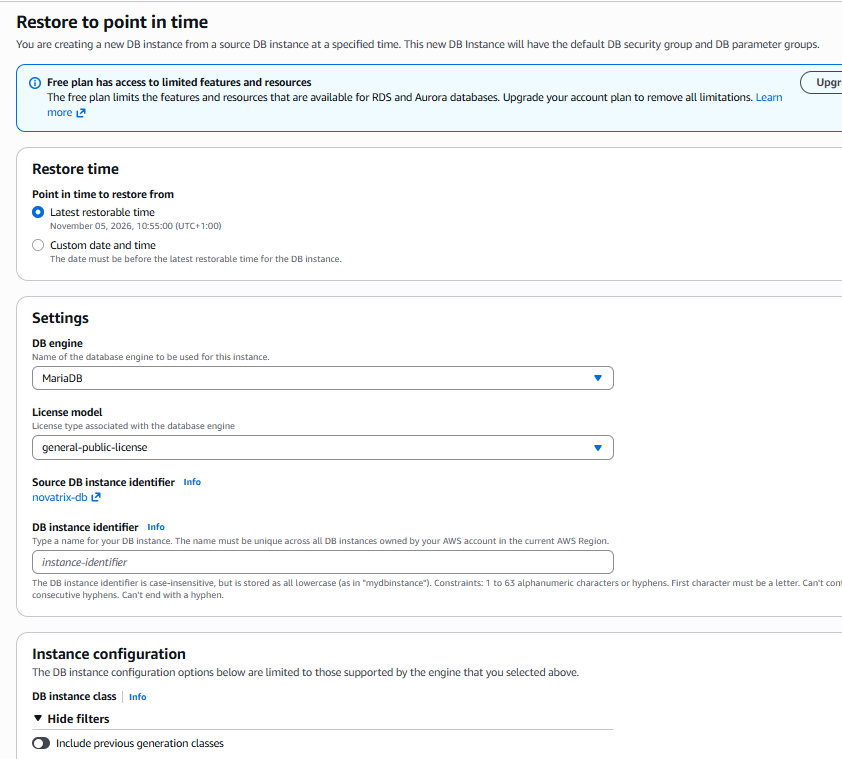

# AWS Uppgift 4 (v45): Storage och databas

**Namn:** Idris Altun

**Kurs:** AWS, MOV25

**Datum:** 2026-11-09

**Repo:** https://github.com/80idralt/aws/tree/master/v45

## Sammanfattning

Förra veckan byggde jag ett nätverk med två privata subnät som stod tomma. Nu har de fått innehåll.

Novatrix har nu en riktig WordPress-sajt. Inläggen ligger i en databas i RDS. Bilder, teman och tillägg ligger på en delad disk i EFS. En kopia av databasen läggs i en S3-bucket och tas bort automatiskt efter 14 dagar. Webbservern är bara motorn. Om den går sönder finns innehållet kvar.

Databasen och disken står i de privata subnäten. Bara webbservern kommer åt dem. Hemifrån går databasen inte att nå alls.

Jag byggde allt först i konsolen två gånger för att förstå hur delarna hänger ihop. Sedan rev jag det och byggde vidare på skripten från v44. Nu bygger ett skript hela stacken från noll, från nätverket till en WordPress som väntar på installationen. Ett annat skript river allt igen.

## Innehåll

1. [Delmoment 1: Repo](#delmoment-1-repo)
2. [Delmoment 2: Databas](#delmoment-2-databas)
3. [Delmoment 3: Delad lagring](#delmoment-3-delad-lagring)
4. [Delmoment 4: Objektlagring och backup](#delmoment-4-objektlagring-och-backup)
5. [Delmoment 5: Koppla ihop WordPress](#delmoment-5-koppla-ihop-wordpress)
6. [Delmoment 6: Säkra åtkomsten](#delmoment-6-säkra-åtkomsten)
7. [Delmoment 7: Verifiera och dokumentera](#delmoment-7-verifiera-och-dokumentera)
8. [VG: Mina val och vad de kostar](#vg-mina-val-och-vad-de-kostar)
9. [VG: Hela stacken som kod](#vg-hela-stacken-som-kod)
10. [Så återskapar du miljön](#så-återskapar-du-miljön)
11. [Bilaga: skripten](#bilaga-skripten)

## Delmoment 1: Repo

I mappen `v45` ligger:

- `deploy.ps1` som bygger hela stacken.
- `destroy.ps1` som river allt igen.
- `user-data.sh` som installerar WordPress och kopplar in EFS när webbservern startar. Det är mitt installationsskript för WordPress.
- `backup.sh` som tar en backup av databasen och lägger den i S3.
- `livscykel.json` med regeln som tar bort gamla backuper.
- `images/` med skissen och skärmbilder.

Rollerna och bucketarna kommer från v43. Policyn som låter servern lägga backuper i S3 ligger i [`v43/policies/s3-backup.json`](../v43/policies/s3-backup.json). Jag har också lagt till `wp-config.php` i `.gitignore`. Den filen innehåller databasens lösenord och ska aldrig hamna i repot.

## Delmoment 2: Databas

### Skiss



Besökarna kommer in till webbservern på port 80. Jag kommer in med SSH via bastionen, som i v44. Webbservern pratar sedan inåt med databasen på port 3306 och med EFS på port 2049. Båda står i de privata subnäten. Backupen går vid sidan om, till S3 med en roll.

Under varje del står vilken security group den har och vad den släpper in. Skissen läses uppifrån och ner.

### Databasen

Databasen heter `novatrix-db`. Det är MariaDB 11.4 i RDS. RDS betyder att AWS sköter driften åt mig. AWS tar backup, lägger in uppdateringar och håller koll på disken. Jag behöver bara välja storlek och nätverk.

Jag valde 11.4 och inte 11.8. Version 11.8 kräver krypterad anslutning, vilket krånglar till det för WordPress. Det märkte jag i första konsolrundan.

Databasen får bara bo i de två privata subnäten. Det styrs av en subnet group som heter `novatrix-db-subnets`. Där står bara `novatrix-private-a` och `novatrix-private-b`. Det publika subnätet finns inte med. Databasen kan alltså aldrig hamna där besökarna är.



Public access står på No. Databasen får ingen publik adress. Lösenordet för användaren `admin` skapas av AWS och sparas i Secrets Manager. Det står aldrig i någon fil.



Bilden är från konsolrundan. I koden är det samma val, se avsnitt 7 i `deploy.ps1`.

## Delmoment 3: Delad lagring

EFS är en disk som flera servrar kan använda samtidigt över nätverket. Den heter `novatrix-efs`. Jag kopplar in den på mappen `/var/www/html/wp-content` på webbservern. Där sparar WordPress uppladdade bilder, teman och tillägg.

Varför inte på serverns egen disk? Där skulle filerna försvinna om servern byts ut. Med EFS står de kvar. Om Novatrix får fler webbservrar senare kan alla dela samma bilder.

EFS har ett uttag i varje privat subnät. Uttagen skyddas av `novatrix-efs-sg`, som bara släpper in webbservern på port 2049. Disken är krypterad.



Webbservern kopplar in disken med en rad i `/etc/fstab`. Då kopplas den in igen efter varje omstart.

```
fs-036cfbf560671d465:/ /var/www/html/wp-content efs _netdev,noresvport,tls 0 0
```

`tls` betyder att trafiken till EFS krypteras på vägen.

En sak jag fick lära mig: VPC:t måste ha DNS hostnames påslaget. Annars kan webbservern inte slå upp EFS-namnet och monteringen misslyckas med "Failed to resolve". Det hände i första konsolrundan. Nu slår skriptet på det direkt när VPC:t skapas.

## Delmoment 4: Objektlagring och backup

### Bucketen och regeln

Backuperna läggs i bucketen `novatrix-backup-80idralt-01` under mappen `backup/`. Bucketen skapades i v43 och är helt stängd för allmänheten.

Bucketen har en livscykelregel som heter `backup-14-dagar`. Den tar bort allt under `backup/` när det är 14 dagar gammalt. Därför behöver ingen få rätt att radera backuper. Regeln sköter det.



### Backup av databasen

`backup.sh` gör en kopia av databasen med `mysqldump` och lägger den i S3. Filnamnet får datum och tid. Kopian tas alltid bort från servern efteråt. Lösenordet frågas efter när skriptet körs.

```
[ec2-user@ip-10-0-1-210 ~]$ bash backup.sh novatrix-db.xxxxxxxxxxxx.eu-north-1.rds.amazonaws.com
Profilen backup skapad
Enter password:
Dump klar: /tmp/wordpress-2026-11-05-0956.sql (1.1M)
upload: ../../tmp/wordpress-2026-11-05-0956.sql to s3://novatrix-backup-80idralt-01/backup/wordpress-2026-11-05-0956.sql
Klart. Filen ligger under backup/ och tas bort av livscykelregeln efter 14 dagar.
```



### Automatisk backup i RDS

RDS tar också en egen backup varje dag. Uppgiften vill att den ska sparas lika länge, alltså 14 dagar. Mitt konto har Free plan och där är max 1 dag. Därför står RDS-backupen på 1 dag. De 14 dagarna sparas i S3 i stället. På ett vanligt betalkonto är det bara en inställning, `--backup-retention-period 14`.

### Servern får skriva, men bara backup

Webbserverns roll från v43 heter `novatrix-ec2-s3-read`. Den får bara läsa i data-bucketen. För att lägga en backup lånar servern en andra roll, `novatrix-backup-write`. Den får bara göra en sak: lägga filer i `backup/`. Den får inte läsa, lista eller radera.

Det är profilen `backup` i `backup.sh` som sköter lånet. Det betyder att servern inte ens kan se vilka backuper som finns. Det testade jag:

```
[ec2-user@ip-10-0-1-185 tmp]$ aws s3 ls s3://novatrix-backup-80idralt-01/backup/
aws: [ERROR]: An error occurred (AccessDenied) when calling the ListObjectsV2 operation: User: arn:aws:sts::XXXXXXXXXXXX:assumed-role/novatrix-ec2-s3-read/i-09abe6ea06bba9cfa is not authorized to perform: s3:ListBucket on resource: "arn:aws:s3:::novatrix-backup-80idralt-01" because no identity-based policy allows the s3:ListBucket action
```

Jag ser backuperna med mitt eget konto hemifrån:

```
PS> aws s3 ls s3://novatrix-backup-80idralt-01/backup/
2026-11-04 18:49:53          0
2026-11-04 19:27:39    1059413 wordpress-2026-11-04.sql
2026-11-05 10:57:31    1056296 wordpress-2026-11-05-0956.sql
```

## Delmoment 5: Koppla ihop WordPress

Webbservern installerar WordPress själv när den startar. Det gör `user-data.sh`. Den installerar webbservern, PHP och verktyget för EFS. Sedan kopplar den in EFS på `wp-content`, hämtar WordPress från wordpress.org och lägger filerna i `/var/www/html`. Sist gör den användaren `apache` till ägare av filerna så att WordPress får spara bilder.

När skriptet är klart skickar webbsidan vidare till WordPress installationsguide. Där fyllde jag i:

- Database Name: `wordpress`
- Username: `admin`
- Password: lösenordet från Secrets Manager
- Database Host: databasens endpoint, inte `localhost`
- Table Prefix: `wp_`

WordPress skriver då in uppgifterna i `wp-config.php` på servern. Sedan skapade jag sajten Novatrix AB med ett eget användarnamn och skrev ett inlägg med en bild.



Bilden är från konsolrundan. När skriptet byggde stacken skrev jag ett nytt inlägg, Välkommen till Novatrix AB, som syns i delmoment 7.

Texten i inlägget ligger i RDS. Bilden ligger på EFS.

## Delmoment 6: Säkra åtkomsten

Varje del släpper bara in den som behöver komma in. Jag använder webbserverns security group som källa i stället för en IP-adress. Då får en ny webbserver i samma grupp åtkomst automatiskt.

- `novatrix-web-sg` tar emot 80 och 443 från alla. SSH tar den bara emot från bastionen.
- `novatrix-db-sg` tar emot 3306 bara från `novatrix-web-sg`.
- `novatrix-efs-sg` tar emot 2049 bara från `novatrix-web-sg`.
- `novatrix-bastion-sg` tar emot 22 bara från min egen IP.

NACL:en på det publika subnätet släppte från början bara ut 80, 443 och svar på höga portar. Jag lade till regler så att webbservern kan nå databasen och EFS. Först öppnade jag mot hela VPC:t, 10.0.0.0/16. I koden gjorde jag det snävare. Nu släpper NACL:en bara ut 3306 och 2049 till de två privata subnäten.



Svaren tillbaka kommer på höga portar. Dem släpper regel 130 redan in.

## Delmoment 7: Verifiera och dokumentera

Allt nedan är kört mot stacken som skriptet byggde den 5 november. Endpointen och kontonumret är maskade.

Stacken som skriptet byggde, kontrollerad hemifrån:

```
PS> $Q = "DBInstances[0].[DBInstanceStatus,EngineVersion,DBInstanceClass,AllocatedStorage," +
>>   "PubliclyAccessible,MultiAZ,BackupRetentionPeriod,StorageEncrypted,DBName," +
>>   "DBSubnetGroup.DBSubnetGroupName,AvailabilityZone]"
PS> aws rds describe-db-instances --db-instance-identifier novatrix-db --query $Q --output text
available	11.4.13	db.t3.micro	20	False	False	1	True	wordpress	novatrix-db-subnets	eu-north-1a

PS> aws s3api get-bucket-lifecycle-configuration --bucket novatrix-backup-80idralt-01 --query "Rules[].[ID,Status,Filter.Prefix,Expiration.Days]" --output text
backup-14-dagar	Enabled	backup/	14
```

Raden från RDS betyder i tur och ordning: igång, version 11.4.13, minsta klassen, 20 GB, inte publik, inte Multi-AZ, backup 1 dag, krypterad, databasen wordpress, rätt subnet group och zon 1a.



På webbservern ser jag att EFS är inkopplad på `wp-content`. 8.0E betyder att disken inte har någon fast storlek. Den växer när det läggs in filer.

```
[ec2-user@ip-10-0-1-210 ~]$ df -h /var/www/html/wp-content
Filesystem      Size  Used Avail Use% Mounted on
127.0.0.1:/     8.0E     0  8.0E   0% /var/www/html/wp-content
```

Bilden från inlägget ligger på EFS. WordPress gör själv mindre kopior av den.

```
[ec2-user@ip-10-0-1-210 ~]$ ls -R /var/www/html/wp-content/uploads
/var/www/html/wp-content/uploads:
2026

/var/www/html/wp-content/uploads/2026:
11

/var/www/html/wp-content/uploads/2026/11:
Skarmbild-2026-11-04-101359-150x150.png  Skarmbild-2026-11-04-101359-768x717.png
Skarmbild-2026-11-04-101359-300x280.png  Skarmbild-2026-11-04-101359.png
```

Inlägget ligger i databasen:

```
[ec2-user@ip-10-0-1-210 ~]$ mysql -h novatrix-db.xxxxxxxxxxxx.eu-north-1.rds.amazonaws.com -u admin -p -e "SELECT post_title, post_status FROM wordpress.wp_posts WHERE post_type='post';"
Enter password:
+-----------------------------+-------------+
| post_title                  | post_status |
+-----------------------------+-------------+
| Auto Draft                  | auto-draft  |
| Hello world!                | publish     |
| Välkommen till Novatrix AB  | publish     |
+-----------------------------+-------------+
```

Auto Draft är ett tomt utkast som WordPress skapar av sig själv.

Till sist försökte jag nå databasen hemifrån. Namnet går att slå upp, men adressen är privat. Den finns bara inne i novatrix-vpc. Anslutningen går inte fram.

```
PS> Resolve-DnsName novatrix-db.xxxxxxxxxxxx.eu-north-1.rds.amazonaws.com

Name                                           Type   TTL   Section    IPAddress
----                                           ----   ---   -------    ---------
novatrix-db.xxxxxxxxxxxx.eu-north-1.rds.amazon A      5     Answer     10.0.2.191
aws.com

PS> Test-NetConnection novatrix-db.xxxxxxxxxxxx.eu-north-1.rds.amazonaws.com -Port 3306
WARNING: TCP connect to (10.0.2.191 : 3306) failed
WARNING: Ping to 10.0.2.191 failed with status: TimedOut

ComputerName           : novatrix-db.xxxxxxxxxxxx.eu-north-1.rds.amazonaws.com
RemoteAddress          : 10.0.2.191
RemotePort             : 3306
PingSucceeded          : False
TcpTestSucceeded       : False
```

## VG: Mina val och vad de kostar

### Databasens storlek

Jag valde `db.t3.micro` med 20 GB. Det är den minsta klassen och den minsta disken. Novatrix är ett litet företag med lite trafik. Databasen hade 0 anslutningar i viloläge och använde ungefär 3 procent av processorn. Om trafiken växer kan jag byta till en större klass med Modify. Det tar några minuter och innehållet följer med. Jag har stängt av autoscaling för disken så att kostnaden inte kan växa av sig själv.

### Multi-AZ

Med Multi-AZ har databasen en reservkopia i en annan zon. Om zonen eller servern går sönder tar reserven över av sig själv. Det skyddar inte mot misstag. Raderar någon ett inlägg raderas det i båda kopiorna. Mot det skyddar bara backuper. Multi-AZ kostar ungefär dubbelt så mycket för databasen. Det behöver inte Novatrix nu. Subnet group har redan två zoner, så det går att slå på senare.

### Var backupen ska ligga

Backupen ska inte ligga på webbservern. Om servern går sönder eller blir hackad försvinner backupen samtidigt. Den ska inte heller ligga på EFS. Det är ju EFS och databasen jag vill skydda. Dessutom kostar EFS mer per GB än S3.

Jag använder S3 Standard. Standard-IA är billigare per GB, men man betalar alltid för minst 30 dagar. Mina backuper lever bara i 14 dagar. Då blir IA dyrare. Glacier har ännu längre minsta tid.

### EFS-läget

Jag valde Bursting och lagringsklassen Standard utan livscykelregel. Med Bursting får disken fart efter hur mycket som ligger på den. Den kan också spurta en stund när det behövs. För en liten sajt räcker det. Jag betalar bara för det som lagras.

Elastic tar betalt för varje läsning och skrivning. Provisioned kostar för fart som jag kanske aldrig använder. Jag stängde också av flytten till IA-klassen. Bilderna läses varje gång någon besöker sajten. I IA kostar varje läsning extra. Om sajten växer och blir långsam byter jag till Elastic.

### Kostnad per månad

Jag har räknat ungefär med att allt står på dygnet runt i Stockholm, med AWS vanliga timpris:

- Databasen db.t3.micro, cirka 13 dollar.
- Databasens disk 20 GB, cirka 2,5 dollar.
- Två servrar t3.micro, webbserver och bastion, cirka 16 dollar.
- Två publika IP-adresser, cirka 7 dollar.
- Lösenordet i Secrets Manager, 0,40 dollar.
- EFS och S3 med några MB, mindre än en dollar.

Det blir runt 40 dollar i månaden. Bastionen och IP-adresserna är en stor del. Därför river jag allt när jag inte jobbar med det. Med Multi-AZ skulle det bli runt 15 dollar mer.

### Vad som skulle få mig att välja om

Om sajten blir långsam när många besöker den byter jag först till en större databasklass. Om Novatrix inte tål att sajten ligger nere en stund slår jag på Multi-AZ. Om backuperna ska sparas längre än 30 dagar byter jag till Standard-IA i livscykelregeln.

### Säkerheten lager för lager

Nätet. Databasen och EFS står i privata subnät utan väg till internet. Hotet är någon på internet som letar efter öppna databaser. De hittar ingen väg in. Utan det här lagret skulle databasen kunna få en publik adress.

NACL. Den gäller hela det publika subnätet. Hotet är att webbservern blir hackad och används för att nå andra saker på 3306 eller 2049. NACL:en släpper bara ut de portarna till de två privata subnäten. Utan den skulle bara security groups skydda.

Security groups. De står vid varje sak. Hotet är en annan server i nätet, till exempel bastionen, som försöker nå databasen. Den stoppas, eftersom bara webbservern släpps in. Utan dem skulle allt i VPC:t kunna nå databasen.

IAM. Hotet är att någon tar över webbservern. Rollen kan läsa data-bucketen och lägga nya filer i `backup/`. Den kan inte läsa, lista eller radera backuper. Utan det här lagret skulle en angripare kunna radera backuperna.

Kryptering. Databasens disk, EFS och S3 är krypterade när data ligger still. Trafiken till EFS är krypterad på vägen med `tls`. Databasens lösenord ligger i Secrets Manager. Trafiken mellan webbservern och databasen har jag inte tvingat till kryptering. Den går bara inne i VPC:t och skyddas av lagren ovanför. Det är nästa sak jag skulle göra.

### Jag testade att backupen går att använda

En backup som aldrig testats vet man inte om den fungerar. Därför testade jag båda.

RDS-backupen kan spola tillbaka databasen till en tidpunkt. Under Actions och Restore to point in time ser jag att den senaste tidpunkten är nästan nu. Jag klickade Cancel. En riktig återställning skapar en ny databas som kostar lika mycket. Rutan överst visar också varför backupen bara får vara en dag.



Dumpen läste jag in i en separat testdatabas. Den riktiga databasen rördes inte. Inlägget fanns med. Sedan städade jag bort testet.

```
[ec2-user@ip-10-0-1-210 ~]$ DB=novatrix-db.xxxxxxxxxxxx.eu-north-1.rds.amazonaws.com
[ec2-user@ip-10-0-1-210 ~]$ read -s -p "RDS-lösenord: " MYSQL_PWD; export MYSQL_PWD; echo
[ec2-user@ip-10-0-1-210 ~]$ mysqldump --single-transaction -h $DB -u admin wordpress > /tmp/test.sql
[ec2-user@ip-10-0-1-210 ~]$ mysql -h $DB -u admin -e "CREATE DATABASE wordpress_test;"
[ec2-user@ip-10-0-1-210 ~]$ mysql -h $DB -u admin wordpress_test < /tmp/test.sql
[ec2-user@ip-10-0-1-210 ~]$ mysql -h $DB -u admin -e "SELECT post_title, post_status FROM wordpress_test.wp_posts WHERE post_type='post';"
+-----------------------------+-------------+
| post_title                  | post_status |
+-----------------------------+-------------+
| Auto Draft                  | auto-draft  |
| Hello world!                | publish     |
| Välkommen till Novatrix AB  | publish     |
+-----------------------------+-------------+
[ec2-user@ip-10-0-1-210 ~]$ mysql -h $DB -u admin -e "DROP DATABASE wordpress_test;"
[ec2-user@ip-10-0-1-210 ~]$ rm /tmp/test.sql
[ec2-user@ip-10-0-1-210 ~]$ unset MYSQL_PWD
```

`MYSQL_PWD` gör att jag bara behöver skriva lösenordet en gång. `unset` tar bort det igen.

## VG: Hela stacken som kod

Jag byggde vidare på `deploy.ps1` från v44. Nätverksdelen är densamma. Det nya ligger i avsnitt 7 till 11 i skriptet. Där står också DNS hostnames, `novatrix-efs-sg` och de nya NACL-reglerna.

Ordningen spelar roll. Databasen tar ungefär tio minuter att skapa. Skriptet startar den tidigt och väntar inte. Medan databasen byggs skapar det EFS, livscykelregeln och servrarna. Allra sist väntar det in databasen med `aws rds wait`. För EFS finns inget sådant väntkommando. Där frågar skriptet var tionde sekund tills båda uttagen är klara.

Webbservern behöver EFS-id:t i `fstab`. Id:t finns inte förrän skriptet skapat EFS. Därför står det `EFS_ID` i `user-data.sh`. `deploy.ps1` byter ut det mot det riktiga id:t precis innan servern startas.

Lösenordet står aldrig i skriptet. `--manage-master-user-password` gör att AWS skapar det och sparar det i Secrets Manager. I slutet skriver skriptet ut kommandot som hämtar det.

`destroy.ps1` river i omvänd ordning. Databasen tar längst tid att radera. Därför startar skriptet raderingen först och väntar in den senare. Det raderar utan sista snapshot och utan sparade backuper. De två rutorna glömde jag att bocka ur i konsolen första gången.

Jag har inte döpt något med `-cli` på slutet. Konsolstacken var redan riven när jag körde skriptet, så inga namn kunde krocka.

Skripten lyckades på första försöket. Utskriften från deploy slutade så här:

```
Klart.
Webbsidan:  http://16.170.159.114 (user data behöver 1-2 minuter till)
Bastion:    51.20.192.13
Webbens privata IP, nås via bastion: 10.0.1.210
Databasens endpoint: novatrix-db.xxxxxxxxxxxx.eu-north-1.rds.amazonaws.com
Databaslösenordet (användare admin) hämtar du med:
  (aws secretsmanager get-secret-value --secret-id arn:aws:secretsmanager:eu-north-1:XXXXXXXXXXXX:secret:rds!db-... --query SecretString --output text | ConvertFrom-Json).password
```

Efter `destroy.ps1` fanns ingen databas, ingen EFS, inga security groups och inget novatrix-vpc kvar. Bara bucketarna och rollerna från v43 står kvar, som de ska.

## Så återskapar du miljön

Det här behövs i kontot först:

- Key pair `novatrix-key`.
- Rollerna och bucketarna från v43. Kör `v43/deploy.ps1` först om de inte finns.

Bygger du i ett annat konto byter du bucketnamnet överst i `deploy.ps1` och i `backup.sh`. Regionen är eu-north-1 och zonerna står i skriptet. Alla id:n hämtas av skriptet, så dem behöver du inte byta.

Bygg stacken:

```powershell
aws login
cd v45
.\deploy.ps1
```

Skriptet skriver ut ett kommando för databasens lösenord på slutet. Lösenordet ligger i Secrets Manager. Det går också att hämta det så här:

```powershell
$Arn = aws rds describe-db-instances --db-instance-identifier novatrix-db `
    --query "DBInstances[0].MasterUserSecret.SecretArn" --output text
(aws secretsmanager get-secret-value --secret-id $Arn `
    --query SecretString --output text | ConvertFrom-Json).password
```

Surfa sedan till webbserverns adress och fyll i WordPress-guiden. Databasen heter wordpress och användaren admin. Värden är databasens endpoint.

Kopiera `backup.sh` till webbservern via bastionen och kör den där:

```powershell
$Nyckel  = "$HOME\.ssh\novatrix-key.pem"
$Bastion = "ec2-user@<bastionens IP>"
scp -i $Nyckel -o "ProxyCommand=C:\Windows\System32\OpenSSH\ssh.exe -i $Nyckel -W %h:%p $Bastion" backup.sh ec2-user@<webbens privata IP>:~/
ssh -i $Nyckel -o "ProxyCommand=C:\Windows\System32\OpenSSH\ssh.exe -i $Nyckel -W %h:%p $Bastion" ec2-user@<webbens privata IP>
```

```bash
bash backup.sh <databasens endpoint>
```

Riv allt när du är klar:

```powershell
.\destroy.ps1
```

## Bilaga: skripten

### deploy.ps1

```powershell
# Novatrix v45 VG: bygger nätverket, databasen, EFS och WordPress från kod.
# Kräver: inloggad med "aws login", key pair novatrix-key, rollen och bucketarna från v43.

$ErrorActionPreference = "Stop"
$PSNativeCommandUseErrorActionPreference = $true
$env:AWS_CLI_FILE_ENCODING = "UTF-8"

# Inställningar, det här är det man byter om man bygger i ett annat konto
$Nyckel    = "novatrix-key"
$Typ       = "t3.micro"
$Roll      = "novatrix-ec2-s3-read"
$Ami = "resolve:ssm:/aws/service/ami-amazon-linux-latest/al2023-ami-kernel-default-x86_64"
$UserData  = Join-Path $PSScriptRoot "user-data.sh"
$DbKlass   = "db.t3.micro"
$DbGb      = 20
$DbMotor   = "11.4"
$Bucket    = "novatrix-backup-80idralt-01"
$Livscykel = Join-Path $PSScriptRoot "livscykel.json"

# Min IP just nu, för SSH
$MinIp = (Invoke-RestMethod "https://checkip.amazonaws.com").Trim()

# 1. VPC
$VpcId = aws ec2 create-vpc --cidr-block 10.0.0.0/16 --query Vpc.VpcId --output text
aws ec2 create-tags --resources $VpcId --tags Key=Name,Value=novatrix-vpc
# DNS hostnames på, annars hittar webbservern inte EFS-namnet
aws ec2 modify-vpc-attribute --vpc-id $VpcId --enable-dns-hostnames
Write-Host "VPC skapat: $VpcId"

# 2. Subnät, ett publikt och två privata
$PublicId = aws ec2 create-subnet --vpc-id $VpcId --cidr-block 10.0.1.0/24 `
    --availability-zone eu-north-1a --query Subnet.SubnetId --output text
aws ec2 create-tags --resources $PublicId --tags Key=Name,Value=novatrix-public

$PrivAId = aws ec2 create-subnet --vpc-id $VpcId --cidr-block 10.0.2.0/24 `
    --availability-zone eu-north-1a --query Subnet.SubnetId --output text
aws ec2 create-tags --resources $PrivAId --tags Key=Name,Value=novatrix-private-a

$PrivBId = aws ec2 create-subnet --vpc-id $VpcId --cidr-block 10.0.4.0/24 `
    --availability-zone eu-north-1b --query Subnet.SubnetId --output text
aws ec2 create-tags --resources $PrivBId --tags Key=Name,Value=novatrix-private-b
Write-Host "Subnät skapade"

# 3. Internet gateway, skapa och koppla till VPC:t
$IgwId = aws ec2 create-internet-gateway --query InternetGateway.InternetGatewayId --output text
aws ec2 create-tags --resources $IgwId --tags Key=Name,Value=novatrix-igw
aws ec2 attach-internet-gateway --internet-gateway-id $IgwId --vpc-id $VpcId
Write-Host "Internet gateway skapad och kopplad: $IgwId"

# 4. Route table med väg ut, bara för det publika subnätet
$RtId = aws ec2 create-route-table --vpc-id $VpcId --query RouteTable.RouteTableId --output text
aws ec2 create-tags --resources $RtId --tags Key=Name,Value=novatrix-public-rt
aws ec2 create-route --route-table-id $RtId --destination-cidr-block 0.0.0.0/0 --gateway-id $IgwId | Out-Null
aws ec2 associate-route-table --route-table-id $RtId --subnet-id $PublicId | Out-Null
Write-Host "Route table skapad och kopplad till novatrix-public"

# 5. Security groups. Bastion först, eftersom webben pekar på den.
$BastionSg = aws ec2 create-security-group --group-name novatrix-bastion-sg `
    --description "SSH fran min IP" --vpc-id $VpcId --query GroupId --output text
aws ec2 authorize-security-group-ingress --group-id $BastionSg --protocol tcp --port 22 --cidr "$MinIp/32" | Out-Null

$WebSg = aws ec2 create-security-group --group-name novatrix-web-sg `
    --description "Webb fran alla, SSH bara fran bastion" --vpc-id $VpcId --query GroupId --output text
aws ec2 authorize-security-group-ingress --group-id $WebSg --protocol tcp --port 80 --cidr 0.0.0.0/0 | Out-Null
aws ec2 authorize-security-group-ingress --group-id $WebSg --protocol tcp --port 443 --cidr 0.0.0.0/0 | Out-Null
aws ec2 authorize-security-group-ingress --group-id $WebSg --protocol tcp --port 22 --source-group $BastionSg | Out-Null

$DbSg = aws ec2 create-security-group --group-name novatrix-db-sg `
    --description "MySQL bara fran webben" --vpc-id $VpcId --query GroupId --output text
aws ec2 authorize-security-group-ingress --group-id $DbSg --protocol tcp --port 3306 --source-group $WebSg | Out-Null

$EfsSg = aws ec2 create-security-group --group-name novatrix-efs-sg `
    --description "NFS bara fran webben" --vpc-id $VpcId --query GroupId --output text
aws ec2 authorize-security-group-ingress --group-id $EfsSg --protocol tcp --port 2049 --source-group $WebSg | Out-Null
Write-Host "Security groups skapade: bastion, web, db och efs"

# 6. NACL för det publika subnätet, regler åt båda håll
$NaclId = aws ec2 create-network-acl --vpc-id $VpcId --query NetworkAcl.NetworkAclId --output text
aws ec2 create-tags --resources $NaclId --tags Key=Name,Value=novatrix-public-nacl

# In
aws ec2 create-network-acl-entry --network-acl-id $NaclId --ingress --rule-number 100 --protocol tcp --port-range From=80,To=80 --cidr-block 0.0.0.0/0 --rule-action allow
aws ec2 create-network-acl-entry --network-acl-id $NaclId --ingress --rule-number 110 --protocol tcp --port-range From=443,To=443 --cidr-block 0.0.0.0/0 --rule-action allow
aws ec2 create-network-acl-entry --network-acl-id $NaclId --ingress --rule-number 120 --protocol tcp --port-range From=22,To=22 --cidr-block "$MinIp/32" --rule-action allow
aws ec2 create-network-acl-entry --network-acl-id $NaclId --ingress --rule-number 130 --protocol tcp --port-range From=1024,To=65535 --cidr-block 0.0.0.0/0 --rule-action allow

# Ut
aws ec2 create-network-acl-entry --network-acl-id $NaclId --egress --rule-number 100 --protocol tcp --port-range From=80,To=80 --cidr-block 0.0.0.0/0 --rule-action allow
aws ec2 create-network-acl-entry --network-acl-id $NaclId --egress --rule-number 110 --protocol tcp --port-range From=443,To=443 --cidr-block 0.0.0.0/0 --rule-action allow
aws ec2 create-network-acl-entry --network-acl-id $NaclId --egress --rule-number 120 --protocol tcp --port-range From=1024,To=65535 --cidr-block 0.0.0.0/0 --rule-action allow

# Ny i v45: webben ska nå databasen och EFS, men bara i de två privata subnäten.
# Inte hela 10.0.0.0/16 (då ingår det publika subnätet) och aldrig internet.
aws ec2 create-network-acl-entry --network-acl-id $NaclId --egress --rule-number 140 --protocol tcp --port-range From=3306,To=3306 --cidr-block 10.0.2.0/24 --rule-action allow
aws ec2 create-network-acl-entry --network-acl-id $NaclId --egress --rule-number 141 --protocol tcp --port-range From=3306,To=3306 --cidr-block 10.0.4.0/24 --rule-action allow
aws ec2 create-network-acl-entry --network-acl-id $NaclId --egress --rule-number 150 --protocol tcp --port-range From=2049,To=2049 --cidr-block 10.0.2.0/24 --rule-action allow
aws ec2 create-network-acl-entry --network-acl-id $NaclId --egress --rule-number 151 --protocol tcp --port-range From=2049,To=2049 --cidr-block 10.0.4.0/24 --rule-action allow

# Byt ut standard-NACL:en på det publika subnätet mot vår
$KopplingId = aws ec2 describe-network-acls `
    --filters "Name=association.subnet-id,Values=$PublicId" `
    --query "NetworkAcls[0].Associations[?SubnetId=='$PublicId'].NetworkAclAssociationId" `
    --output text
aws ec2 replace-network-acl-association --association-id $KopplingId --network-acl-id $NaclId | Out-Null
Write-Host "NACL skapad och kopplad till novatrix-public"

# 7. Databasen. Först listan med rum den får bo i, bara de privata.
aws rds create-db-subnet-group --db-subnet-group-name novatrix-db-subnets `
    --db-subnet-group-description "Privata subnat for databasen" `
    --subnet-ids $PrivAId $PrivBId | Out-Null

# Lösenordet skapas och sparas i Secrets Manager, det står aldrig i koden.
# Backup 1 dag är max på Free plan, 14 dagar sparas i S3 i stället.
aws rds create-db-instance --db-instance-identifier novatrix-db `
    --engine mariadb --engine-version $DbMotor `
    --db-instance-class $DbKlass --allocated-storage $DbGb `
    --storage-type gp2 --storage-encrypted `
    --master-username admin --manage-master-user-password `
    --db-name wordpress `
    --db-subnet-group-name novatrix-db-subnets --vpc-security-group-ids $DbSg `
    --availability-zone eu-north-1a --no-multi-az --no-publicly-accessible `
    --backup-retention-period 1 --no-deletion-protection | Out-Null
Write-Host "Databasen novatrix-db skapas, tar cirka 10 minuter. Vi fortsätter så länge."

# 8. EFS, den delade disken för wp-content. Krypterad, Bursting, ingen extra backup.
$EfsId = aws efs create-file-system `
    --performance-mode generalPurpose --throughput-mode bursting `
    --encrypted --no-backup --tags Key=Name,Value=novatrix-efs `
    --query FileSystemId --output text
Write-Host "EFS skapad: $EfsId, väntar på att den blir klar..."

# AWS har inget wait-kommando för EFS, så vi frågar var 5:e sekund
do {
    Start-Sleep -Seconds 5
    $Lage = aws efs describe-file-systems --file-system-id $EfsId `
        --query "FileSystems[0].LifeCycleState" --output text
} while ($Lage -ne "available")

# Ett uttag i varje privat subnät, med efs-sg som vakt
aws efs create-mount-target --file-system-id $EfsId --subnet-id $PrivAId --security-groups $EfsSg | Out-Null
aws efs create-mount-target --file-system-id $EfsId --subnet-id $PrivBId --security-groups $EfsSg | Out-Null
Write-Host "Mount targets skapade, väntar på att båda blir klara..."

# Räkna hur många uttag som är klara, vänta tills det är 2
do {
    Start-Sleep -Seconds 10
    $Klara = aws efs describe-mount-targets --file-system-id $EfsId `
        --query "length(MountTargets[?LifeCycleState=='available'])" --output text
} while ($Klara -ne "2")
Write-Host "EFS klar med uttag i private-a och private-b"

# 9. Backup-bucketen finns sedan v43. Här får den regeln som tar bort backuper efter 14 dagar.
aws s3api put-bucket-lifecycle-configuration --bucket $Bucket --lifecycle-configuration "file://$Livscykel"
Write-Host "Livscykelregel backup-14-dagar satt på $Bucket"

# 10. Servrarna. Webben får rollen från v43 och user data som installerar WordPress.
# user-data.sh har EFS_ID som platshållare.
# Byt till det riktiga id:t och spara en färdig kopia.
# Radbrytningarna görs om till Linux-stil, så att det fungerar även om filen sparats i Windows.
$Skript = (Get-Content $UserData -Raw).Replace("EFS_ID", $EfsId).Replace("`r`n", "`n")
$UserDataKlar = Join-Path $env:TEMP "novatrix-user-data.sh"
Set-Content -Path $UserDataKlar -Value $Skript -NoNewline

$WebId = aws ec2 run-instances --image-id $Ami --instance-type $Typ --key-name $Nyckel `
    --subnet-id $PublicId --security-group-ids $WebSg --associate-public-ip-address `
    --iam-instance-profile Name=$Roll --user-data "file://$UserDataKlar" `
    --query "Instances[0].InstanceId" --output text
aws ec2 create-tags --resources $WebId `
    --tags Key=Name,Value=novatrix-web Key=Project,Value=novatrix

# Bastion: ingen roll och ingen user data, den ska bara vara en dörr
$BastionId = aws ec2 run-instances --image-id $Ami --instance-type $Typ --key-name $Nyckel `
    --subnet-id $PublicId --security-group-ids $BastionSg --associate-public-ip-address `
    --query "Instances[0].InstanceId" --output text
aws ec2 create-tags --resources $BastionId `
    --tags Key=Name,Value=novatrix-bastion Key=Project,Value=novatrix
Write-Host "Servrar startade, väntar på att de ska köra..."

aws ec2 wait instance-running --instance-ids $WebId $BastionId

$WebIp     = aws ec2 describe-instances --instance-ids $WebId --query "Reservations[0].Instances[0].PublicIpAddress" --output text
$WebPrivat = aws ec2 describe-instances --instance-ids $WebId --query "Reservations[0].Instances[0].PrivateIpAddress" --output text
$BastionIp = aws ec2 describe-instances --instance-ids $BastionId --query "Reservations[0].Instances[0].PublicIpAddress" --output text

# 11. Databasen startades i avsnitt 7. Nu väntar vi in den och hämtar adressen.
Write-Host "Väntar på databasen, det kan ta några minuter till..."
aws rds wait db-instance-available --db-instance-identifier novatrix-db
$DbAdress = aws rds describe-db-instances --db-instance-identifier novatrix-db `
    --query "DBInstances[0].Endpoint.Address" --output text
$HemligArn = aws rds describe-db-instances --db-instance-identifier novatrix-db `
    --query "DBInstances[0].MasterUserSecret.SecretArn" --output text

Write-Host ""
Write-Host "Klart."
Write-Host "Webbsidan:  http://$WebIp (user data behöver 1-2 minuter till)"
Write-Host "Bastion:    $BastionIp"
Write-Host "Webbens privata IP, nås via bastion: $WebPrivat"
Write-Host "Databasens endpoint: $DbAdress"
Write-Host "Databaslösenordet (användare admin) hämtar du med:"
$Kommando = "(aws secretsmanager get-secret-value --secret-id $HemligArn" +
    " --query SecretString --output text | ConvertFrom-Json).password"
Write-Host "  $Kommando"
```

### user-data.sh

```bash
#!/bin/bash
# Novatrix v45: webbservern installerar WordPress och kopplar in EFS på wp-content.
# EFS_ID byts mot det riktiga id:t av deploy.ps1 innan servern startas.

# 1. Program: webbserver, PHP till WordPress, databasklient och EFS-verktyget
dnf install -y httpd php php-mysqlnd php-gd php-mbstring php-xml mariadb105 amazon-efs-utils

# 2. EFS på wp-content, via fstab så att den kopplas in vid varje omstart
mkdir -p /var/www/html/wp-content
echo "EFS_ID:/ /var/www/html/wp-content efs _netdev,noresvport,tls 0 0" >> /etc/fstab

# EFS-namnet kan ta en stund innan det går att slå upp. Försök upp till 10 gånger.
for i in 1 2 3 4 5 6 7 8 9 10; do
  mount -a && mountpoint -q /var/www/html/wp-content && break
  sleep 15
done

# 3. WordPress till webbroten. -n gör att filer som redan finns på EFS inte skrivs över.
cd /tmp
curl -sSLo latest.tar.gz https://wordpress.org/latest.tar.gz
tar -xzf latest.tar.gz
cp -rn /tmp/wordpress/. /var/www/html/

# 4. apache äger filerna, sedan startar PHP och webbservern
chown -R apache:apache /var/www/html
systemctl enable --now php-fpm httpd
```

### backup.sh

```bash
#!/bin/bash
# Novatrix v45: backup av databasen till S3, med datum och tid i filnamnet.
# Körs på webbservern:  bash backup.sh <rds-endpoint>
# Lösenordet frågas efter när mysqldump körs. Det står aldrig i filen.

BUCKET="novatrix-backup-80idralt-01"
ENDPOINT="$1"
FIL="/tmp/wordpress-$(date +%F-%H%M).sql"

if [ -z "$ENDPOINT" ]; then
  echo "Ange databasens endpoint: bash backup.sh <rds-endpoint>"
  exit 1
fi

# Sluta direkt om något steg misslyckas. Ta alltid bort dumpen från servern på slutet.
set -e
trap 'rm -f "$FIL"' EXIT

# 1. Profilen backup lånar rollen novatrix-backup-write från v43.
#    Den rollen får bara lägga filer i backup/, inte läsa eller radera.
if ! grep -q "profile backup" ~/.aws/config 2>/dev/null; then
  KONTO=$(aws sts get-caller-identity --query Account --output text)
  mkdir -p ~/.aws
  cat >> ~/.aws/config <<EOF
[profile backup]
role_arn = arn:aws:iam::${KONTO}:role/novatrix-backup-write
credential_source = Ec2InstanceMetadata
region = eu-north-1
EOF
  echo "Profilen backup skapad"
fi

# 2. Kopia av hela databasen wordpress
mysqldump --single-transaction -h "$ENDPOINT" -u admin -p wordpress > "$FIL"
echo "Dump klar: $FIL ($(du -h "$FIL" | cut -f1))"

# 3. Till S3 med den lånade rollen
aws s3 cp "$FIL" "s3://$BUCKET/backup/" --profile backup
echo "Klart. Filen ligger under backup/ och tas bort av livscykelregeln efter 14 dagar."
```

### livscykel.json

```json
{
  "Rules": [
    {
      "ID": "backup-14-dagar",
      "Filter": { "Prefix": "backup/" },
      "Status": "Enabled",
      "Expiration": { "Days": 14 }
    }
  ]
}
```

### destroy.ps1

```powershell
# Novatrix v45 VG: river allt som deploy.ps1 skapade, i omvänd ordning.
# Kräver: inloggad med "aws login".

$ErrorActionPreference = "Stop"
$PSNativeCommandUseErrorActionPreference = $true

# Hitta VPC:t på namnet
$VpcId = aws ec2 describe-vpcs --filters "Name=tag:Name,Values=novatrix-vpc" --query "Vpcs[0].VpcId" --output text
if ($VpcId -eq "None") {
    Write-Host "Inget novatrix-vpc finns, inget att riva."
    exit 0
}

# 1. Databasen. Starta raderingen först, den tar längst tid.
#    Ingen sista snapshot och inga sparade backuper.
$DbFinns = aws rds describe-db-instances `
    --query "DBInstances[?DBInstanceIdentifier=='novatrix-db'].DBInstanceIdentifier" --output text
if ($DbFinns) {
    aws rds delete-db-instance --db-instance-identifier novatrix-db `
        --skip-final-snapshot --delete-automated-backups | Out-Null
    Write-Host "Databasen raderas, vi fortsätter så länge"
}

# 2. Servrarna, de sitter i subnätet. Hoppa över den som redan är borta.
$Lever = "Name=instance-state-name,Values=pending,running,stopping,stopped,shutting-down"
$WebId = aws ec2 describe-instances `
    --filters "Name=tag:Name,Values=novatrix-web" $Lever `
    --query "Reservations[0].Instances[0].InstanceId" --output text
if ($WebId -ne "None") {
    aws ec2 terminate-instances --instance-ids $WebId | Out-Null
    Write-Host "Terminerar webbservern, väntar..."
    aws ec2 wait instance-terminated --instance-ids $WebId
}

$BastionId = aws ec2 describe-instances `
    --filters "Name=tag:Name,Values=novatrix-bastion" $Lever `
    --query "Reservations[0].Instances[0].InstanceId" --output text
if ($BastionId -ne "None") {
    aws ec2 terminate-instances --instance-ids $BastionId | Out-Null
    Write-Host "Terminerar bastion, väntar..."
    aws ec2 wait instance-terminated --instance-ids $BastionId
}
Write-Host "Servrarna borta"

# 3. EFS. Uttagen först, sedan disken.
$EfsId = aws efs describe-file-systems --query "FileSystems[?Name=='novatrix-efs'].FileSystemId" --output text
if ($EfsId) {
    $Uttag = aws efs describe-mount-targets --file-system-id $EfsId --query "MountTargets[].MountTargetId" --output text
    foreach ($MtId in $Uttag -split "\s+") {
        aws efs delete-mount-target --mount-target-id $MtId
    }
    Write-Host "EFS-uttagen tas bort, väntar..."
    do {
        Start-Sleep -Seconds 10
        $Kvar = aws efs describe-mount-targets --file-system-id $EfsId --query "length(MountTargets)" --output text
    } while ($Kvar -ne "0")
    aws efs delete-file-system --file-system-id $EfsId
    Write-Host "EFS borta"
}

# 4. Databasen måste vara helt borta innan listan med rum kan raderas
if ($DbFinns) {
    Write-Host "Väntar på att databasen ska vara helt borta..."
    aws rds wait db-instance-deleted --db-instance-identifier novatrix-db
}
aws rds delete-db-subnet-group --db-subnet-group-name novatrix-db-subnets
Write-Host "Databasen och subnet group borta"

# 5. Security groups. efs och db pekar på web, web pekar på bastion. Därför efs och db först.
$EfsSg = aws ec2 describe-security-groups --filters "Name=group-name,Values=novatrix-efs-sg" --query "SecurityGroups[0].GroupId" --output text
aws ec2 delete-security-group --group-id $EfsSg | Out-Null
$DbSg = aws ec2 describe-security-groups --filters "Name=group-name,Values=novatrix-db-sg" --query "SecurityGroups[0].GroupId" --output text
aws ec2 delete-security-group --group-id $DbSg | Out-Null
$WebSg = aws ec2 describe-security-groups --filters "Name=group-name,Values=novatrix-web-sg" --query "SecurityGroups[0].GroupId" --output text
aws ec2 delete-security-group --group-id $WebSg | Out-Null
$BastionSg = aws ec2 describe-security-groups --filters "Name=group-name,Values=novatrix-bastion-sg" --query "SecurityGroups[0].GroupId" --output text
aws ec2 delete-security-group --group-id $BastionSg | Out-Null
Write-Host "Security groups borta"

# 6. Subnäten. Då släpper också kopplingarna till route table och NACL.
$PublicId = aws ec2 describe-subnets --filters "Name=tag:Name,Values=novatrix-public" --query "Subnets[0].SubnetId" --output text
aws ec2 delete-subnet --subnet-id $PublicId
$PrivAId = aws ec2 describe-subnets --filters "Name=tag:Name,Values=novatrix-private-a" --query "Subnets[0].SubnetId" --output text
aws ec2 delete-subnet --subnet-id $PrivAId
$PrivBId = aws ec2 describe-subnets --filters "Name=tag:Name,Values=novatrix-private-b" --query "Subnets[0].SubnetId" --output text
aws ec2 delete-subnet --subnet-id $PrivBId
Write-Host "Subnäten borta"

# 7. Route table och NACL
$RtId = aws ec2 describe-route-tables --filters "Name=tag:Name,Values=novatrix-public-rt" --query "RouteTables[0].RouteTableId" --output text
aws ec2 delete-route-table --route-table-id $RtId

$NaclId = aws ec2 describe-network-acls --filters "Name=tag:Name,Values=novatrix-public-nacl" --query "NetworkAcls[0].NetworkAclId" --output text
aws ec2 delete-network-acl --network-acl-id $NaclId
Write-Host "Route table och NACL borta"

# 8. Internet gateway: lossa från VPC:t, sedan ta bort
$IgwId = aws ec2 describe-internet-gateways --filters "Name=tag:Name,Values=novatrix-igw" --query "InternetGateways[0].InternetGatewayId" --output text
aws ec2 detach-internet-gateway --internet-gateway-id $IgwId --vpc-id $VpcId
aws ec2 delete-internet-gateway --internet-gateway-id $IgwId
Write-Host "Internet gateway borta"

# 9. Sist själva VPC:t
aws ec2 delete-vpc --vpc-id $VpcId
Write-Host ""
Write-Host "Klart. Allt från v45 är rivet."
Write-Host "IAM och bucketarna från v43 står kvar, med livscykelregeln."
```
