# AWS Uppgift 5 (v46): IaC med CloudFormation

**Namn:** Idris Altun

**Kurs:** AWS, MOV25

**Datum:** 2026-11-13

**Repo:** https://github.com/80idralt/aws/tree/master/v46

## Sammanfattning

I fyra veckor har jag byggt Novatrix miljö bit för bit. Först i konsolen och sedan med skript. Den här veckan har jag skrivit hela miljön som kod i CloudFormation.

Miljön består nu av tre filer. `natverk.yaml` bygger nätet från v44. `data.yaml` bygger databasen och EFS från v45. `webb.yaml` bygger rollen från v43 och webbservern med WordPress. Varje fil blir en stack. Stackarna byggs i ordningen nät, data, webb och rivs i omvänd ordning.

Namnen är desamma som förut. novatrix-vpc heter fortfarande novatrix-vpc. Det är bara sättet att bygga som är nytt.

Ett skript bygger allt med ett kommando och ett annat river allt. Webbservern hämtar själv databasens lösenord från Secrets Manager, så ingen människa behöver se det. Med ett annat prefix bygger samma filer en fristående kopia. Det har jag provat med `novatrix-test`.

## Innehåll

1. [Delmoment 1: Repo](#delmoment-1-repo)
2. [Delmoment 2: Templates](#delmoment-2-templates)
3. [Delmoment 3: Deploya från kod](#delmoment-3-deploya-från-kod)
4. [Delmoment 4: Versionshantering](#delmoment-4-versionshantering)
5. [Delmoment 5: Så återskapar du miljön](#delmoment-5-så-återskapar-du-miljön)
6. [VG: Hela stacken som kod](#vg-hela-stacken-som-kod)
7. [VG: Varför jag har valt som jag gjort](#vg-varför-jag-har-valt-som-jag-gjort)
8. [Bilaga: templates och skript](#bilaga-templates-och-skript)

## Delmoment 1: Repo

Allt ligger i mappen `v46`:

| Fil | Vad den gör |
|---|---|
| `natverk.yaml` | Stacken novatrix-natverk med VPC, subnät, internet gateway, NACL och security groups |
| `data.yaml` | Stacken novatrix-data med databasen, lösenordet i Secrets Manager och EFS |
| `webb.yaml` | Stacken novatrix-webb med serverns roll och webbservern |
| `deploy.ps1` | Bygger alla tre stackarna i rätt ordning |
| `destroy.ps1` | River alla tre i omvänd ordning |
| `backup.sh` | Körs på webbservern. Sparar databasen och bilderna i S3 |
| `restore.sh` | Körs på en nybyggd webbserver. Läser in backupen och byter till den nya adressen |
| `images/` | Skärmbilder |

Templaterna började som ett startpaket med färdiga delar och luckor. Luckorna skrev jag själv. Det var de privata subnäten, vägen ut till internet, NACL-reglerna, security groups för databas och EFS, databasen, EFS och webbserverns inställningar. Lösenordet till WordPress och skripten är också mina egna.

### Innan jag kunde börja

CloudFormation tar inte över resurser som redan finns. Finns det en resurs med samma namn stoppar bygget. Min handbyggda miljö från v45 var redan riven. Det fanns alltså ingen databas kvar att ta backup på före övergången. Den senaste dumpen från v45 låg redan i backup-bucketen. Det enda som krockade var rollen `novatrix-ec2-s3-read` från v43, eftersom `webb.yaml` skapar en roll med samma namn.

En roll går inte att ta bort så länge något sitter fast i den. Jag tog bort den baklänges mot hur den byggdes:

```powershell
aws iam remove-role-from-instance-profile --instance-profile-name novatrix-ec2-s3-read --role-name novatrix-ec2-s3-read
aws iam delete-instance-profile --instance-profile-name novatrix-ec2-s3-read
aws iam delete-role-policy --role-name novatrix-ec2-s3-read --policy-name novatrix-s3-read
aws iam delete-role-policy --role-name novatrix-ec2-s3-read --policy-name novatrix-assume-backup
aws iam delete-role --role-name novatrix-ec2-s3-read
```

Bucketarna, key pairet och grupperna från v43 fick stå kvar. De ingår inte i någon stack.

## Delmoment 2: Templates

### Tre stackar, ett lager i varje

| Stack | Innehåll | Läser från |
|---|---|---|
| novatrix-natverk | novatrix-vpc, tre subnät, novatrix-igw, novatrix-public-rt, novatrix-public-nacl, novatrix-web-sg, novatrix-db-sg och novatrix-efs-sg | ingen |
| novatrix-data | novatrix-db-subnets, lösenordet, novatrix-db och novatrix-efs med två mount targets | nätet |
| novatrix-webb | rollen och instance profilen novatrix-ec2-s3-read samt novatrix-web | nätet och data |

Jag delade upp miljön i tre filer för att varje lager ska kunna ändras utan att röra de andra. Jag kan riva webbservern och bygga en ny utan att databasen påverkas. En enda stor fil hade varit svårare att läsa. Den hade också varit farligare att ändra, eftersom ett misstag i webbdelen hade kunnat röra databasen.

### Så pratar stackarna med varandra

Nätverksstacken sätter upp sju exporter, ungefär som lappar på en anslagstavla. Datastacken läser dem med `!ImportValue`.

I `natverk.yaml`:

```yaml
  PrivateSubnetAId:
    Value: !Ref PrivateSubnetA
    Export: {Name: !Sub "${Prefix}-private-a-id"}
```

I `data.yaml`:

```yaml
      SubnetIds:
        - !ImportValue {"Fn::Sub": "${Prefix}-private-a-id"}
        - !ImportValue {"Fn::Sub": "${Prefix}-private-b-id"}
```

Det ger en ordning som CloudFormation själv vaktar. Datastacken kan inte byggas innan nätet finns. Nätet kan inte rivas så länge datastacken använder dess exporter.

Inne i en fil kopplas resurserna ihop med `!Ref`. Subnätet skriver `VpcId: !Ref Vpc`. Då vet CloudFormation att VPC:t ska skapas först. I v45 fick jag fånga varje id i en variabel och skicka det vidare själv. Det behövs inte längre.

### Parametrar

| Parameter | Fil | Varför den är en parameter |
|---|---|---|
| `Prefix` | alla | Alla namn och exporter byggs med prefixet. Ett annat prefix ger en kopia |
| `MyIp` | natverk | Min IP för SSH är olika på olika datorer och dagar |
| `DbInstanceClass` | data | Byta till en större databas utan att ändra filen |
| `BackupDays` | data | 1 dag på Free plan, 14 dagar på ett betalt konto |
| `KeyName`, `DataBucket`, `BackupBucket` | webb | Är olika i varje konto |
| `InstanceType` | webb | Byta till en större server utan att ändra filen |
| `LatestAmiId` | webb | Senaste Amazon Linux 2023 slås upp vid varje deploy |

Det som är likadant varje gång står direkt i filen. Det gäller till exempel adressintervallen och portarna. Zonerna står inte i filen. `!Select [0, !GetAZs ""]` betyder den första zonen i den region där stacken byggs. Filen fungerar alltså i en annan region utan ändringar.

### Det som skiljer sig från v45

- **DNS hostnames är på från början.** I v45 fick jag slå på det i efterhand för att webbservern skulle hitta EFS.
- **Lösenordet är en egen resurs i stacken.** AWS slumpar fram 24 bokstäver och siffror. Databasen hämtar det med `{{resolve:secretsmanager:...}}` när den skapas. Det står aldrig i någon fil.
- **`DeletionPolicy: Delete` på databasen.** Utan den tar AWS en sista snapshot när stacken rivs. Den kostar pengar. I v45 glömde jag den rutan i konsolen. Nu står valet i koden.
- **Ingen bastion den här veckan.** Webbservern tar emot SSH bara från min egen IP, både i security groupen och i NACL:en. Jag valde bort bastionen för att hålla fokus på CloudFormation.
- **Rollen skriver backuper direkt.** I v43 och v45 lånade servern rollen `novatrix-backup-write` för att få skriva i backup-bucketen. Nu får serverns egen roll lägga filer i `backup/`, men inte läsa eller radera. Därför har v46 ett eget `backup.sh` som inte behöver den lånade rollen.
- **Bucketarna ligger utanför stackarna.** Data ska finnas kvar när miljön rivs. En bucket med innehåll går dessutom inte att ta bort med CloudFormation. Webbstacken får bucketnamnen som parametrar. Livscykelregeln från v45 sitter kvar på backup-bucketen.

## Delmoment 3: Deploya från kod

Först validerar jag. Det tar en sekund och hittar skrivfel innan något har byggts. Sedan bygger jag lager för lager:

```powershell
$MinIp = (Invoke-RestMethod https://checkip.amazonaws.com).Trim()
aws cloudformation validate-template --template-body file://natverk.yaml --no-cli-pager
aws cloudformation deploy --template-file natverk.yaml --stack-name novatrix-natverk --parameter-overrides "MyIp=$MinIp/32"
aws cloudformation deploy --template-file data.yaml --stack-name novatrix-data
aws cloudformation deploy --template-file webb.yaml --stack-name novatrix-webb --capabilities CAPABILITY_NAMED_IAM --parameter-overrides KeyName=novatrix-key DataBucket=novatrix-data-80idralt-01 BackupBucket=novatrix-backup-80idralt-01
```

`CAPABILITY_NAMED_IAM` är mitt godkännande av att webbstacken skapar en roll med eget namn. Utan den flaggan stoppar AWS innan något skapas.

Nätet tog under en minut. Alla sju exporterna kom upp:

```
PS> aws cloudformation describe-stacks --stack-name novatrix-natverk --query "Stacks[0].Outputs[].[OutputKey,OutputValue]" --output table
----------------------------------------------------
|                  DescribeStacks                  |
+---------------------+----------------------------+
|  VpcId              |  vpc-0f46b466e67ad0813     |
|  PublicSubnetId     |  subnet-07468a5b2ffbd44eb  |
|  WebSecurityGroupId |  sg-0aabc84609e5dd034      |
|  PrivateSubnetBId   |  subnet-073f231a3fad73669  |
|  PrivateSubnetAId   |  subnet-057a0d6c21e6fbc5e  |
|  EfsSecurityGroupId |  sg-0a124824224fbcfc3      |
|  DbSecurityGroupId  |  sg-06b8b79c23a5121f0      |
+---------------------+----------------------------+

PS> aws cloudformation list-exports --query "Exports[].Name" --output table
-------------------------------
|         ListExports         |
+-----------------------------+
|  novatrix-db-sg-id          |
|  novatrix-efs-sg-id         |
|  novatrix-private-a-id      |
|  novatrix-private-b-id      |
|  novatrix-public-subnet-id  |
|  novatrix-vpc-id            |
|  novatrix-web-sg-id         |
+-----------------------------+
```

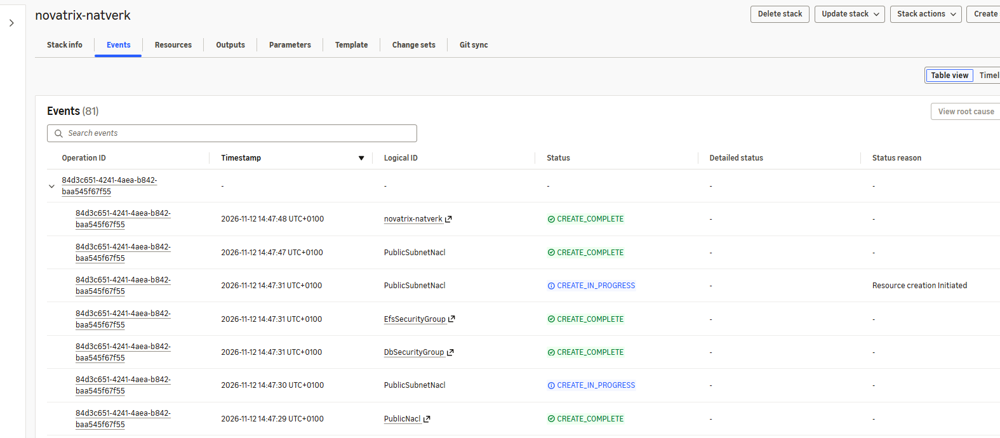

Kartan i VPC-konsolen visar samma nät som i v44. Bara `novatrix-public` går via `novatrix-public-rt` ut genom `novatrix-igw`. De privata subnäten ligger på VPC:ts huvudtabell, som bara känner till vägar inuti VPC:t.

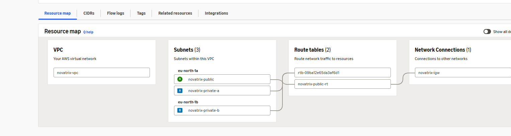

Datastacken tog ungefär tio minuter, nästan bara för databasen. Endpointen och kontonumret är maskade:

```
PS> aws cloudformation describe-stacks --stack-name novatrix-data --query "Stacks[0].[StackStatus,Outputs[].[OutputKey,OutputValue]]" --output text
CREATE_COMPLETE
DbEndpoint      novatrix-db.xxxxxxxxxxxx.eu-north-1.rds.amazonaws.com
DbSecretArn     arn:aws:secretsmanager:eu-north-1:XXXXXXXXXXXX:secret:DbSecret-...
FileSystemId    fs-0c6e066d94313ba7e
```

Webbstacken tog ett par minuter:

```
PS> aws cloudformation describe-stacks --stack-name novatrix-webb --query "Stacks[0].Outputs[].[OutputKey,OutputValue]" --output table
---------------------------------------
|           DescribeStacks            |
+-------------+-----------------------+
|  PublicIp   |  13.49.80.192         |
|  InstanceId |  i-03ac29fa9dbc0d165  |
|  WebUrl     |  http://13.49.80.192  |
+-------------+-----------------------+
```

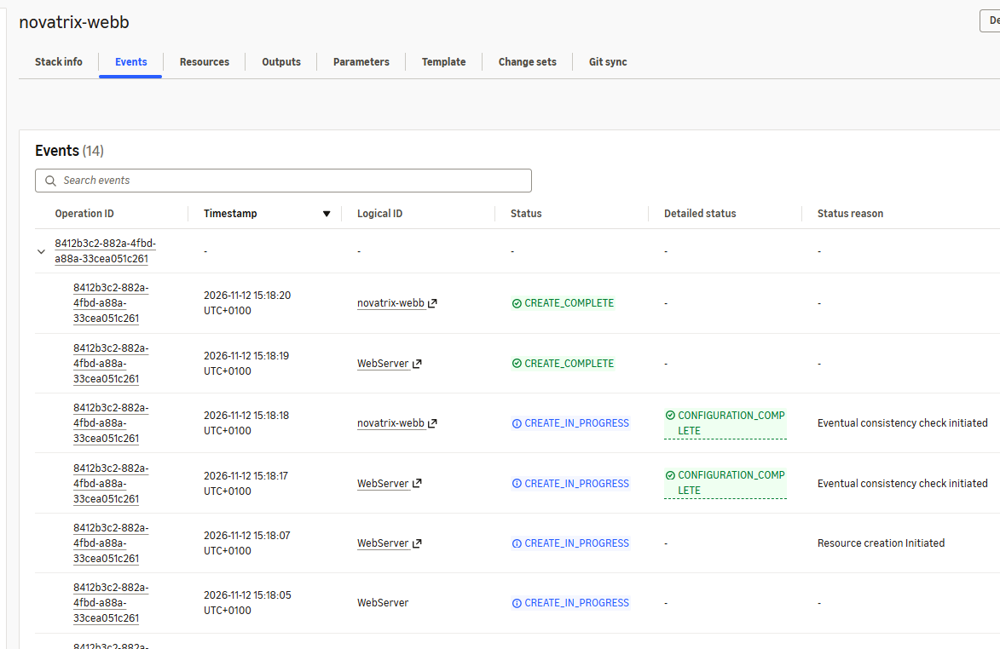

### Verifiering

Jag installerade WordPress, skrev ett inlägg och laddade upp en bild.

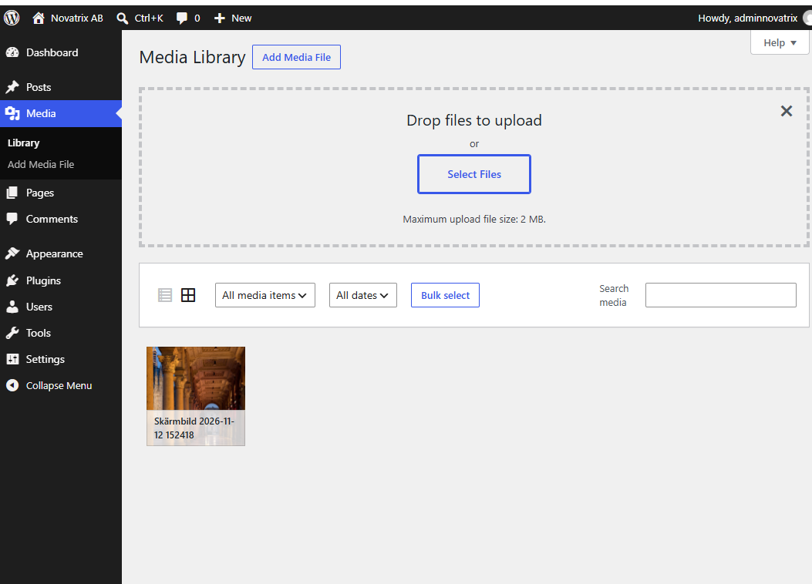

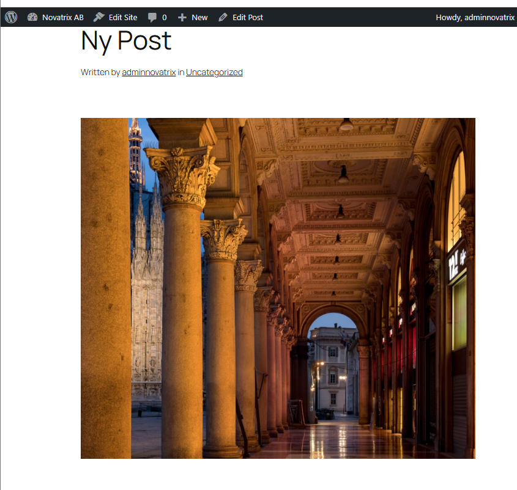

På webbservern kontrollerade jag var allt hamnade. `wp-content` är EFS. 8.0E betyder att disken inte har någon fast storlek. Adressen 127.0.0.1 beror på att EFS kopplas in krypterat, via en liten tunnel på servern.

```bash
[ec2-user@ip-10-0-1-32 ~]$ df -h /var/www/html/wp-content
Filesystem      Size  Used Avail Use% Mounted on
127.0.0.1:/     8.0E     0  8.0E   0% /var/www/html/wp-content
```

Bilden ligger på EFS. WordPress gör själv fyra mindre kopior av den.

```bash
[ec2-user@ip-10-0-1-32 ~]$ ls -l /var/www/html/wp-content/uploads/2026/11/
total 4628
-rw-r--r--. 1 apache apache 1610572 Nov 12 14:24 Skarmbild-2026-11-12-152418-1024x887.png
-rw-r--r--. 1 apache apache   47227 Nov 12 14:24 Skarmbild-2026-11-12-152418-150x150.png
-rw-r--r--. 1 apache apache  160106 Nov 12 14:24 Skarmbild-2026-11-12-152418-300x260.png
-rw-r--r--. 1 apache apache  962355 Nov 12 14:24 Skarmbild-2026-11-12-152418-768x665.png
-rw-r--r--. 1 apache apache 1948356 Nov 12 14:24 Skarmbild-2026-11-12-152418.png
```

Inlägget ligger i databasen i RDS:

```bash
[ec2-user@ip-10-0-1-32 ~]$ mysql -h novatrix-db.xxxxxxxxxxxx.eu-north-1.rds.amazonaws.com -u admin -p -e "SELECT ID, post_title FROM wordpress.wp_posts WHERE post_status='publish';"
Enter password:
+----+---------------+
| ID | post_title    |
+----+---------------+
|  1 | Hello world!  |
|  2 | Sample Page   |
|  4 | Navigation    |
|  7 | Ny Post       |
|  8 | Custom Styles |
+----+---------------+
```

Alla tre stackarna blev klara. Datastacken står som UPDATE_COMPLETE eftersom jag ändrade den i Delmoment 4.

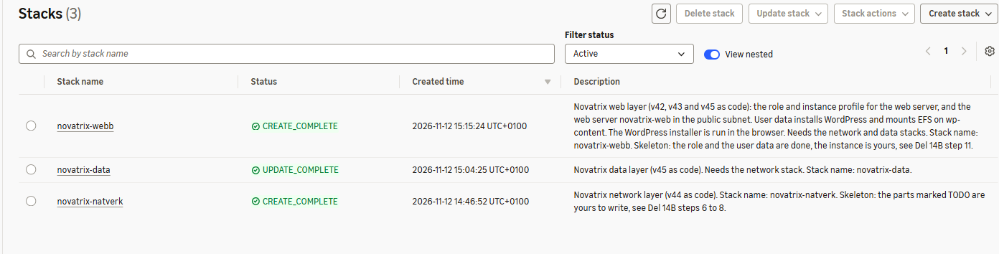

### Kontroll före inlämning

Vid den sista uppbyggnaden kontrollerade jag stackarna som text. Alla tre var klara och ingen stod i ROLLBACK_COMPLETE:

```
PS> aws cloudformation list-stacks --stack-status-filter CREATE_COMPLETE UPDATE_COMPLETE ROLLBACK_COMPLETE --query "StackSummaries[].[StackName,StackStatus]" --output table
-----------------------------------------
|              ListStacks               |
+-------------------+-------------------+
|  novatrix-webb    |  CREATE_COMPLETE  |
|  novatrix-data    |  CREATE_COMPLETE  |
|  novatrix-natverk |  CREATE_COMPLETE  |
+-------------------+-------------------+
```

Sedan lät jag CloudFormation jämföra varje stack med sin fil. Det kallas att leta efter drift. Drift uppstår om någon ändrar något i konsolen i stället för i filen. Alla tre stämde:

```
PS> foreach ($S in "novatrix-natverk", "novatrix-data", "novatrix-webb") { aws cloudformation detect-stack-drift --stack-name $S | Out-Null }
PS> Start-Sleep 30
PS> $Q = "Stacks[?starts_with(StackName,'novatrix')]" +
>>   ".[StackName,DriftInformation.StackDriftStatus]"
PS> aws cloudformation describe-stacks --query $Q --output table
---------------------------------
|        DescribeStacks         |
+-------------------+-----------+
|  novatrix-webb    |  IN_SYNC  |
|  novatrix-data    |  IN_SYNC  |
|  novatrix-natverk |  IN_SYNC  |
+-------------------+-----------+
```

IN_SYNC betyder att miljön i AWS är exakt det som står i repot.

## Delmoment 4: Versionshantering

Jag committade varje gång en del fungerade. Då motsvarar varje rad i historiken en miljö som faktiskt har funnits.

Som ändring lade jag en tagg på databasen i `data.yaml`. Det är en liten ändring men på den känsligaste resursen.

```yaml
      Tags:
        - Key: Course
          Value: MOV25
```

Jag körde den inte direkt. Först skapade jag ett change set, alltså en lista över vad som skulle hända:

```
PS> aws cloudformation deploy --template-file data.yaml --stack-name novatrix-data --no-execute-changeset
Waiting for changeset to be created..
Changeset created successfully.

PS> $cs = aws cloudformation list-change-sets --stack-name novatrix-data --query "Summaries[?Status=='CREATE_COMPLETE'].ChangeSetName | [0]" --output text
PS> aws cloudformation describe-change-set --stack-name novatrix-data --change-set-name $cs --query "Changes[].ResourceChange.[Action,LogicalResourceId,Replacement]" --output table
---------------------------------
|       DescribeChangeSet       |
+--------+------------+---------+
|  Modify|  Database  |  False  |
+--------+------------+---------+
```

Replacement False betyder att databasen ändras på plats. Hade det stått True hade CloudFormation byggt en ny databas och tagit bort den gamla. Då hade inlägget försvunnit. Jag hade avbrutit där.

Nu vågade jag köra den:

```
PS> aws cloudformation execute-change-set --stack-name novatrix-data --change-set-name $cs
PS> aws cloudformation wait stack-update-complete --stack-name novatrix-data
PS> aws rds describe-db-instances --db-instance-identifier novatrix-db --query "DBInstances[0].TagList[?Key=='Course']" --output table
---------------------
|DescribeDBInstances|
+---------+---------+
|   Key   |  Value  |
+---------+---------+
|  Course |  MOV25  |
+---------+---------+
```

Inlägget Ny Post fanns kvar på sajten efteråt. Sedan committade jag och tittade på historiken:

```
PS> git log --oneline -5
5cacac2 (HEAD -> master, origin/master, origin/HEAD) v46: tagg Course på databasen
5acb6b5 v46: nät, data och webb som CloudFormation
2c85173 v46: nätverksstacken som CloudFormation
d2513cb v45: bash-block och tydligare krav från v43
101c904 v45: tydligare vad som behövs från v43
```

### Varför det hjälper drift och samarbete

I en klickad miljö finns bara dagens läge. Ingen vet vem som öppnade en port eller varför. Med koden i Git syns varje ändring som en rad i historiken, med datum, vem och ett meddelande om varför. Går något sönder efter en ändring kan jag se exakt vad som ändrades och gå tillbaka till versionen före.

En kollega kan läsa ändringen innan den körs. Det är lättare att upptäcka att en regel släpper in för mycket i en fil än i en konsol. Change setet visar dessutom vad AWS tänker göra innan något händer.

Det kräver en regel för att fungera. Ändringar görs i filen och aldrig i konsolen. En regel som läggs till i konsolen finns inte i koden och försvinner nästa gång miljön byggs.

## Delmoment 5: Så återskapar du miljön

Det här behövs i kontot först:

- Key pair `novatrix-key`.
- Bucketarna `novatrix-data-80idralt-01` och `novatrix-backup-80idralt-01` från v43 och v45.
- Ingen roll som heter `novatrix-ec2-s3-read` får finnas, eftersom webbstacken skapar den.

Bygger du i ett annat konto byter du de tre värdena överst i `deploy.ps1`. Allt annat hämtas eller räknas ut, även min IP och zonerna.

Bygg hela miljön:

```powershell
aws login
cd v46
.\deploy.ps1
```

Skriptet validerar alla tre filerna först. Ett skrivfel stoppar alltså innan något har byggts. Sedan bygger det nät, data och webb i den ordningen. Det tar ungefär en kvart, mest för databasen. På slutet skriver det ut adressen till sidan.

Går inloggningen ut medan skriptet väntar stannar det med ett fel. Bygget fortsätter ändå i AWS. Kör `aws login` och sedan `.\deploy.ps1` igen. Det som redan är klart lämnas orört.

Vänta 2 till 3 minuter så att webbservern hinner installera WordPress. Surfa sedan till adressen, välj språk, sajtnamn och en användare för WordPress. Databasen är redan inställd.

Riv allt när du är klar:

```powershell
.\destroy.ps1
```

Skriptet river i ordningen webb, data, nät. Databasen och EFS försvinner med datastacken. Vill du spara inlägg och bilder ska du ta en backup först. Bucketarna och key pairet finns kvar efter rivningen.

## VG: Hela stacken som kod

Nät, servrar, databas, lagring och säkerhet byggs nu från repot. Rollen, security groups och NACL-reglerna står i filerna. Det enda som ligger utanför är bucketarna och key pairet. Bucketarna står utanför med flit.

### Lösenordet utan konsolsteg

Första gången fick jag hämta databasens lösenord i terminalen och klistra in det i WordPress-guiden. Det är ett manuellt steg. Lösenordet passerade dessutom mitt urklipp.

Nu gör servern det själv när den startar. Det krävde två saker.

Rollen får läsa just den här hemligheten och inget annat:

```yaml
        - PolicyName: !Sub ${Prefix}-db-secret-read
          PolicyDocument:
            Version: "2012-10-17"
            Statement:
              - Effect: Allow
                Action: secretsmanager:GetSecretValue
                Resource: !ImportValue {"Fn::Sub": "${Prefix}-db-secret-arn"}
```

User data hämtar lösenordet och skriver `wp-config.php`. Det är den fil som WordPress-guidens databassida annars skapar:

```bash
set +x
SECRET=$(aws secretsmanager get-secret-value --region ${AWS::Region} --secret-id ${SecretArn} --query SecretString --output text)
DBPASS=$(echo "$SECRET" | python3 -c 'import json,sys; print(json.load(sys.stdin)["password"])')
cd /var/www/html
cp wp-config-sample.php wp-config.php
sed -i "s/database_name_here/wordpress/" wp-config.php
sed -i "s/username_here/admin/" wp-config.php
sed -i "s/password_here/$DBPASS/" wp-config.php
sed -i "s/localhost/${DbHost}/" wp-config.php
set -x
```

Två saker var viktiga att förstå:

- **`set +x` och `set -x`.** Skriptet skriver normalt ut varje kommando i startloggen. Utan `set +x` hade lösenordet hamnat där i klartext.
- **`${DbHost}` jämfört med `$DBPASS`.** User data står inuti `!Sub`. Allt med klamrar byts ut av CloudFormation innan servern finns. Variablerna utan klamrar lämnas kvar och fylls i av servern när skriptet körs.

Lösenordet innehåller bara bokstäver och siffror. Det är inställt i `data.yaml`. Ett snedstreck i lösenordet hade förstört `sed`-raden.

När jag surfade till den nya servern kom jag direkt från språkvalet till Welcome. Sidan som frågar efter databasen kom aldrig.

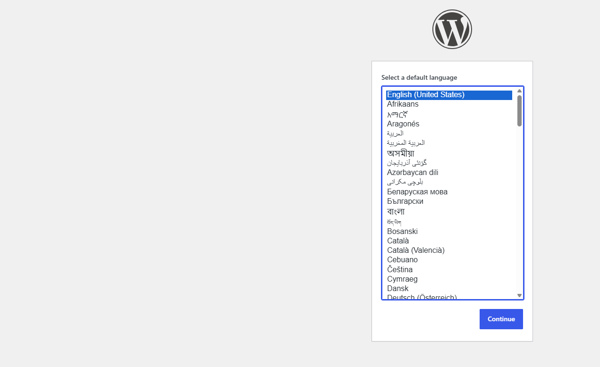

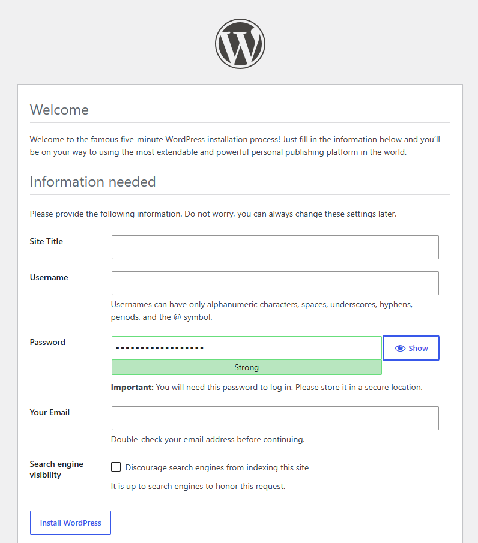

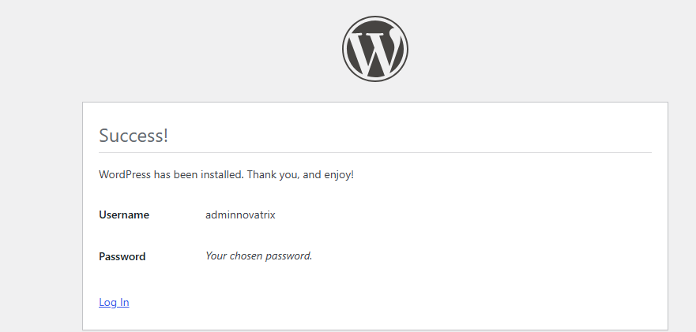

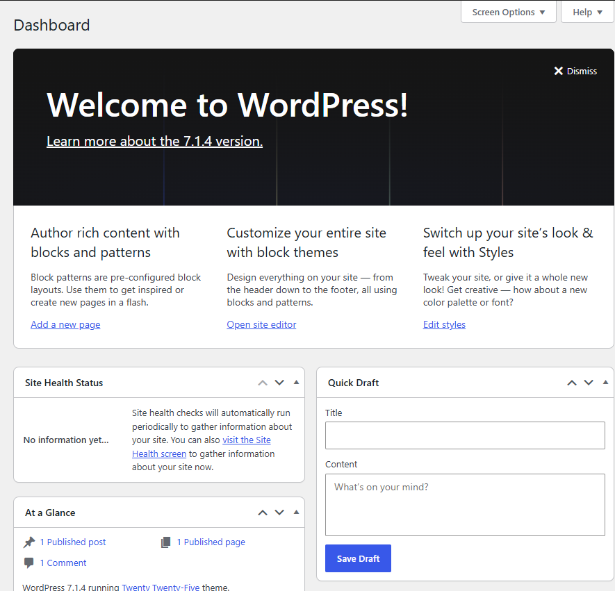

På servern kontrollerade jag att filen har rätt innehåll. Lösenordsraden visar jag inte. Ordet secretsmanager finns noll gånger i startloggen, så lösenordshämtningen syns inte där.

```bash
[ec2-user@ip-10-0-1-5 ~]$ sudo grep -E "DB_NAME|DB_USER|DB_HOST" /var/www/html/wp-config.php
define( 'DB_NAME', 'wordpress' );
define( 'DB_USER', 'admin' );
define( 'DB_HOST', 'novatrix-db.xxxxxxxxxxxx.eu-north-1.rds.amazonaws.com' );
[ec2-user@ip-10-0-1-5 ~]$ sudo grep -c secretsmanager /var/log/cloud-init-output.log
0
```

Kvar i webbläsaren är bara sajtnamnet och WordPress-användaren. Det är inställningar för sajten och inte för miljön.

### Ett kommando bygger allt

`deploy.ps1` validerar och bygger de tre stackarna. När jag körde det mot en miljö som redan fanns hände ingenting. Det kallas idempotens. Filerna beskriver hur miljön ska se ut. Allt såg redan ut så. Skriptet går att köra hur många gånger som helst. Ett vanligt skript som det i v45 hade försökt skapa allt en gång till. Det hade stoppat på första namnet som redan fanns.

```
PS> .\deploy.ps1
natverk.yaml validerad
data.yaml validerad
webb.yaml validerad

Waiting for changeset to be created..

No changes to deploy. Stack novatrix-natverk is up to date

Waiting for changeset to be created..

No changes to deploy. Stack novatrix-data is up to date

Waiting for changeset to be created..

No changes to deploy. Stack novatrix-webb is up to date

Klart. Sidan: http://16.16.186.169 (user data behöver 2-3 minuter till)
```

Utan `--no-fail-on-empty-changeset` hade AWS räknat "No changes" som ett fel. Då hade skriptet stannat.

### Från en ren klon

För att visa att allt verkligen byggs från repot klonade jag det till en tom mapp och körde skriptet därifrån. I kontot fanns bara bucketarna och key pairet.

```
PS> git clone git@github.com:80idralt/aws.git aws-ren-klon
PS> cd aws-ren-klon\v46
PS> .\deploy.ps1
natverk.yaml validerad
data.yaml validerad
webb.yaml validerad

Waiting for changeset to be created..
Waiting for stack create/update to complete
Successfully created/updated stack - novatrix-natverk

Waiting for changeset to be created..
Waiting for stack create/update to complete

aws: [ERROR]: Failed to create/update the stack. Run the following command
to fetch the list of events leading up to the failure
aws cloudformation describe-stack-events --stack-name novatrix-data
```

Inloggningen gick ut medan skriptet väntade på databasen. Skriptet fick inget svar och stannade. Inga händelser i stacken hade misslyckats. Stacken blev klar ändå:

```
PS> $Q = "StackEvents[?contains(ResourceStatus,'FAILED')]" +
>>   ".[LogicalResourceId,ResourceStatusReason]"
PS> aws cloudformation describe-stack-events --stack-name novatrix-data --query $Q --output table
PS> aws cloudformation describe-stacks --stack-name novatrix-data --query "Stacks[0].StackStatus" --output text
CREATE_COMPLETE
```

Jag loggade in igen och körde samma kommando:

```
PS> aws login
PS> .\deploy.ps1
natverk.yaml validerad
data.yaml validerad
webb.yaml validerad

Waiting for changeset to be created..

No changes to deploy. Stack novatrix-natverk is up to date

Waiting for changeset to be created..

No changes to deploy. Stack novatrix-data is up to date

Waiting for changeset to be created..
Waiting for stack create/update to complete
Successfully created/updated stack - novatrix-webb

Klart. Sidan: http://13.60.203.25 (user data behöver 2-3 minuter till)
```

Sidan på den nya adressen gick direkt från språkvalet till Welcome, precis som förut. Servern från klonen hämtade alltså också lösenordet själv.

Skriptet stannade halvvägs, men jag behövde inte städa något. Nät och data fanns redan och lämnades orörda. Bara webben byggdes. Med skriptet från v45 hade en andra körning krockat med allt som redan fanns.

### En kopia med andra namn

Med ett annat prefix bygger samma filer en hel kopia. Ingen rad ändras.

```
PS> .\deploy.ps1 -Prefix novatrix-test
natverk.yaml validerad
data.yaml validerad
webb.yaml validerad

Waiting for changeset to be created..
Waiting for stack create/update to complete
Successfully created/updated stack - novatrix-test-natverk

Waiting for changeset to be created..
Waiting for stack create/update to complete
Successfully created/updated stack - novatrix-test-data

Waiting for changeset to be created..
Waiting for stack create/update to complete
Successfully created/updated stack - novatrix-test-webb

Klart. Sidan: http://13.51.238.119 (user data behöver 2-3 minuter till)
```

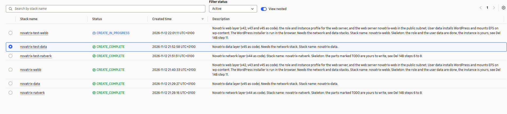

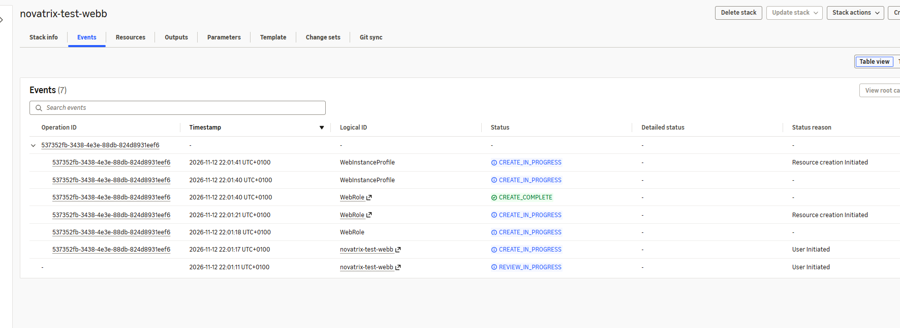

Kopian har egna exporter. Originalet har kvar samma server och samma adress som innan. Båda VPC:erna har samma adressintervall men olika id:

```
PS> aws cloudformation list-exports --query "Exports[?starts_with(Name,'novatrix-test')].Name" --output table
------------------------------------
|            ListExports           |
+----------------------------------+
|  novatrix-test-db-endpoint       |
|  novatrix-test-db-secret-arn     |
|  novatrix-test-db-sg-id          |
|  novatrix-test-efs-id            |
|  novatrix-test-efs-sg-id         |
|  novatrix-test-private-a-id      |
|  novatrix-test-private-b-id      |
|  novatrix-test-public-subnet-id  |
|  novatrix-test-vpc-id            |
|  novatrix-test-web-instance-id   |
|  novatrix-test-web-sg-id         |
+----------------------------------+

PS> aws cloudformation describe-stacks --stack-name novatrix-webb --query "Stacks[0].Outputs[].[OutputKey,OutputValue]" --output table
----------------------------------------
|            DescribeStacks            |
+-------------+------------------------+
|  PublicIp   |  16.16.186.169         |
|  InstanceId |  i-013d5677ec87b753f   |
|  WebUrl     |  http://16.16.186.169  |
+-------------+------------------------+

PS> aws ec2 describe-vpcs --filters Name=tag:Name,Values=novatrix-vpc,novatrix-test-vpc --query "Vpcs[].[Tags[?Key=='Name'].Value|[0],VpcId,CidrBlock]" --output table
---------------------------------------------------------------
|                        DescribeVpcs                         |
+--------------------+-------------------------+--------------+
|  novatrix-test-vpc |  vpc-03582325e0548d219  |  10.0.0.0/16 |
|  novatrix-vpc      |  vpc-0e70fb6f2cc008ee0  |  10.0.0.0/16 |
+--------------------+-------------------------+--------------+
```

Kopian hämtade också lösenordet själv och gick direkt till språkvalet.

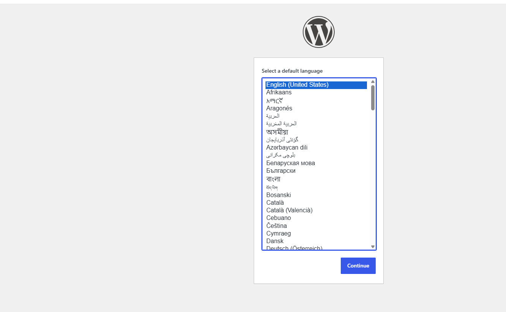

Två VPC:er med samma adressintervall krockar inte. Ett VPC är ett eget stängt nät. Adresserna betyder bara något inuti det. Det hade inte gått om näten skulle kopplas ihop, till exempel med VPC peering eller en VPN till ett kontor. Då vet routern inte vilken 10.0.1.5 som menas. Ska näten någon gång prata med varandra ska de få olika intervall från början.

Det som måste vara unikt har prefixet i namnet:

| Namn | Måste vara unikt i |
|---|---|
| Rollen, `novatrix-test-ec2-s3-read` | hela kontot |
| Databasen, `novatrix-test-db` | regionen |
| Exporterna, `novatrix-test-...` | regionen |
| Subnet groupen, `novatrix-test-db-subnets` | regionen |
| Security groups, `novatrix-test-web-sg` och de andra | VPC:t |

Hade ett enda namn varit hårdkodat hade kopian stoppat på just den raden. Hemligheten har med flit inget eget namn. När en stack rivs tas hemligheten inte bort direkt. Den står kvar en tid innan den försvinner helt. Hade den haft ett fast namn hade nästa bygge krockat med den gamla. Nu hittar CloudFormation på ett nytt namn varje gång.

Jag rev kopian samma kväll med `.\destroy.ps1 -Prefix novatrix-test`. Två databaser kostar dubbelt.

### Säkerheten följer med in i koden

Varje skyddslager från tidigare veckor står nu i en fil och kan läsas innan det byggs.

| Lager | Var | Vad det gör |
|---|---|---|
| IAM | `webb.yaml` | Rollen får läsa en bucket, skriva i `backup/` och läsa en enda hemlighet. Inget mer |
| Nät | `natverk.yaml` | De privata subnäten har ingen väg till internet. NACL:en släpper bara de portar som behövs |
| Security groups | `natverk.yaml` | Databasen och EFS släpper bara in servrar som har webbens grupp |
| Data | `data.yaml` | Databasen är inte publik och är krypterad. EFS är krypterad. Lösenordet har ingen människa skrivit |

Om någon öppnar en port för hela internet syns det i `git diff` och i historiken. I en klickad miljö märks det ofta inte förrän det är för sent.

### Om jag river i fel ordning

Datastacken använder nätverksstackens exporter. Webbstacken använder datastackens. Det går att fråga CloudFormation vem som använder en export:

```
PS> aws cloudformation list-imports --export-name novatrix-private-a-id --output table
---------------------
|    ListImports    |
+-------------------+
||     Imports     ||
|+-----------------+|
||  novatrix-data  ||
|+-----------------+|

PS> aws cloudformation list-imports --export-name novatrix-efs-id --output table
---------------------
|    ListImports    |
+-------------------+
||     Imports     ||
|+-----------------+|
||  novatrix-webb  ||
|+-----------------+|
```

Om jag försöker riva nätet först vägrar CloudFormation, eftersom novatrix-data fortfarande använder subnätet. Meddelandet säger vilken stack det gäller. Därför river `destroy.ps1` i ordningen webb, data, nät.

### Riva och bygga mellan passen

Databasen kostar varje timme den finns. Nu när miljön är kod river jag den när jag är klar för dagen och bygger den igen nästa gång. Det tar en kvart. Det enda som inte följer med är innehållet i databasen och på EFS. Det sparar jag med en backup först, se nästa avsnitt.

### Backup och återställning i en ny miljö

Databasen och EFS rivs med datastacken. En nybyggd miljö är tom. Jag ville visa att innehållet ändå går att få tillbaka.

Två saker behöver sparas. Inlägg, sidor och användare ligger i databasen. Bilderna ligger på EFS. `backup.sh` sparar båda i backup-bucketen. Adressen och lösenordet läser skriptet från `wp-config.php` på servern, så jag behöver inte skriva in något.

Först skrev jag ett inlägg med en bild i en nybyggd miljö:

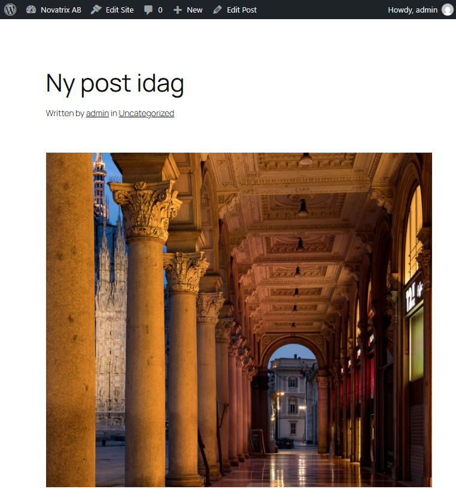

Sedan körde jag backupen på servern och kontrollerade att filerna inte var tomma:

```bash
[ec2-user@ip-10-0-1-156 ~]$ bash backup.sh
upload: ../../tmp/wordpress-2026-11-13-0925.sql to s3://novatrix-backup-80idralt-01/backup/wordpress-2026-11-13-0925.sql
upload: ../../tmp/uploads-2026-11-13-0925.tgz to s3://novatrix-backup-80idralt-01/backup/uploads-2026-11-13-0925.tgz
Klart: wordpress-2026-11-13-0925.sql och uploads-2026-11-13-0925.tgz ligger i s3://novatrix-backup-80idralt-01/backup/
```

```
PS> aws s3 ls s3://novatrix-backup-80idralt-01/backup/
2026-11-04 18:49:53          0
2026-11-13 10:25:29    4730261 uploads-2026-11-13-0925.tgz
2026-11-04 19:27:39    1059413 wordpress-2026-11-04.sql
2026-11-05 10:57:31    1056296 wordpress-2026-11-05-0956.sql
2026-11-13 10:25:29    1045746 wordpress-2026-11-13-0925.sql
```

Raden utan namn är själva mappen `backup/`. Tiden i filnamnen är serverns tid, som går efter UTC.

Därefter rev jag hela miljön med `destroy.ps1` och byggde den igen med `deploy.ps1`. Den nya servern fick en ny adress och databasen var tom.

Serverns roll får lägga filer i `backup/`, men inte läsa dem. Det är med flit. Blir servern hackad kommer angriparen inte åt gamla backuper. Därför hämtade jag filerna som admin och skickade upp dem till den nya servern:

```powershell
aws s3 cp s3://novatrix-backup-80idralt-01/backup/wordpress-2026-11-13-0925.sql $env:TEMP\
aws s3 cp s3://novatrix-backup-80idralt-01/backup/uploads-2026-11-13-0925.tgz $env:TEMP\
$Ip = aws cloudformation describe-stacks --stack-name novatrix-webb --query "Stacks[0].Outputs[?OutputKey=='PublicIp'].OutputValue" --output text
scp -i $HOME\.ssh\novatrix-key.pem restore.sh $env:TEMP\wordpress-2026-11-13-0925.sql $env:TEMP\uploads-2026-11-13-0925.tgz "ec2-user@${Ip}:~/"
```

Filerna lade jag i en tillfällig mapp och inte i repot. Dumpen innehåller användarnas lösenordsdata och ska aldrig hamna på GitHub.

På den nya servern körde jag `restore.sh`. Den läser in dumpen, packar upp bilderna på EFS och byter adress. WordPress sparar nämligen sin egen adress i databasen, även i länkarna till bilderna. Utan bytet hade sidan skickat besökaren till den gamla servern, som inte finns längre.

```bash
[ec2-user@ip-10-0-1-131 ~]$ bash restore.sh wordpress-2026-11-13-0925.sql uploads-2026-11-13-0925.tgz
Bytte http://13.48.29.128 mot http://51.20.74.93
Klart. Öppna http://51.20.74.93
```

Inlägget fanns i den nya databasen. Adressen var den nya och bilderna låg på det nya EFS:

```bash
[ec2-user@ip-10-0-1-131 ~]$ mysql -h "$DB" -u admin wordpress -e "SELECT ID, post_title FROM wp_posts WHERE post_status='publish';"
+----+---------------+
| ID | post_title    |
+----+---------------+
|  1 | Hello world!  |
|  2 | Sample Page   |
|  4 | Navigation    |
|  6 | Ny post idag  |
|  7 | Custom Styles |
+----+---------------+
[ec2-user@ip-10-0-1-131 ~]$ mysql -h "$DB" -u admin wordpress -e "SELECT option_name, option_value FROM wp_options WHERE option_name IN ('siteurl','home');"
+-------------+--------------------+
| option_name | option_value       |
+-------------+--------------------+
| home        | http://51.20.74.93 |
| siteurl     | http://51.20.74.93 |
+-------------+--------------------+
[ec2-user@ip-10-0-1-131 ~]$ ls -l /var/www/html/wp-content/uploads/2026/11/
total 4628
-rw-r--r--. 1 apache apache 1610572 Nov 13 09:19 Skarmbild-2026-11-12-152418-1024x887.png
-rw-r--r--. 1 apache apache   47227 Nov 13 09:19 Skarmbild-2026-11-12-152418-150x150.png
-rw-r--r--. 1 apache apache  160106 Nov 13 09:19 Skarmbild-2026-11-12-152418-300x260.png
-rw-r--r--. 1 apache apache  962355 Nov 13 09:19 Skarmbild-2026-11-12-152418-768x665.png
-rw-r--r--. 1 apache apache 1948356 Nov 13 09:19 Skarmbild-2026-11-12-152418.png
```

Lösenordet till mysql läste jag ur `wp-config.php` på samma sätt som skripten gör. Det syns inte i utskriften.

Sidan på den nya adressen visade samma inlägg med samma bild. Installationsguiden kom aldrig, eftersom databasen redan hade allt.

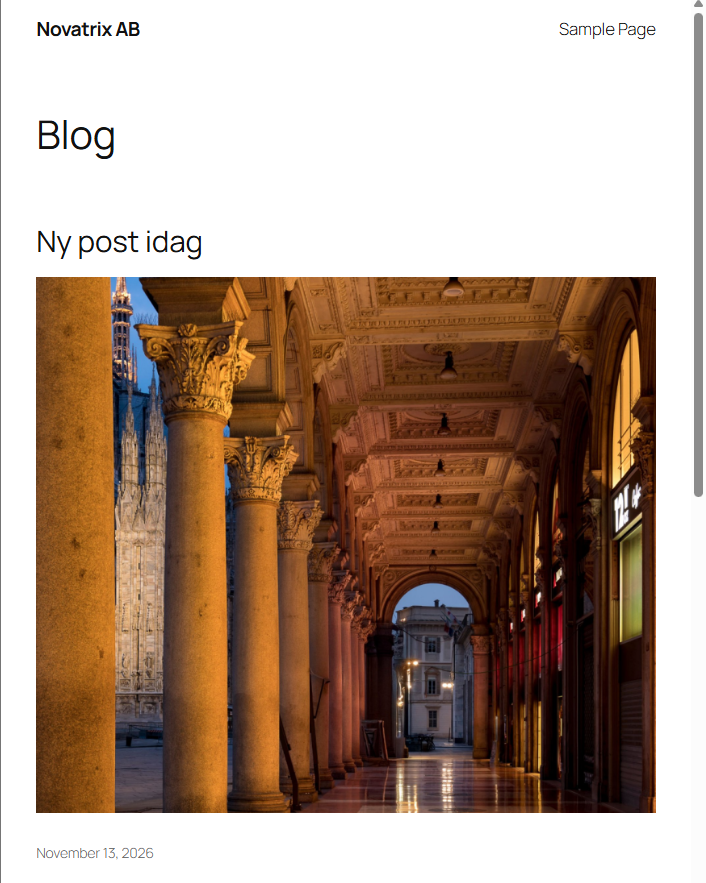

## VG: Varför jag har valt som jag gjort

### Varför tre stackar och inte en eller fem?

En enda stack hade gjort varje ändring riskabel. Ett misstag i webbserverns inställningar hade kunnat röra databasen, eftersom allt hör till samma stack. Rivningen hade också varit allt eller inget.

Fem stackar, till exempel med security groups, IAM och EFS som egna lager, hade gett fler exporter och fler beroenden att hålla reda på. Ordningen för att bygga och riva hade blivit längre och lättare att göra fel i. De delarna ändras dessutom tillsammans med sitt lager. En ny port för databasen hör ihop med nätet. Rollen hör ihop med servern som använder den.

Tre lager följer hur miljön faktiskt används. Nätet ändras sällan. Datalagret ska vara stabilt, eftersom det håller innehållet. Webbservern byts ut oftast. Nästa steg, en lastbalanserare, kan läggas till som ett fjärde lager ovanpå utan att de tre första ändras.

### Varför är just de här värdena parametrar?

Jag frågade för varje värde om det skiljer sig mellan två användningar av filerna. Gör det det blev det en parameter. Annars står det i filen.

- Det som skiljer mellan personer och konton är key pair, bucketnamn och min IP.
- Det som skiljer mellan miljöer är prefixet.
- Det som kan behöva växa är storleken på servern och databasen. Därför har de standardvärden och en lista över tillåtna val, så att ingen kan skriva in något felstavat.
- Antal dagar med backup är en parameter, eftersom Free plan bara tillåter en dag.

Adressintervall och portar ändras aldrig och står därför i filen. Fler parametrar hade gjort filerna svårare att använda och lättare att fylla i fel.

### Finns det något i miljön som inte kommer från en template?

Ja. Det är med flit:

| Utanför stackarna | Varför |
|---|---|
| Bucketarna för data och backup | Data ska överleva att miljön rivs. Backupen är till för att kunna bygga upp igen. En bucket med innehåll går inte heller att ta bort med CloudFormation, så rivningen hade fastnat |
| Livscykelregeln på backup-bucketen | Den hör till bucketen och ska gälla hur många gånger miljön än rivs |
| Key pairet | Den privata nyckeln ska bara finnas på min dator. Skapar en stack nyckeln måste den lämna ut den någonstans |
| Grupperna och användarna från v43 | De beskriver människor och deras behörigheter, inte miljön. De ska inte försvinna när servern rivs |

Allt annat, alltså nät, regler, roll, server, databas, lösenord och filsystem, kommer från templaterna. Ingenting är klickat i konsolen.

Är det rätt att bucketarna ligger utanför? För data tycker jag det. Nackdelen är att någon som börjar i ett tomt konto först måste skapa bucketarna, till exempel med skriptet från v43. Ett alternativ hade varit en egen stack bara för bucketarna, med en inställning som gör att de står kvar när stacken rivs. Då hade allt funnits som kod. Det har jag inte gjort den här veckan.

### Varför ingen bastion och ingen NAT gateway?

Bastionen från v44 valde jag bort för att hålla fokus på CloudFormation. SSH går direkt till webbservern, men bara från min IP. Det står både i security groupen och i NACL:en. Ska fler personer logga in, eller servern flyttas till ett privat subnät, är bastionen det första jag lägger tillbaka.

En NAT gateway hade gett de privata subnäten en väg ut till internet. Databasen och EFS behöver ingen sådan väg. AWS sköter deras uppdateringar. Utan väg ut kan de inte heller skicka något vidare om de skulle bli angripna. En NAT gateway kostar dessutom pengar varje timme.

### Varför Secrets Manager och inte ett lösenord som parameter?

En parameter kan döljas i konsolen med NoEcho, men någon måste fortfarande hitta på lösenordet och skriva in det. Då finns det i någons terminal, historik eller urklipp. Med Secrets Manager skapar AWS lösenordet själv. Databasen och webbservern hämtar det därifrån. Ingen människa behöver se det. Filen `wp-config.php` som innehåller lösenordet skapas bara på servern och står i `.gitignore`, så den kan aldrig hamna i repot.

### Vad måste ändras för att bygga i en annan region?

Nästan ingenting i templaterna:

- Zonerna letas upp med `!GetAZs`, så eu-north-1a står ingenstans.
- Senaste Amazon Linux slås upp i den region stacken byggs i.
- User data använder `${AWS::Region}` när den hämtar lösenordet.

Det som måste finnas eller ändras utanför:

- **Key pairet** finns bara i den region där det skapades. Ett nytt behövs i den nya regionen.
- **Regionen i AWS CLI** styr var `deploy.ps1` bygger. Den byts med `aws configure` eller variabeln `AWS_REGION`.
- **Bucketarna** kan ligga kvar i Stockholm och fungerar ändå. Data hamnar då i ett annat land än servrarna. Det kan spela roll för kostnad och för var data får lagras.
- **MariaDB 11.4 och db.t3.micro** måste finnas i den nya regionen. Det gör de i de flesta.

## Bilaga: templates och skript

### natverk.yaml

```yaml
AWSTemplateFormatVersion: "2010-09-09"
Description: >
  Novatrix network (v44 as code): the VPC, one public and two private subnets,
  the way out to the internet, the NACL and the security groups.
  Stack name: novatrix-natverk.

Parameters:
  Prefix:
    Type: String
    Default: novatrix
    AllowedPattern: "[a-z][a-z0-9-]*"
    Description: Name prefix for all resources, e.g. novatrix
  MyIp:
    Type: String
    AllowedPattern: "(\\d{1,3}\\.){3}\\d{1,3}/32"
    Description: Public address of YOUR computer for SSH, e.g. 203.0.113.10/32

Resources:
  # The network. DNS hostnames must be on, otherwise the web server
  # cannot find EFS by its name.
  Vpc:
    Type: AWS::EC2::VPC
    Properties:
      CidrBlock: 10.0.0.0/16
      EnableDnsSupport: true
      EnableDnsHostnames: true
      Tags:
        - Key: Name
          Value: !Sub ${Prefix}-vpc

  # One public subnet for the web server. The zones are looked up,
  # so the file also works in another region.
  PublicSubnet:
    Type: AWS::EC2::Subnet
    Properties:
      VpcId: !Ref Vpc
      CidrBlock: 10.0.1.0/24
      AvailabilityZone: !Select [0, !GetAZs ""]
      MapPublicIpOnLaunch: true
      Tags:
        - Key: Name
          Value: !Sub ${Prefix}-public

  # Two private subnets in two zones for the database and EFS.
  # No public addresses here.
  PrivateSubnetA:
    Type: AWS::EC2::Subnet
    Properties:
      VpcId: !Ref Vpc
      CidrBlock: 10.0.2.0/24
      AvailabilityZone: !Select [0, !GetAZs ""]
      Tags:
        - Key: Name
          Value: !Sub ${Prefix}-private-a

  PrivateSubnetB:
    Type: AWS::EC2::Subnet
    Properties:
      VpcId: !Ref Vpc
      CidrBlock: 10.0.4.0/24
      AvailabilityZone: !Select [1, !GetAZs ""]
      Tags:
        - Key: Name
          Value: !Sub ${Prefix}-private-b

  # The way out to the internet, only for the public subnet.
  # The private subnets stay on the main route table, which only knows the VPC.
  InternetGateway:
    Type: AWS::EC2::InternetGateway
    Properties:
      Tags:
        - Key: Name
          Value: !Sub ${Prefix}-igw

  GatewayAttachment:
    Type: AWS::EC2::VPCGatewayAttachment
    Properties:
      VpcId: !Ref Vpc
      InternetGatewayId: !Ref InternetGateway

  PublicRouteTable:
    Type: AWS::EC2::RouteTable
    Properties:
      VpcId: !Ref Vpc
      Tags:
        - Key: Name
          Value: !Sub ${Prefix}-public-rt

  # The route must wait until the gateway is attached to the VPC
  InternetRoute:
    Type: AWS::EC2::Route
    DependsOn: GatewayAttachment
    Properties:
      RouteTableId: !Ref PublicRouteTable
      DestinationCidrBlock: 0.0.0.0/0
      GatewayId: !Ref InternetGateway

  PublicSubnetRoute:
    Type: AWS::EC2::SubnetRouteTableAssociation
    Properties:
      RouteTableId: !Ref PublicRouteTable
      SubnetId: !Ref PublicSubnet

  # NACL for the public subnet. It does not remember connections,
  # so the answers need their own rules (ports 1024-65535).
  PublicNacl:
    Type: AWS::EC2::NetworkAcl
    Properties:
      VpcId: !Ref Vpc
      Tags:
        - Key: Name
          Value: !Sub ${Prefix}-public-nacl

  # In: web from everyone, SSH only from my computer, and the answers
  NaclInHttp:
    Type: AWS::EC2::NetworkAclEntry
    Properties: {NetworkAclId: !Ref PublicNacl, RuleNumber: 100, Protocol: 6, RuleAction: allow, Egress: false, CidrBlock: 0.0.0.0/0, PortRange: {From: 80, To: 80}}
  NaclInHttps:
    Type: AWS::EC2::NetworkAclEntry
    Properties: {NetworkAclId: !Ref PublicNacl, RuleNumber: 110, Protocol: 6, RuleAction: allow, Egress: false, CidrBlock: 0.0.0.0/0, PortRange: {From: 443, To: 443}}
  NaclInSsh:
    Type: AWS::EC2::NetworkAclEntry
    Properties: {NetworkAclId: !Ref PublicNacl, RuleNumber: 120, Protocol: 6, RuleAction: allow, Egress: false, CidrBlock: !Ref MyIp, PortRange: {From: 22, To: 22}}
  NaclInReturn:
    Type: AWS::EC2::NetworkAclEntry
    Properties: {NetworkAclId: !Ref PublicNacl, RuleNumber: 130, Protocol: 6, RuleAction: allow, Egress: false, CidrBlock: 0.0.0.0/0, PortRange: {From: 1024, To: 65535}}

  # Out: web for updates, and the answers
  NaclOutHttp:
    Type: AWS::EC2::NetworkAclEntry
    Properties: {NetworkAclId: !Ref PublicNacl, RuleNumber: 100, Protocol: 6, RuleAction: allow, Egress: true, CidrBlock: 0.0.0.0/0, PortRange: {From: 80, To: 80}}
  NaclOutHttps:
    Type: AWS::EC2::NetworkAclEntry
    Properties: {NetworkAclId: !Ref PublicNacl, RuleNumber: 110, Protocol: 6, RuleAction: allow, Egress: true, CidrBlock: 0.0.0.0/0, PortRange: {From: 443, To: 443}}
  NaclOutReturn:
    Type: AWS::EC2::NetworkAclEntry
    Properties: {NetworkAclId: !Ref PublicNacl, RuleNumber: 120, Protocol: 6, RuleAction: allow, Egress: true, CidrBlock: 0.0.0.0/0, PortRange: {From: 1024, To: 65535}}

  # Out to the database (3306) and EFS (2049), only to the two private subnets,
  # never to the internet
  NaclOutDbA:
    Type: AWS::EC2::NetworkAclEntry
    Properties: {NetworkAclId: !Ref PublicNacl, RuleNumber: 140, Protocol: 6, RuleAction: allow, Egress: true, CidrBlock: 10.0.2.0/24, PortRange: {From: 3306, To: 3306}}
  NaclOutDbB:
    Type: AWS::EC2::NetworkAclEntry
    Properties: {NetworkAclId: !Ref PublicNacl, RuleNumber: 141, Protocol: 6, RuleAction: allow, Egress: true, CidrBlock: 10.0.4.0/24, PortRange: {From: 3306, To: 3306}}
  NaclOutEfsA:
    Type: AWS::EC2::NetworkAclEntry
    Properties: {NetworkAclId: !Ref PublicNacl, RuleNumber: 150, Protocol: 6, RuleAction: allow, Egress: true, CidrBlock: 10.0.2.0/24, PortRange: {From: 2049, To: 2049}}
  NaclOutEfsB:
    Type: AWS::EC2::NetworkAclEntry
    Properties: {NetworkAclId: !Ref PublicNacl, RuleNumber: 151, Protocol: 6, RuleAction: allow, Egress: true, CidrBlock: 10.0.4.0/24, PortRange: {From: 2049, To: 2049}}

  # Without this the NACL exists but guards nothing
  PublicSubnetNacl:
    Type: AWS::EC2::SubnetNetworkAclAssociation
    Properties:
      SubnetId: !Ref PublicSubnet
      NetworkAclId: !Ref PublicNacl

  # Security groups. The database and EFS only let in servers that have
  # the web group, whatever their IP address is.
  WebSecurityGroup:
    Type: AWS::EC2::SecurityGroup
    Properties:
      GroupName: !Sub ${Prefix}-web-sg
      GroupDescription: HTTP and HTTPS from everyone, SSH from my IP
      VpcId: !Ref Vpc
      SecurityGroupIngress:
        - {IpProtocol: tcp, FromPort: 80, ToPort: 80, CidrIp: 0.0.0.0/0}
        - {IpProtocol: tcp, FromPort: 443, ToPort: 443, CidrIp: 0.0.0.0/0}
        - {IpProtocol: tcp, FromPort: 22, ToPort: 22, CidrIp: !Ref MyIp}

  DbSecurityGroup:
    Type: AWS::EC2::SecurityGroup
    Properties:
      GroupName: !Sub ${Prefix}-db-sg
      GroupDescription: MySQL only from the web server
      VpcId: !Ref Vpc
      SecurityGroupIngress:
        - {IpProtocol: tcp, FromPort: 3306, ToPort: 3306, SourceSecurityGroupId: !Ref WebSecurityGroup}

  EfsSecurityGroup:
    Type: AWS::EC2::SecurityGroup
    Properties:
      GroupName: !Sub ${Prefix}-efs-sg
      GroupDescription: EFS only from the web server
      VpcId: !Ref Vpc
      SecurityGroupIngress:
        - {IpProtocol: tcp, FromPort: 2049, ToPort: 2049, SourceSecurityGroupId: !Ref WebSecurityGroup}

# Exports that the data and web stacks read with !ImportValue.
# The prefix is part of every name, so a copy does not collide with the original.
Outputs:
  VpcId:
    Value: !Ref Vpc
    Export: {Name: !Sub "${Prefix}-vpc-id"}
  PublicSubnetId:
    Value: !Ref PublicSubnet
    Export: {Name: !Sub "${Prefix}-public-subnet-id"}
  PrivateSubnetAId:
    Value: !Ref PrivateSubnetA
    Export: {Name: !Sub "${Prefix}-private-a-id"}
  PrivateSubnetBId:
    Value: !Ref PrivateSubnetB
    Export: {Name: !Sub "${Prefix}-private-b-id"}
  WebSecurityGroupId:
    Value: !Ref WebSecurityGroup
    Export: {Name: !Sub "${Prefix}-web-sg-id"}
  DbSecurityGroupId:
    Value: !Ref DbSecurityGroup
    Export: {Name: !Sub "${Prefix}-db-sg-id"}
  EfsSecurityGroupId:
    Value: !Ref EfsSecurityGroup
    Export: {Name: !Sub "${Prefix}-efs-sg-id"}
```

### data.yaml

```yaml
AWSTemplateFormatVersion: "2010-09-09"
Description: >
  Novatrix data (v45 as code): the database, its password in Secrets Manager
  and EFS for wp-content. Needs novatrix-natverk. Stack name: novatrix-data.

Parameters:
  Prefix:
    Type: String
    Default: novatrix
    AllowedPattern: "[a-z][a-z0-9-]*"
    Description: Same prefix as the network stack
  DbInstanceClass:
    Type: String
    Default: db.t3.micro
    AllowedValues: [db.t3.micro, db.t3.small]
  BackupDays:
    Type: Number
    Default: 1
    MinValue: 0
    MaxValue: 35
    Description: Days of automatic backup. Free plan allows at most 1, use 14 on a paid account

Resources:
  # The database may only live in the two private subnets
  DbSubnetGroup:
    Type: AWS::RDS::DBSubnetGroup
    Properties:
      DBSubnetGroupName: !Sub ${Prefix}-db-subnets
      DBSubnetGroupDescription: Private subnets for the Novatrix database
      SubnetIds:
        - !ImportValue {"Fn::Sub": "${Prefix}-private-a-id"}
        - !ImportValue {"Fn::Sub": "${Prefix}-private-b-id"}

  # AWS makes up the password, nobody types it. Only letters and digits,
  # so the web server can put it in wp-config.php with sed.
  DbSecret:
    Type: AWS::SecretsManager::Secret
    Properties:
      Description: !Sub Admin password for ${Prefix}-db
      GenerateSecretString:
        SecretStringTemplate: '{"username": "admin"}'
        GenerateStringKey: password
        PasswordLength: 24
        ExcludePunctuation: true

  # Same database as in v45. MariaDB 11.4, because 11.8 requires TLS.
  # DeletionPolicy Delete: no paid final snapshot when the stack is removed,
  # the long-term backups go to the S3 bucket instead.
  Database:
    Type: AWS::RDS::DBInstance
    DeletionPolicy: Delete
    Properties:
      DBInstanceIdentifier: !Sub ${Prefix}-db
      Engine: mariadb
      EngineVersion: "11.4"
      DBInstanceClass: !Ref DbInstanceClass
      AllocatedStorage: "20"
      StorageEncrypted: true
      MasterUsername: admin
      MasterUserPassword: !Sub "{{resolve:secretsmanager:${DbSecret}:SecretString:password}}"
      DBName: wordpress
      DBSubnetGroupName: !Ref DbSubnetGroup
      VPCSecurityGroups:
        - !ImportValue {"Fn::Sub": "${Prefix}-db-sg-id"}
      PubliclyAccessible: false
      MultiAZ: false
      BackupRetentionPeriod: !Ref BackupDays
      DeleteAutomatedBackups: true
      Tags:
        - Key: Course
          Value: MOV25

  # Shared disk for wp-content, so uploaded images survive a new web server
  FileSystem:
    Type: AWS::EFS::FileSystem
    Properties:
      Encrypted: true
      PerformanceMode: generalPurpose
      ThroughputMode: bursting
      FileSystemTags:
        - Key: Name
          Value: !Sub ${Prefix}-efs

  # One mount target in each private subnet, guarded by the EFS group
  MountTargetA:
    Type: AWS::EFS::MountTarget
    Properties:
      FileSystemId: !Ref FileSystem
      SubnetId: !ImportValue {"Fn::Sub": "${Prefix}-private-a-id"}
      SecurityGroups:
        - !ImportValue {"Fn::Sub": "${Prefix}-efs-sg-id"}

  MountTargetB:
    Type: AWS::EFS::MountTarget
    Properties:
      FileSystemId: !Ref FileSystem
      SubnetId: !ImportValue {"Fn::Sub": "${Prefix}-private-b-id"}
      SecurityGroups:
        - !ImportValue {"Fn::Sub": "${Prefix}-efs-sg-id"}

# Exports that the web stack reads
Outputs:
  DbSecretArn:
    Value: !Ref DbSecret
    Export: {Name: !Sub "${Prefix}-db-secret-arn"}
  DbEndpoint:
    Value: !GetAtt Database.Endpoint.Address
    Export: {Name: !Sub "${Prefix}-db-endpoint"}
  FileSystemId:
    Value: !Ref FileSystem
    Export: {Name: !Sub "${Prefix}-efs-id"}
```

### webb.yaml

```yaml
AWSTemplateFormatVersion: "2010-09-09"
Description: >
  Novatrix web (v42, v43 and v45 as code): the server role and the web server
  novatrix-web in the public subnet. User data installs WordPress, mounts EFS on
  wp-content and writes wp-config.php with the password from Secrets Manager.
  Needs novatrix-natverk and novatrix-data. Stack name: novatrix-webb.

Parameters:
  Prefix:
    Type: String
    Default: novatrix
    AllowedPattern: "[a-z][a-z0-9-]*"
    Description: Same prefix as the network and data stacks
  KeyName:
    Type: AWS::EC2::KeyPair::KeyName
    Description: Existing key pair for SSH
  DataBucket:
    Type: String
    Description: The bucket from v43 that the server may read, e.g. novatrix-data-<name>-01
  BackupBucket:
    Type: String
    Description: The backup bucket from v45, e.g. novatrix-backup-<name>-01
  InstanceType:
    Type: String
    Default: t3.micro
    AllowedValues: [t3.micro, t3.small]
  LatestAmiId:
    Type: AWS::SSM::Parameter::Value<AWS::EC2::Image::Id>
    Default: /aws/service/ami-amazon-linux-latest/al2023-ami-kernel-default-x86_64
    Description: Latest Amazon Linux 2023, looked up when the stack is deployed

Resources:
  # The server role, same name as in v43. It may read the v43 bucket,
  # write backups to backup/ and read the database secret. Nothing more.
  WebRole:
    Type: AWS::IAM::Role
    Properties:
      RoleName: !Sub ${Prefix}-ec2-s3-read
      AssumeRolePolicyDocument:
        Version: "2012-10-17"
        Statement:
          - Effect: Allow
            Principal: {Service: ec2.amazonaws.com}
            Action: sts:AssumeRole
      Policies:
        - PolicyName: !Sub ${Prefix}-s3-read
          PolicyDocument:
            Version: "2012-10-17"
            Statement:
              - {Effect: Allow, Action: s3:ListBucket, Resource: !Sub "arn:aws:s3:::${DataBucket}"}
              - {Effect: Allow, Action: s3:GetObject, Resource: !Sub "arn:aws:s3:::${DataBucket}/*"}
        - PolicyName: !Sub ${Prefix}-s3-backup
          PolicyDocument:
            Version: "2012-10-17"
            Statement:
              - {Effect: Allow, Action: s3:PutObject, Resource: !Sub "arn:aws:s3:::${BackupBucket}/backup/*"}
        # Only this one secret, so the server can write wp-config.php itself
        - PolicyName: !Sub ${Prefix}-db-secret-read
          PolicyDocument:
            Version: "2012-10-17"
            Statement:
              - Effect: Allow
                Action: secretsmanager:GetSecretValue
                Resource: !ImportValue {"Fn::Sub": "${Prefix}-db-secret-arn"}

  # The holder that EC2 uses to get the role, same name as the role
  WebInstanceProfile:
    Type: AWS::IAM::InstanceProfile
    Properties:
      InstanceProfileName: !Sub ${Prefix}-ec2-s3-read
      Roles: [!Ref WebRole]

  # The web server. The Project tag lets the drift group from v43 start and stop it.
  WebServer:
    Type: AWS::EC2::Instance
    Properties:
      ImageId: !Ref LatestAmiId
      InstanceType: !Ref InstanceType
      KeyName: !Ref KeyName
      SubnetId: !ImportValue {"Fn::Sub": "${Prefix}-public-subnet-id"}
      SecurityGroupIds:
        - !ImportValue {"Fn::Sub": "${Prefix}-web-sg-id"}
      IamInstanceProfile: !Ref WebInstanceProfile
      Tags:
        - Key: Name
          Value: !Sub ${Prefix}-web
        - Key: Project
          Value: !Ref Prefix
      UserData:
        Fn::Base64: !Sub
          - |
            #!/bin/bash
            # Runs once at first boot. Log: /var/log/cloud-init-output.log
            set -euxo pipefail
            dnf install -y httpd php php-mysqlnd php-gd php-mbstring php-xml mariadb105 amazon-efs-utils

            # Mount EFS on wp-content, also after a reboot
            mkdir -p /var/www/html/wp-content
            echo "${EfsId}:/ /var/www/html/wp-content efs _netdev,noresvport,tls 0 0" >> /etc/fstab
            for i in 1 2 3 4 5 6 7 8 9 10; do mount -a && mountpoint -q /var/www/html/wp-content && break; sleep 15; done
            mountpoint -q /var/www/html/wp-content

            # WordPress. -n keeps files that already are on EFS, if another server put them there
            cd /tmp
            curl -sSLo latest.tar.gz https://wordpress.org/latest.tar.gz
            tar -xzf latest.tar.gz
            cp -rn /tmp/wordpress/. /var/www/html/

            # wp-config.php from the secret, so nobody types the database password.
            # set +x keeps the password out of the log.
            set +x
            SECRET=$(aws secretsmanager get-secret-value --region ${AWS::Region} --secret-id ${SecretArn} --query SecretString --output text)
            DBPASS=$(echo "$SECRET" | python3 -c 'import json,sys; print(json.load(sys.stdin)["password"])')
            cd /var/www/html
            cp wp-config-sample.php wp-config.php
            sed -i "s/database_name_here/wordpress/" wp-config.php
            sed -i "s/username_here/admin/" wp-config.php
            sed -i "s/password_here/$DBPASS/" wp-config.php
            sed -i "s/localhost/${DbHost}/" wp-config.php
            set -x

            # Unique security keys for the login cookies
            curl -sS https://api.wordpress.org/secret-key/1.1/salt/ > /tmp/salt.txt
            sed -i "/put your unique phrase here/d" wp-config.php
            sed -i "/DB_COLLATE/r /tmp/salt.txt" wp-config.php
            rm -f /tmp/salt.txt

            chown -R apache:apache /var/www/html
            systemctl enable --now php-fpm httpd
          - EfsId: !ImportValue {"Fn::Sub": "${Prefix}-efs-id"}
            DbHost: !ImportValue {"Fn::Sub": "${Prefix}-db-endpoint"}
            SecretArn: !ImportValue {"Fn::Sub": "${Prefix}-db-secret-arn"}

Outputs:
  PublicIp:
    Value: !GetAtt WebServer.PublicIp
  WebUrl:
    Description: Open this and choose site name and admin user, the database is already set up
    Value: !Sub "http://${WebServer.PublicIp}"
  InstanceId:
    Value: !Ref WebServer
    Export: {Name: !Sub "${Prefix}-web-instance-id"}
```

### deploy.ps1

```powershell
# Novatrix v46: builds the whole environment from the three templates, network, data, web.
# Run:  .\deploy.ps1                       builds novatrix
#       .\deploy.ps1 -Prefix novatrix-test  builds a copy with other names
# Needs: logged in with "aws login", key pair novatrix-key and the two buckets.
# Safe to run again. What already matches the files is left alone.

param(
    [string]$Prefix = "novatrix"
)

$ErrorActionPreference = "Stop"
$PSNativeCommandUseErrorActionPreference = $true

# The only values to change when building in another account
$KeyName      = "novatrix-key"
$DataBucket   = "novatrix-data-80idralt-01"
$BackupBucket = "novatrix-backup-80idralt-01"

# My public IP right now, only this address may use SSH
$MyIp = (Invoke-RestMethod "https://checkip.amazonaws.com").Trim()

Set-Location $PSScriptRoot

# Validate all three first, so a typo stops us before anything is built
foreach ($File in "natverk.yaml", "data.yaml", "webb.yaml") {
    aws cloudformation validate-template --template-body "file://$File" | Out-Null
    Write-Host "$File validerad"
}

# Network, data, web. Each layer reads the exports of the layer before it.
# --no-fail-on-empty-changeset: "No changes" is not an error when run again.
aws cloudformation deploy --template-file natverk.yaml --stack-name "$Prefix-natverk" `
    --no-fail-on-empty-changeset `
    --parameter-overrides "Prefix=$Prefix" "MyIp=$MyIp/32"

aws cloudformation deploy --template-file data.yaml --stack-name "$Prefix-data" `
    --no-fail-on-empty-changeset `
    --parameter-overrides "Prefix=$Prefix"

# CAPABILITY_NAMED_IAM: we accept that this stack creates a role with its own name
aws cloudformation deploy --template-file webb.yaml --stack-name "$Prefix-webb" `
    --no-fail-on-empty-changeset --capabilities CAPABILITY_NAMED_IAM `
    --parameter-overrides "Prefix=$Prefix" "KeyName=$KeyName" "DataBucket=$DataBucket" "BackupBucket=$BackupBucket"

$Url = aws cloudformation describe-stacks --stack-name "$Prefix-webb" `
    --query "Stacks[0].Outputs[?OutputKey=='WebUrl'].OutputValue" --output text
Write-Host ""
Write-Host "Klart. Sidan: $Url (user data behöver 2-3 minuter till)"
```

### destroy.ps1

```powershell
# Novatrix v46: removes the environment in reverse order, web, data, network.
# Run:  .\destroy.ps1                       removes novatrix
#       .\destroy.ps1 -Prefix novatrix-test  removes the copy
# The buckets and the key pair are not part of any stack and stay.
# The database and EFS go with the data stack. Run backup.sh first to keep the content.

param(
    [string]$Prefix = "novatrix"
)

$ErrorActionPreference = "Stop"
$PSNativeCommandUseErrorActionPreference = $true

# Reverse order. CloudFormation refuses to remove a stack whose exports are still in use.
foreach ($Layer in "webb", "data", "natverk") {
    $Stack = "$Prefix-$Layer"
    Write-Host "River $Stack ..."
    aws cloudformation delete-stack --stack-name $Stack
    # delete-stack only starts the job, wait so the next layer is free
    aws cloudformation wait stack-delete-complete --stack-name $Stack
}

Write-Host "Klart. Kvar finns bara bucketarna och key pairet."
```

### backup.sh

```bash
#!/bin/bash
# Novatrix v46: backup of the database and the uploaded files to S3.
# Run on novatrix-web:  bash backup.sh
# Address and password are read from wp-config.php, so nobody types them.
set -euo pipefail

BUCKET="novatrix-backup-80idralt-01"
REGION="eu-north-1"
CONFIG=/var/www/html/wp-config.php
STAMP=$(date +%F-%H%M)
DUMP="/tmp/wordpress-$STAMP.sql"
FILES="/tmp/uploads-$STAMP.tgz"

# Always remove the copies from the server when we are done
trap 'rm -f "$DUMP" "$FILES"' EXIT

# MYSQL_PWD keeps the password off the command line and out of the history
DB_HOST=$(sed -n "s/.*'DB_HOST', '\(.*\)'.*/\1/p" "$CONFIG")
export MYSQL_PWD=$(sed -n "s/.*'DB_PASSWORD', '\(.*\)'.*/\1/p" "$CONFIG")

# 1. The database: posts, pages and users
mysqldump --single-transaction -h "$DB_HOST" -u admin wordpress > "$DUMP"

# 2. The images live on EFS, not in the database, so they need their own copy
tar -czf "$FILES" -C /var/www/html/wp-content uploads

# 3. To S3. The role may only put files in backup/, not read or delete them,
#    so a hacked server cannot get at old backups.
aws s3 cp "$DUMP" "s3://$BUCKET/backup/" --region "$REGION"
aws s3 cp "$FILES" "s3://$BUCKET/backup/" --region "$REGION"
echo "Klart: $(basename "$DUMP") och $(basename "$FILES") ligger i s3://$BUCKET/backup/"
```

### restore.sh

```bash
#!/bin/bash
# Novatrix v46: loads a backup into a newly built environment.
# Run on novatrix-web:  bash restore.sh wordpress-DATE.sql uploads-DATE.tgz
# The server role cannot read backups, so I fetch the files from S3 as admin
# and copy them here with scp first.
set -euo pipefail

DUMP="$1"
FILES="$2"
CONFIG=/var/www/html/wp-config.php

# The new server already wrote wp-config.php from the secret, read it from there
DB_HOST=$(sed -n "s/.*'DB_HOST', '\(.*\)'.*/\1/p" "$CONFIG")
export MYSQL_PWD=$(sed -n "s/.*'DB_PASSWORD', '\(.*\)'.*/\1/p" "$CONFIG")

# 1. The database. The dump creates all tables in the empty database.
mysql -h "$DB_HOST" -u admin wordpress < "$DUMP"

# 2. The images back to EFS, owned by the web server
sudo tar -xzf "$FILES" -C /var/www/html/wp-content
sudo chown -R apache:apache /var/www/html/wp-content/uploads

# 3. WordPress stores its own address in the database, also in the image links.
#    Swap the old server address for this one, otherwise visitors are sent there.
#    The new address comes from the instance metadata (IMDSv2 needs a token).
TOKEN=$(curl -sS -X PUT http://169.254.169.254/latest/api/token -H "X-aws-ec2-metadata-token-ttl-seconds: 60")
NEW="http://$(curl -sS -H "X-aws-ec2-metadata-token: $TOKEN" http://169.254.169.254/latest/meta-data/public-ipv4)"
OLD=$(mysql -N -h "$DB_HOST" -u admin wordpress -e "SELECT option_value FROM wp_options WHERE option_name='siteurl';")

mysql -h "$DB_HOST" -u admin wordpress -e "
  UPDATE wp_options SET option_value='$NEW' WHERE option_name IN ('siteurl','home');
  UPDATE wp_posts SET post_content=REPLACE(post_content,'$OLD','$NEW'), guid=REPLACE(guid,'$OLD','$NEW');"

echo "Bytte $OLD mot $NEW"
echo "Klart. Öppna $NEW"
```
