# AWS Uppgift 6 (v47): Skalbarhet och tillgänglighet

**Namn:** Idris Altun

**Kurs:** AWS, MOV25

**Datum:** 2026-11-23

**Repo:** https://github.com/80idralt/aws/tree/master/v47

## Sammanfattning

Fram till den här veckan hängde Novatrix sajt på en enda server i en zon. Gick servern eller zonen ner var sajten borta. Kom det många besökare samtidigt fanns ingen hjälp att få.

Nu står en lastbalanserare framför en Auto Scaling-grupp med servrar i två zoner. Gruppen håller alltid minst två servrar igång. Den startar fler när CPU stiger och tar bort dem när det blir lugnt igen. Dör en server startar den en ny.

Jag byggde det två gånger. Först i konsolen med en AMI av den gamla servern (G). Sedan som ett fjärde lager kod, `skala.yaml`, där servrarna installerar sig själva och en ny version rullas ut en server i taget (VG). Med koden byggs hela miljön med ett kommando, utan ett enda klick och utan installationsguide.

Jag har testat skalning åt båda hållen, att en server dör, en utrullning och en hel riv och res. Under testerna hittade jag ett fel som bara syntes när två servrar startade samtidigt. Det rättade jag och bevisade med en ny riv och res.

## Innehåll

1. [Arkitektur](#arkitektur)
2. [Delmoment 1: Repo](#delmoment-1-repo)
3. [Delmoment 2: AMI och launch template](#delmoment-2-ami-och-launch-template)
4. [Delmoment 3: Auto Scaling-gruppen](#delmoment-3-auto-scaling-gruppen)
5. [Delmoment 4: Lastbalanseraren](#delmoment-4-lastbalanseraren)
6. [Delmoment 5: Kostnaden per månad](#delmoment-5-kostnaden-per-månad)
7. [Delmoment 6: Verifiering i konsolversionen](#delmoment-6-verifiering-i-konsolversionen)
8. [VG: Skalningen som kod](#vg-skalningen-som-kod)
9. [VG: Bevis från kodversionen](#vg-bevis-från-kodversionen)
10. [VG: Så svarar lösningen på last och fel](#vg-så-svarar-lösningen-på-last-och-fel)
11. [Det viktigaste jag lärde mig](#det-viktigaste-jag-lärde-mig)
12. [VG: Varför jag har valt som jag gjort](#vg-varför-jag-har-valt-som-jag-gjort)
13. [Så återskapar du miljön](#så-återskapar-du-miljön)
14. [Filerna i repot](#filerna-i-repot)

## Arkitektur

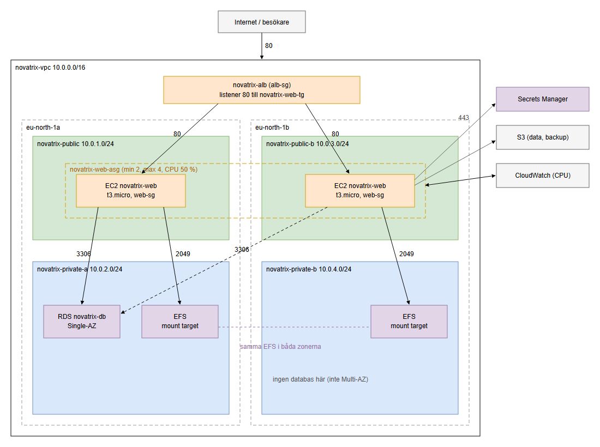

En sidvisning går så här:

1. Besökaren surfar till lastbalanserarens DNS-namn. Det pekar på en nod i varje zon.
2. `novatrix-alb-sg` släpper in port 80 från alla.
3. Listenern på port 80 skickar allt till target groupen `novatrix-web-tg`.
4. Target groupen väljer en server som är healthy, i zon a eller zon b.
5. Servern hämtar inlägget från databasen och bilderna från EFS. Båda ligger i de privata subnäten.
6. Svaret går samma väg tillbaka. Besökaren ser aldrig serverns egen adress.

Servrarna släpper bara in port 80 från lastbalanserarens security group. Att surfa direkt till en server ger timeout.

## Delmoment 1: Repo

Allt ligger i mappen `v47`. Koden ligger samlad i `scripts/`:

| Fil | Vad den gör |
|---|---|
| `scripts/natverk.yaml` | Nätet från v46 med ett andra publikt subnät och en security group för lastbalanseraren |
| `scripts/data.yaml` | Databasen, EFS och två hemligheter i Secrets Manager |
| `scripts/webb.yaml` | Bara rollen och instance profilen. Servern är borta härifrån |
| `scripts/skala.yaml` | Lastbalanseraren, target groupen, launch templaten, gruppen och skalningsregeln (VG) |
| `scripts/deploy.ps1` | Bygger alla fyra stackarna i rätt ordning |
| `scripts/destroy.ps1` | River dem i omvänd ordning |
| `scripts/siteurl.sh` | Pekar om WordPress till lastbalanseraren. Användes bara i konsolversionen |
| `scripts/lasttest.sh` | Håller båda kärnorna på en server sysselsatta i 15 minuter |
| `kalkylbladVG.pdf` | Kostnadsberäkningen från AWS Pricing Calculator |
| `bevis/` | Utskrifter från testerna som text |
| `images/` | Skissen och skärmbilder |

## Delmoment 2: AMI och launch template

### Nätet först

En lastbalanserare kräver subnät i minst två zoner. Nätet hade bara ett publikt subnät, i zon a. Jag lade till det här i `natverk.yaml`:

- `novatrix-public-b` med 10.0.3.0/24 i zon b, kopplat till samma route table och NACL som `novatrix-public`.
- `novatrix-alb-sg` som släpper in 80 och 443 från alla. 443 står öppen för den dag Novatrix har ett eget domännamn.
- `novatrix-web-sg` tar nu bara emot port 80 från `novatrix-alb-sg`.
- Två nya exporter, `public-b-subnet-id` och `alb-sg-id`, som kodversionen behöver.

```yaml
        - IpProtocol: tcp
          FromPort: 80
          ToPort: 80
          SourceSecurityGroupId: !Ref AlbSecurityGroup
```

Efter deploy svarade servern inte längre på port 80 från min dator. SSH fungerade fortfarande:

```
PS> Test-NetConnection 13.51.241.87 -Port 80 | Select-Object TcpTestSucceeded
TcpTestSucceeded
----------------
           False
```

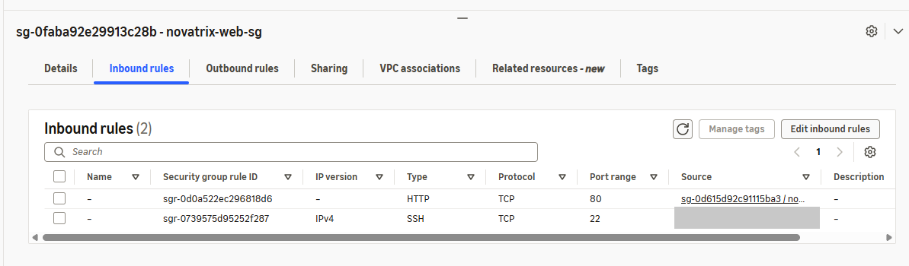

Det gav ett problem. WordPress måste installeras innan jag gör en AMI, men nu nådde jag inte servern på port 80. Jag lade till en tillfällig regel i konsolen för port 80 från min IP, installerade WordPress och skrev ett inlägg med en bild. Sedan tog jag bort regeln igen.

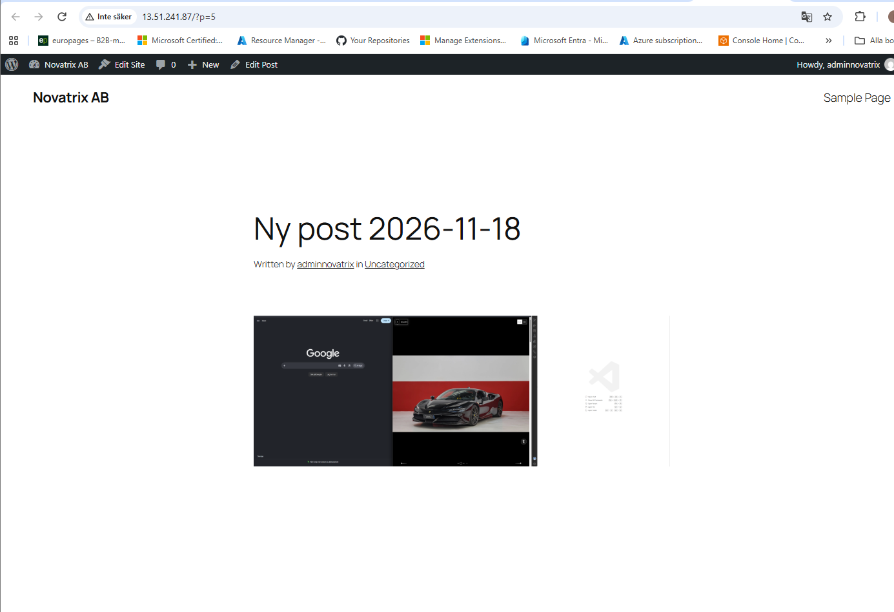

### Det jag skapade i konsolen

Resten av konsolversionen skapade jag i den här ordningen. Tabellen gäller även Delmoment 3 och 4.

| Resurs | Namn | Mina val |
|---|---|---|
| AMI | `novatrix-web-v47` | Av `novatrix-web` med fungerande WordPress, Reboot instance ikryssad |
| Launch template | `novatrix-web-lt` | AMI:n ovan, `t3.micro`, `novatrix-key`, inget subnät, `novatrix-web-sg`, `novatrix-ec2-s3-read`, detailed monitoring, taggen `Name` = `novatrix-web` |
| Target group | `novatrix-web-tg` | Instances, HTTP 80, `novatrix-vpc`, health check `/wp-login.php` med svarskod 200, inga mål registrerade |
| Lastbalanserare | `novatrix-alb` | Internet-facing, `novatrix-public` och `novatrix-public-b`, bara `novatrix-alb-sg`, listener HTTP 80 till `novatrix-web-tg` |
| Auto Scaling-grupp | `novatrix-web-asg` | `novatrix-web-lt`, båda publika subnäten, `novatrix-web-tg`, ELB health check med grace period 300, desired 2, min 2, max 4, target tracking på CPU 50 % |

I AMI:n följer allt med som finns på servern: WordPress, `wp-config.php` med lösenordet och salts. Raden i `/etc/fstab` som monterar EFS följer också med.

Subnätet står med flit tomt i launch templaten. Står det ett subnät där kan gruppen inte sprida servrarna över två zoner. Detailed monitoring gör att CPU mäts varje minut i stället för var femte. Då reagerar gruppen efter några minuter i stället för en kvart.

## Delmoment 3: Auto Scaling-gruppen

Gruppens val står i tabellen under Delmoment 2. Den startade två servrar, en i varje zon. Efter några minuter var båda healthy.

Jag gjorde ett misstag när jag skapade gruppen. Jag lät "No scaling policies" stå kvar. Gruppen höll då två servrar men skalade aldrig. Det märkte jag först i lasttestet, när CPU låg på 100 % utan att något hände. `describe-policies` gav ett tomt svar. Jag lade till regeln i efterhand under Automatic scaling, med namnet `cpu-50` och warmup 300.

## Delmoment 4: Lastbalanseraren

Target groupen och lastbalanseraren står i tabellen under Delmoment 2. Inga mål registrerades för hand. Gruppen lägger själv in sina servrar i target groupen.

### WordPress adress

WordPress sparar sin egen adress i databasen, i `siteurl` och `home`. Där stod den gamla serverns IP. Utan ändring hade varje länk skickat besökaren förbi lastbalanseraren till en server som snart inte fanns. Jag körde `siteurl.sh` på den gamla servern med lastbalanserarens DNS-namn:

```bash
mysql -h "$DB_HOST" -u admin -p -e \
  "UPDATE wordpress.wp_options SET option_value='http://$ALB_DNS'
   WHERE option_name IN ('siteurl','home');"
```

Första gången stannade skriptet med `$'\r': command not found`. Filen hade Windows radslut. Bash på servern läste det osynliga tecknet som en del av kommandot. Jag tog bort tecknen på servern med `sed -i 's/\r$//' siteurl.sh` och bytte till LF i VS Code. Sedan gick det.

### Den gamla servern bort, i koden

`novatrix-web` skapades av webbstacken. Därför tog jag bort den i `webb.yaml` och inte med Terminate. Change setet visade bara en ändring:

```
PS> aws cloudformation deploy --template-file webb.yaml --stack-name novatrix-webb `
>>   --capabilities CAPABILITY_NAMED_IAM --no-execute-changeset `
>>   --parameter-overrides DataBucket=novatrix-data-80idralt-01 `
>>   BackupBucket=novatrix-backup-80idralt-01
...
|  Remove  |  WebServer  |
```

Sajten svarade fortfarande via lastbalanseraren när servern var borta, nu från gruppens två servrar.

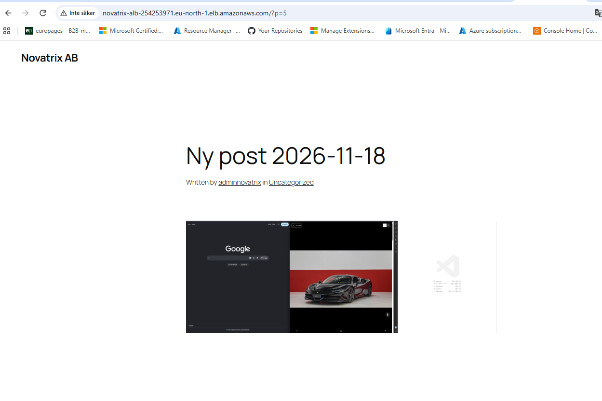

## Delmoment 5: Kostnaden per månad

Beräkningen är gjord i AWS Pricing Calculator: [länk](https://calculator.aws/#/estimate?id=a7b8de06a4a44a529d89bde70fe6cceab45556ee). PDF:en ligger i `kalkylbladVG.pdf`. Den räknar på kodversionen, som har två hemligheter.

| Del | USD per månad |
|---|---|
| EC2, 2 st t3.micro med 8 GB gp3 och detailed monitoring | 21,31 |
| Application Load Balancer | 23,03 |
| RDS MariaDB db.t3.micro, Single-AZ, 20 GB | 14,81 |
| Publika IPv4, 4 st (2 servrar och 2 för lastbalanseraren) | 14,60 |
| Secrets Manager, 2 hemligheter | 0,80 |
| EFS, 1 GB | 0,30 |
| S3, 1 GB | 0,02 |
| **Normal last, 2 servrar** | **74,87** |
| Tillägg: 2 servrar till och deras 2 adresser | 28,61 |
| **Utskalat, 4 servrar** | **103,48** |

Bilden nedan visar kalkylatorn. Överst står 133,10, men den summan gäller aldrig. Kalkylatorn lägger ihop alla tre grupperna, även jämförelsen med Multi-AZ som inte ingår: 74,87 + 28,61 + 29,62 = 133,10. Normal last är 74,87 och utskalat är 103,48, som i tabellen ovan.

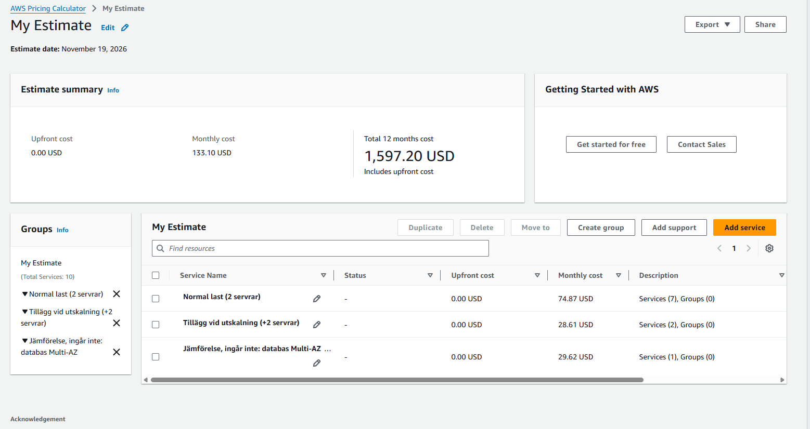

### Antaganden

- Stockholm, On-Demand, alla 730 timmar i månaden.
- Lastbalanseraren med låg trafik: 1 GB per månad, 1 ny anslutning och 1 förfrågan per sekund.
- 1 GB på EFS och 1 GB i S3. Sajten är liten.
- EFS räknas som Elastic utan trafik. Kalkylatorn har inget val för Bursting, som är det vi använder.
- Utskalat betyder att gruppen ligger på max hela månaden. Max 4 är alltså taket. En månad kan aldrig kosta mer än 103,48 för den här delen, hur hög lasten än blir.

### Det som kostar mest

1. **Lastbalanseraren, 23,03.** Den kostar per timme den finns, även när ingen surfar. Trafiken är en liten del.
2. **Servrarna, 21,31 för två.** De går dygnet runt eftersom min är 2.
3. **Databasen, 14,81.** Även den går dygnet runt.

Strax efter kommer de publika IPv4-adresserna med 14,60. Varje publik adress kostar per timme. Det är nästan lika mycket som två servrar.

### Om databasen vore Multi-AZ

Med en reserv i den andra zonen kostar databasen 29,62 i stället för 14,81. Normal last blir då 89,68. Det är priset för att ta bort den sista felpunkten, se [Om databasen försvinner](#om-databasen-försvinner).

### Det som inte är med

- Dataöverföring ut till internet.
- NAT gateway, eftersom jag valde bort den. Se [varför publika subnät](#varför-publika-subnät-och-ingen-nat-gateway).
- CloudWatch-larmen som target tracking skapar.
- Moms.

## Delmoment 6: Verifiering i konsolversionen

Arkitekturen är dokumenterad med skissen under [Arkitektur](#arkitektur). Den här verifieringen gjordes på konsolversionen 18 november. Samma tester gjorde jag på kodversionen dagen efter, med alla utskrifter sparade som text. De finns under [VG: Bevis från kodversionen](#vg-bevis-från-kodversionen).

### Lasttest

Jag körde `lasttest.sh` på båda servrarna. Med last på bara en av två hamnar snittet runt 50 %, precis på målet. Då händer oftast ingenting.

Gruppen gick från 2 till 4 servrar på en gång. Target tracking räknade ut att 100 % mot målet 50 % kräver dubbelt så många servrar.

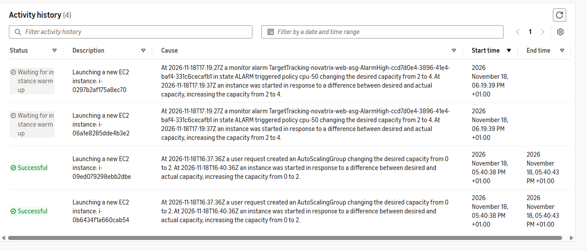

När lasten var stoppad tog gruppen bort en server i taget.

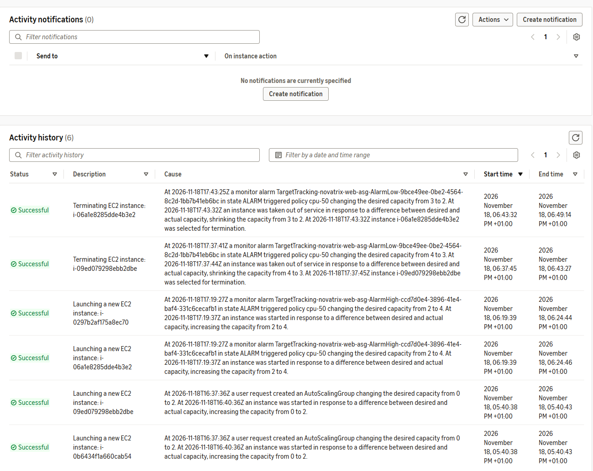

Hela förloppet i CPU-grafen, svensk tid. Från 17:58 till 18:12 låg CPU på 100 % utan att något hände. Det var när skalningsregeln saknades. Dippen strax efter är när jag lade till regeln och startade om lasten. Gruppen skalade ut 18:19. Sedan stoppade jag lasten och CPU föll till nästan noll.

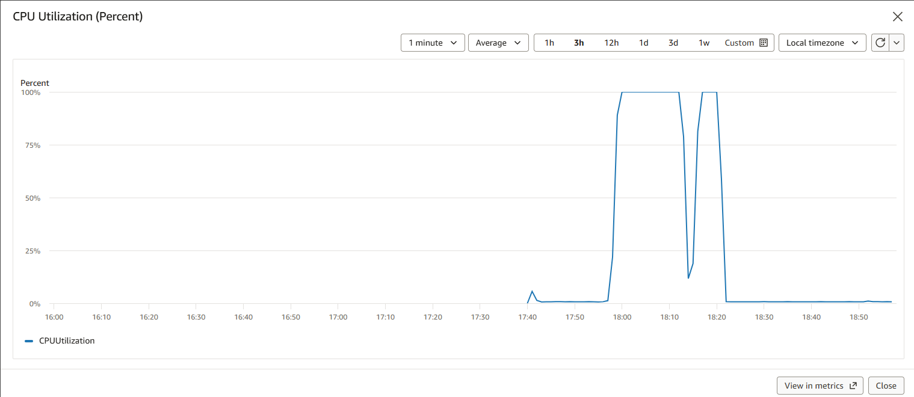

### Failover

Jag avslutade en server med Terminate medan en loop frågade sajten var femte sekund. Det blev ett enda fel. Sedan svarade sajten igen från den andra servern. Gruppen startade en ersättare i samma zon.

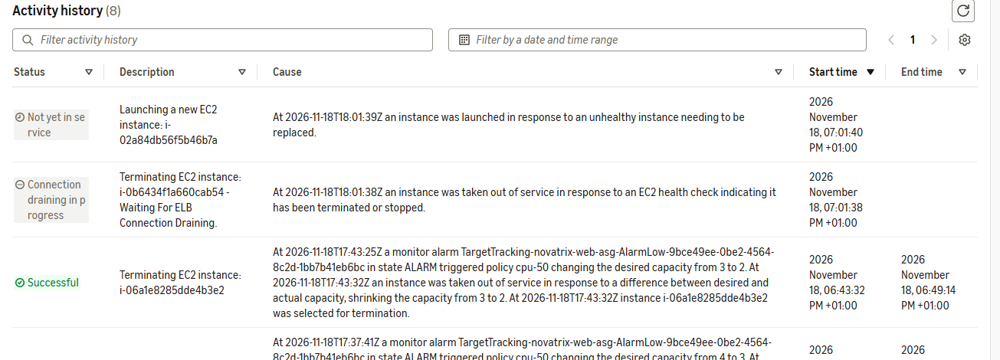

Hela förloppet 18 november som text, tiderna i UTC:

```
18:01:40  At 18:01:39Z an instance was launched in response to an unhealthy instance
          needing to be replaced.
18:01:38  At 18:01:38Z an instance was taken out of service in response to an EC2
          health check indicating it has been terminated or stopped.
17:43:32  ...AlarmLow... in state ALARM triggered policy cpu-50 changing the desired
          capacity from 3 to 2.
17:37:45  ...AlarmLow... in state ALARM triggered policy cpu-50 changing the desired
          capacity from 4 to 3.
17:19:39  ...AlarmHigh... in state ALARM triggered policy cpu-50 changing the desired
          capacity from 2 to 4.
16:40:38  At 16:37:36Z a user request created an AutoScalingGroup changing the desired
          capacity from 0 to 2.
```

Hela filen ligger i [bevis/activity.txt](bevis/activity.txt).

### Rivning av konsolversionen

Det som klickades fram ligger utanför stackarna. Det måste bort för hand, i rätt ordning:

1. Gruppen först. Annars startar den nya servrar för varje server jag tar bort.
2. Lastbalanseraren och target groupen.
3. Launch templaten.
4. AMI:n med Deregister, sedan dess snapshot under Elastic Block Store, Snapshots. Snapshoten kostar annars.
5. `destroy.ps1` för stackarna.

AMI:n hade ändå inte gått att använda igen. Efter en riv och res finns ett nytt EFS och ett nytt lösenord. AMI:n innehåller de gamla.

## VG: Skalningen som kod

### Ett fjärde lager

| Stack | Innehåll | Läser från |
|---|---|---|
| novatrix-natverk | VPC, två publika och två privata subnät, NACL, fyra security groups | ingen |
| novatrix-data | Databasen, EFS, lösenordet till databasen och lösenordet till WordPress-admin | nätet |
| novatrix-webb | Rollen och instance profilen | data |
| novatrix-skala | Lastbalanseraren, target groupen, listenern, launch templaten, gruppen och skalningsregeln | nätet, data och webb |

Allt som har med skalningen att göra ligger i `skala.yaml`. Det är de delar som klickades fram i G. AMI:n behövs inte längre. Servrarna startar från en ren Amazon Linux och installerar sig själva.

| Resurs i `skala.yaml` | Typ |
|---|---|
| `LoadBalancer` | `AWS::ElasticLoadBalancingV2::LoadBalancer` |
| `TargetGroup` | `AWS::ElasticLoadBalancingV2::TargetGroup` |
| `Listener` | `AWS::ElasticLoadBalancingV2::Listener` |
| `LaunchTemplate` | `AWS::EC2::LaunchTemplate` |
| `WebGroup` | `AWS::AutoScaling::AutoScalingGroup` |
| `CpuPolicy` | `AWS::AutoScaling::ScalingPolicy` med `TargetTrackingScaling` |

### Vad skalningsstacken importerar

| Från | Export | Används till |
|---|---|---|
| natverk | `vpc-id` | Target groupen |
| natverk | `public-subnet-id`, `public-b-subnet-id` | Lastbalanseraren och gruppen |
| natverk | `alb-sg-id` | Lastbalanseraren |
| natverk | `web-sg-id` | Launch templaten |
| data | `efs-id`, `db-endpoint` | User data |
| data | `db-secret-arn`, `wp-admin-secret-arn` | User data |
| webb | `web-profile-name` | Launch templaten |

Webbstacken exporterar nu bara namnet på instance profilen. Det var det enda launch templaten behövde därifrån.

### Varför subnätet och alb-sg ligger i nätverksstacken

`novatrix-web-sg` ligger i `natverk.yaml` och pekar på `novatrix-alb-sg`. Hade `alb-sg` legat i `skala.yaml` hade nätverksstacken behövt importera från skalningsstacken, samtidigt som skalningsstacken importerar från nätet. Två stackar som väntar på varandra går inte att bygga. Nätet hör dessutom ihop. Skalningsstacken kan rivas och byggas om utan att nätet rörs.

### Ordningen

Bygg: nät, data, webb, skala. Varje lager läser exporter från lagren före.

Riv: skala, webb, data, nät. CloudFormation vägrar riva en stack vars exporter fortfarande används. Skala måste också bort först av ett annat skäl. Gruppen har servrar i nätets subnät. Så länge den finns kan nätet inte rivas.

### Gruppen följer alltid senaste versionen

```yaml
      LaunchTemplate:
        LaunchTemplateId: !Ref LaunchTemplate
        Version: !GetAtt LaunchTemplate.LatestVersionNumber
```

När user data ändras skapar CloudFormation en ny version av launch templaten. Versionsnumret ändras. Då ser CloudFormation att gruppen berörs. Det är det som startar utrullningen.

### Utrullning en server i taget

```yaml
    UpdatePolicy:
      AutoScalingRollingUpdate:
        MinInstancesInService: 1
        MaxBatchSize: 1
        WaitOnResourceSignals: true
        PauseTime: PT20M
```

En server byts åt gången. Minst en är alltid kvar i trafik. Nästa server rörs inte förrän den nya har skickat en signal. Signalen skickas sist i user data, men först när `wp-login.php` svarar 200 på servern:

```bash
for i in $(seq 1 30); do
  curl -sf -o /dev/null http://localhost/wp-login.php && break
  sleep 10
done
curl -sf -o /dev/null http://localhost/wp-login.php
/opt/aws/bin/cfn-signal -e 0 --region ${AWS::Region} \
  --stack ${AWS::StackName} --resource WebGroup
```

Utan signalen väntar CloudFormation bara en fast tid. Då kan den byta den andra servern innan den första är klar. Svarar servern aldrig skickas ingen signal. Då rullas hela uppdateringen tillbaka.

En ny version rullas ut med en parameter:

```powershell
.\deploy.ps1 -AppVersion 2
```

`AppVersion` står i user data. Ett nytt värde ger alltså en ny version av launch templaten.

### Nya servrar utan handpåläggning

Webbstacken från v46 skrev redan `wp-config.php` från Secrets Manager. Med många servrar som startar var för sig blev tre saker nya.

**Adressen.** I G pekade jag om adressen i databasen för hand. Nu står den i `wp-config.php`. User data får lastbalanserarens DNS-namn från samma stack:

```bash
define('WP_HOME', 'http://${LoadBalancer.DNSName}');
define('WP_SITEURL', 'http://${LoadBalancer.DNSName}');
```

`${LoadBalancer.DNSName}` fylls i av CloudFormation innan servern finns. `WP_HOME` och `WP_SITEURL` går före värdena i databasen. `siteurl.sh` behövs inte. Byggs lastbalanseraren om får den ett nytt namn. De nya servrarna får det automatiskt.

**Samma salts på alla servrar.** WordPress signerar inloggningskakan med salts. Hämtar varje server egna salts loggas besökaren ut varje gång lastbalanseraren byter server. Saltsen ligger därför i en fil på EFS, som alla servrar redan delar. `wp-config.php` läser filen:

```bash
require __DIR__ . '/wp-content/novatrix-salts.php';
```

**Vem gör det som bara ska göras en gång?** Saltfilen ska skapas en gång. WordPress ska installeras en gång. Men gruppen startar två servrar i samma sekund. Jag löste det med en mapp på EFS:

```bash
if mkdir $WPC/novatrix-first 2>/dev/null; then
  cp -rn /tmp/wp-content-start/. $WPC/
  { echo "<?php"; curl -sS https://api.wordpress.org/secret-key/1.1/salt/; } \
    > $WPC/novatrix-salts.tmp
  mv $WPC/novatrix-salts.tmp $WPC/novatrix-salts.php
  ...
  wp core install --path=/var/www/html --allow-root ...
fi
```

`mkdir` lyckas bara för en server, även om två försöker samtidigt. Den servern fyller EFS med teman, skapar saltfilen och installerar WordPress med WP-CLI. De andra väntar tills saltfilen finns och WordPress är installerat. På en sajt som redan körs finns mappen. Då hoppas allt det här över.

Lösenordet till WordPress-admin skapas av AWS i `data.yaml`, på samma sätt som databasens. Ingen behöver öppna installationsguiden.

## VG: Bevis från kodversionen

Alla utskrifter ligger som text i [bevis/](bevis/). Tiderna från AWS är i UTC. Tiderna från mina loopar är svensk tid, alltså en timme senare.

### Fyra stackar med ett kommando

```
PS> .\deploy.ps1
natverk.yaml validerad
data.yaml validerad
webb.yaml validerad
skala.yaml validerad
...
Successfully created/updated stack - novatrix-skala

Klart. Sidan: http://novatrix-alb-1143307936.eu-north-1.elb.amazonaws.com (version 1)
```

Sidan svarade direkt med sajtnamnet Novatrix. Ingen installationsguide.

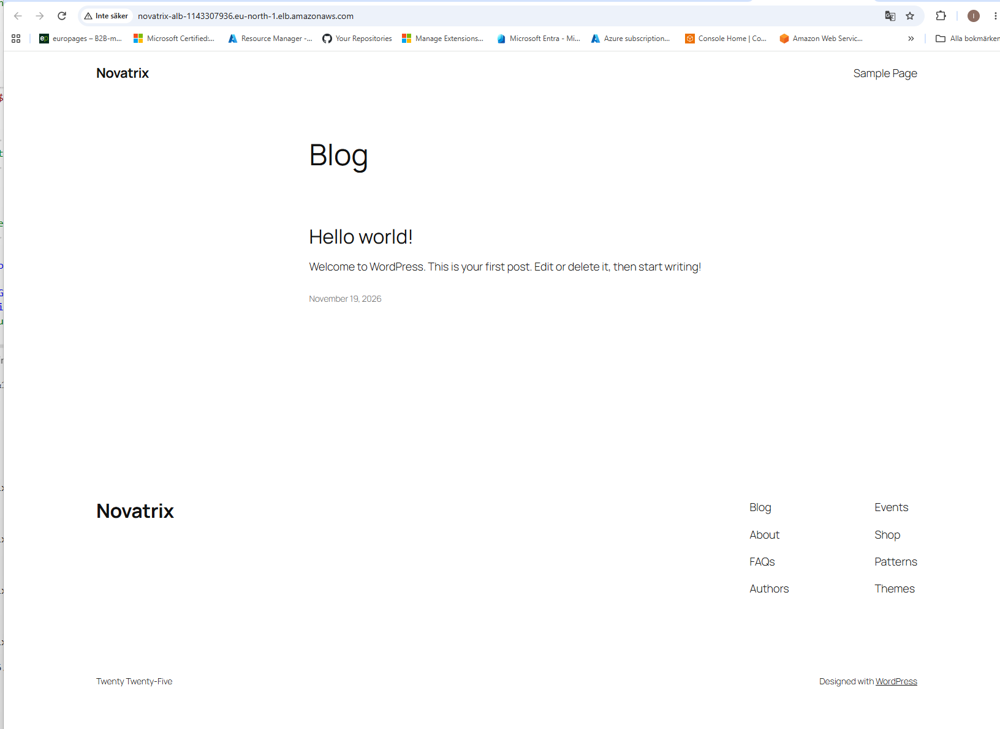

### Inloggningen håller

Jag loggade in i wp-admin och laddade om sidan åtta gånger. Jag var inloggad hela tiden, fast lastbalanseraren skickade mig mellan servrarna. Båda servrarna läser alltså samma salts.

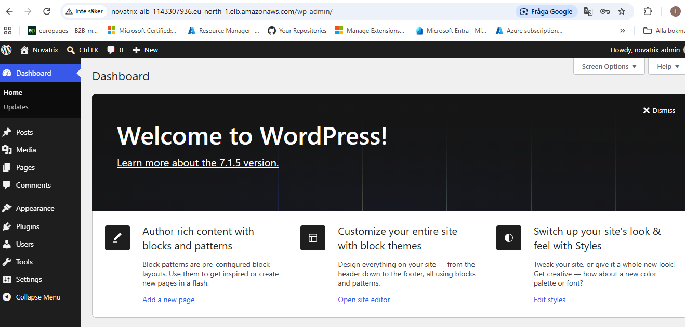

Att trafiken verkligen fördelas syns i `version.txt`. Varje server skriver sin version, sitt id och sin zon där:

```
v1 i-077a7f3362f04c159 eu-north-1b
v1 i-04a5e7d4d076d1967 eu-north-1a
v1 i-077a7f3362f04c159 eu-north-1b
v1 i-04a5e7d4d076d1967 eu-north-1a
```

### Låset fungerade

Ur startloggen på båda servrarna. Den första vann låset, installerade WordPress och skickade sin signal. Den andra väntade:

```
--- server 13.60.7.124 ---
+ mkdir /var/www/html/wp-content/novatrix-first
+ mv /var/www/html/wp-content/novatrix-salts.tmp /var/www/html/wp-content/novatrix-salts.php
Success: WordPress installed successfully.
+ /opt/aws/bin/cfn-signal -e 0 --region eu-north-1 --stack novatrix-skala --resource WebGroup
--- server 13.48.149.57 ---
+ mkdir /var/www/html/wp-content/novatrix-first
+ /opt/aws/bin/cfn-signal -e 0 --region eu-north-1 --stack novatrix-skala --resource WebGroup
```

### Friska servrar och larmen i vila

```
|  i-04a5e7d4d076d1967 |  healthy  |  None |
|  i-077a7f3362f04c159 |  healthy  |  None |
```

```
|  TargetTracking-novatrix-web-asg-AlarmHigh-365cc2fd-...  |  OK    |
|  TargetTracking-novatrix-web-asg-AlarmLow-89e1281e-...   |  ALARM |
```

AlarmLow står i ALARM i vila. CPU är låg och larmet vill skala in. Gruppen kan inte, eftersom den redan ligger på min 2.

### Utrullning av version 2 utan avbrott

```
PS> .\deploy.ps1 -AppVersion 2
...
No changes to deploy. Stack novatrix-natverk is up to date
No changes to deploy. Stack novatrix-data is up to date
No changes to deploy. Stack novatrix-webb is up to date
Successfully created/updated stack - novatrix-skala

Klart. Sidan: http://novatrix-alb-1143307936.eu-north-1.elb.amazonaws.com (version 2)
```

En loop frågade `version.txt` varannan sekund under hela utrullningen. Här är bytet:

```
14:20:52 200 v1 i-077a7f3362f04c159 eu-north-1b
14:20:54 200 v1 i-077a7f3362f04c159 eu-north-1b
14:20:57 200 v2 i-0f197049efb80fded eu-north-1a
14:20:59 200 v2 i-0f197049efb80fded eu-north-1a
```

242 svar, 68 från v1 och 174 från v2. **Noll fel.**

Activity visar att servrarna byttes en i taget:

```
13:21:01  an instance was started ... increasing the capacity from 1 to 2.
13:20:54  instance i-077a7f3362f04c159 was taken out of service in response to a user request.
13:19:41  an instance was started ... increasing the capacity from 1 to 2.
13:19:37  instance i-04a5e7d4d076d1967 was taken out of service in response to a user request.
```

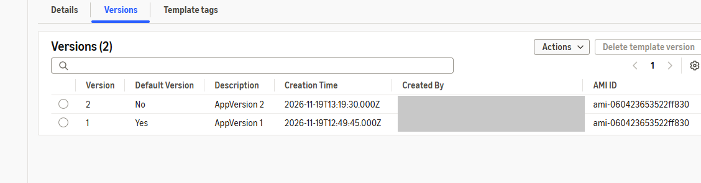

### Lasttest

CPU-snittet för gruppen minut för minut, ur CloudWatch, svensk tid:

| Tid | CPU | Vad som hände |
|---|---|---|
| 14:34 | 0,8 % | Vila |
| 14:35 | 11,6 % | Lasten startade på båda servrarna |
| 14:36 till 14:38 | 100 % | Tre minuter över målet |
| 14:39 | 100 % | AlarmHigh i ALARM. Gruppen startade två servrar |
| 14:41 | 100 % | Fyra servrar healthy |
| 14:43 | 6,8 % | Jag stoppade lasten med `pkill yes` |
| 14:58 | 0,9 % | En server togs bort |
| 15:04 | 0,9 % | En server till togs bort. Tillbaka på två |

```
|  TargetTracking-novatrix-web-asg-AlarmHigh-365cc2fd-...  |  ALARM |
|  TargetTracking-novatrix-web-asg-AlarmLow-89e1281e-...   |  OK    |
```

```
|  i-0b407b8c5ecd3d6e3 |  healthy  |  None |
|  i-0b0b0600348440276 |  healthy  |  None |
|  i-073ad4a51bd99cdb6 |  healthy  |  None |
|  i-0f197049efb80fded |  healthy  |  None |
```

Orsakerna ur Activity:

```
14:04:12  ...AlarmLow... in state ALARM triggered policy ... changing the desired
          capacity from 3 to 2.
13:58:54  ...AlarmLow... in state ALARM triggered policy ... changing the desired
          capacity from 4 to 3.
13:39:55  ...AlarmHigh... in state ALARM triggered policy ... changing the desired
          capacity from 2 to 4.
```

### Failover

Jag avslutade en server medan en loop frågade `wp-login.php` varannan sekund:

```
PS> aws ec2 terminate-instances --instance-ids i-0f197049efb80fded
|  i-0f197049efb80fded |  shutting-down  |
```

```
15:07:13 200
15:07:15 FEL
15:07:17 200
15:07:19 FEL
15:07:21 FEL
15:07:23 200
15:07:30 FEL
15:07:32 200
15:07:40 FEL
15:07:42 200
15:07:44 200
```

74 svar med 200 och 5 fel. Alla fel kom inom 25 sekunder. Efter 15:07:42 svarade allt. Gruppen reagerade samma sekund:

```
14:07:43  an instance was launched in response to an unhealthy instance needing to be replaced.
14:07:41  an instance was taken out of service in response to an EC2 health check
          indicating it has been terminated or stopped.
```

```
|  i-0663c055050b57a5e |  healthy  |  None |
|  i-0b407b8c5ecd3d6e3 |  healthy  |  None |
```

Varför fem fel nu och noll vid utrullningen förklarar jag under [Fel på en server](#fel-på-en-server).

### Inlägg med bild

Bilden ligger på EFS. Den syntes varje gång jag laddade om, oavsett vilken server som svarade.

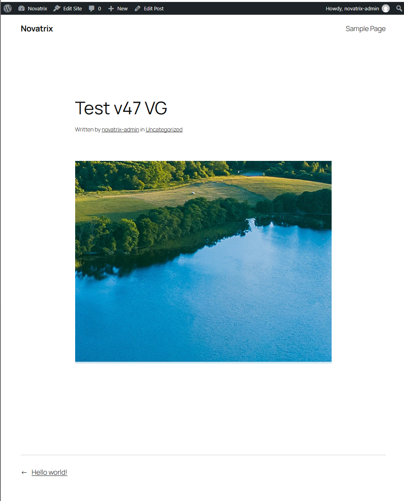

### Felet jag hittade

I Activity från första deploy såg jag något som inte stämde:

```
13:03:58  an instance was taken out of service in response to an ELB system health
          check failure.
13:01:58  an instance was taken out of service in response to an ELB system health
          check failure.
12:49:55  a user request update of AutoScalingGroup ... changing the desired capacity
          from 0 to 2.
```

De två första servrarna blev aldrig friska. Efter 12 minuter byttes de ut. Ersättarna fungerade. Stacken blev ändå klar, eftersom ersättarna hann skicka sina signaler inom 20 minuter.

Servrarna var borta, men AWS sparar konsolutskriften en stund. Där stod det:

```
cloud-init[1951]: cp: cannot create regular file
  '/var/www/html/./wp-content/themes/twentytwentyfive/patterns/page-cv-bio.php': File exists
cloud-init[1951]: cp: cannot create directory
  '/var/www/html/./wp-content/themes/twentytwentyfour/assets/fonts/jost': File exists
...
cloud-init[1951]: Failed to run module scripts-user
```

Båda servrarna kopierade WordPress teman till det tomma EFS i samma sekund. När den ena hade skapat en fil försökte den andra skapa samma. `cp` svarade "File exists". Skriptet har `set -e` och stannade därför direkt, på båda servrarna. Ersättarna startade två minuter isär mot ett EFS som redan var fyllt. Därför fungerade de.

Felet syns bara när två servrar startar samtidigt mot ett tomt EFS. Det händer vid första deploy och efter varje riv och res. Utrullningen byter en server i taget och gick aldrig in i det.

Rättningen följer samma tanke som låset. Alla servrar kopierar WordPress till sin egen disk men lägger `wp-content` åt sidan. Bara den server som vinner låset kopierar `wp-content` till EFS.

```bash
mv /tmp/wordpress/wp-content /tmp/wp-content-start
cp -r /tmp/wordpress/. /var/www/html/
```

`set -e` gjorde rätt. En server som stannar blir aldrig healthy och byts ut. En server som fortsätter halvfärdig hade varit svårare att hitta.

### Riv och res

Jag rev allt med `destroy.ps1` och byggde upp igen med `deploy.ps1`. Det blev ett nytt EFS, en ny databas, nya hemligheter och ett nytt namn på lastbalanseraren. Activity hade nu bara två rader:

```
15:20:32  ...changing the desired capacity from 0 to 2. ... an instance was started
          ... increasing the capacity from 0 to 2.
15:20:32  ...changing the desired capacity from 0 to 2. ... an instance was started
          ... increasing the capacity from 0 to 2.
```

Inga fel. Servrarna startade 15:20:30 och stacken var klar 15:22:23. Båda servrarna installerade sig och signalerade på under två minuter. Med felet tog samma steg över 14 minuter.

Den här gången syns det i loggen att bara vinnaren kopierade till EFS:

```
--- server 16.16.187.8 ---
+ mkdir /var/www/html/wp-content/novatrix-first
+ cp -rn /tmp/wp-content-start/. /var/www/html/wp-content/
+ mv /var/www/html/wp-content/novatrix-salts.tmp /var/www/html/wp-content/novatrix-salts.php
Success: WordPress installed successfully.
+ /opt/aws/bin/cfn-signal -e 0 --region eu-north-1 --stack novatrix-skala --resource WebGroup
--- server 13.60.12.183 ---
+ mkdir /var/www/html/wp-content/novatrix-first
+ /opt/aws/bin/cfn-signal -e 0 --region eu-north-1 --stack novatrix-skala --resource WebGroup
```

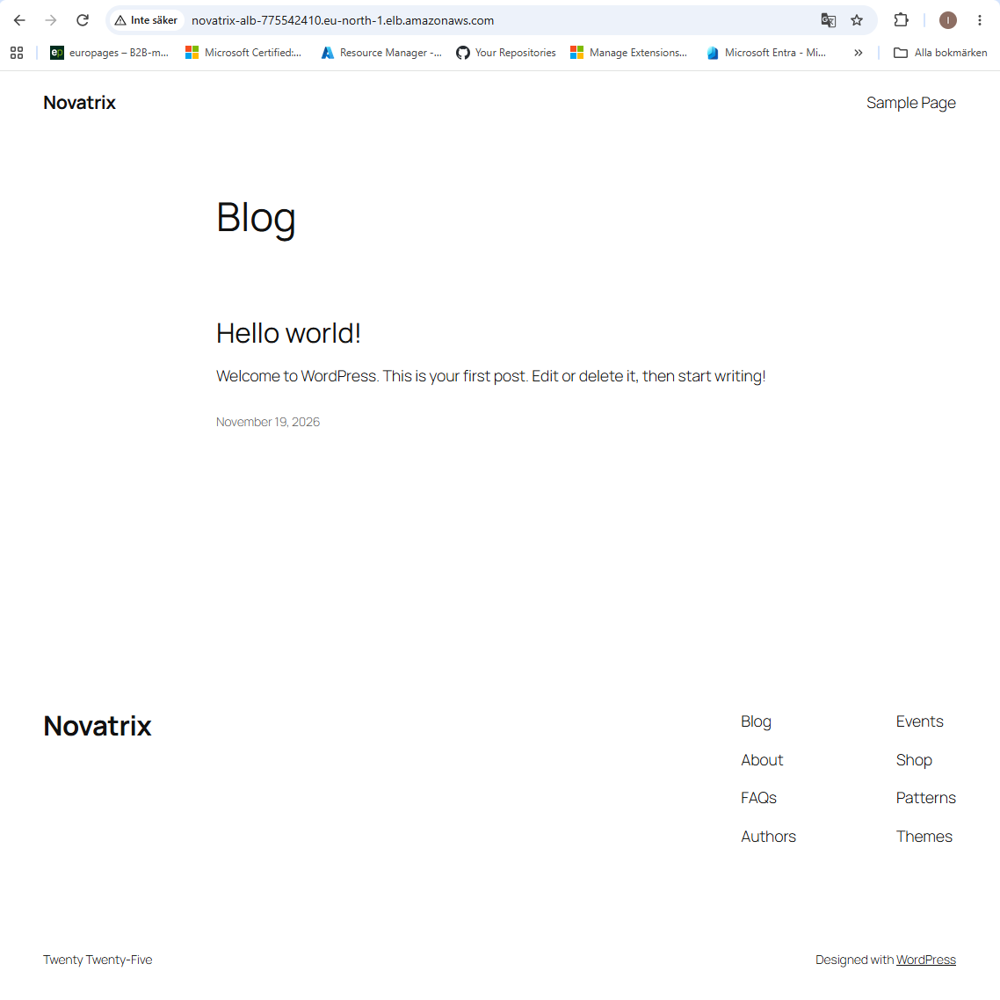

Inlägget med bilden fanns inte kvar. Databasen och EFS är nya. Det är väntat. Innehållet sparas med `backup.sh` från v46 före en rivning.

Till sist rev jag allt och kontrollerade att kontot var tomt:

```
Stackar:
Databaser:
Lastbalanserare:
Körande servrar:
```

## VG: Så svarar lösningen på last och fel

### Vid last

1. Fler besökare betyder mer PHP att köra. CPU stiger.
2. Gruppen tittar på snittet för alla servrar. När det legat över 50 % i tre minuter går larmet AlarmHigh till ALARM.
3. Policyn räknar ut ett nytt desired och höjer det. Med 100 % mot målet 50 % gick det från 2 till 4 direkt.
4. Nya servrar startar från launch templaten och installerar sig.
5. När `wp-login.php` svarat 200 två gånger i rad är de healthy och får trafik.
6. Lasten delas på fler servrar och snittet sjunker.

I testet tog det cirka 5 minuter från att lasten började till att gruppen startade servrar. Det tog cirka 6 till 7 minuter tills de fick trafik. Tiden går åt till tre saker. Larmet väntar tre minuter så att en kort topp inte startar servrar i onödan. Servern ska installera sig. Health checken ska godkänna den.

De nya servrarna drar själva mycket CPU medan de installerar. Därför räknas deras CPU inte in förrän efter warmup, 300 sekunder. Annars hade gruppen trott att lasten fortsatte öka och startat ännu fler.

### Vid lugn

När CPU sjunker väntar larmet AlarmLow i 15 minuter innan det går till ALARM. Sedan tar gruppen bort en server i taget. I testet tog det 16 minuter från att lasten stoppades till första borttagningen. Den andra kom 5 minuter senare.

Det går långsammare än att skala ut med flit. Att starta en server för sent ger långsamma sidor. Att ta bort en för tidigt kan betyda att den behövs igen fem minuter senare. Servern som tas bort avregistreras först och får 30 sekunder på sig att avsluta pågående anrop.

### Fel på en server

1. En server kraschar eller slutar svara.
2. Lastbalanseraren märker det inte direkt. Health checken frågar var 15:e sekund.
3. Efter två misslyckade svar i rad räknas servern som unhealthy och får ingen trafik. Under tiden svarar den andra servern för alla.
4. Gruppen ser att den har färre friska servrar än desired. Den avslutar den trasiga och startar en ersättare, helst i samma zon.
5. Efter ett par minuter är ersättaren healthy.

I testet blev det 5 fel under 25 sekunder. Under den tiden skickade lastbalanseraren ungefär vartannat anrop till en server som redan var död. Vid utrullningen blev det inga fel alls. Skillnaden är hur servern försvann. När gruppen själv tar bort en server avregistreras den först och töms på anrop. När en server kraschar finns ingen sådan förvarning. Då är det health checken som bestämmer hur länge felen pågår. Jag satte 15 sekunder och två försök i stället för standardvärdena 30 sekunder och fem försök.

Gruppen använder lastbalanserarens health check och inte bara EC2:s egen. I mitt test märkte EC2-kollen felet först, eftersom servern var avstängd. Hade servern levt men Apache eller databaskopplingen slutat svara hade bara lastbalanserarens check märkt det. Med den byts även sådana servrar ut.

Att avsluta en server är inte samma sak som att ändra desired. När jag avslutar en server står desired kvar på 2. Gruppen ser att en saknas och startar en ersättare. När policyn sänker desired tas en server bort utan att någon ersätter den.

### Fel i en zon

Det har jag inte kunnat testa. Det går inte att stänga av en zon. Så här ska det fungera:

- Lastbalanseraren har en nod i varje zon. Noden i den trasiga zonen tas bort ur DNS-svaret. Besökarna hamnar på noden i den andra zonen.
- Servern i den trasiga zonen blir unhealthy. Gruppen startar en ersättare i den zon som fungerar, så att antalet blir två igen. När zonen är tillbaka flyttar gruppen tillbaka en server så att det blir en i varje.
- EFS har en mount target i varje zon och fungerar från båda.

Min 2 är det som gör det här möjligt. Med min 1 hade den enda servern kunnat stå i den zon som försvann.

### Om databasen försvinner

Här finns den felpunkt som är kvar. Databasen är Single-AZ och finns i en zon.

Går databasen ner svarar `wp-login.php` med fel på alla servrar. Alla blir unhealthy samtidigt. När alla mål är unhealthy skickar lastbalanseraren trafik till alla ändå. Besökarna får ett databasfel från WordPress. Gruppen börjar dessutom byta ut servrar som egentligen är friska. Det hjälper inte, eftersom felet sitter i databasen.

Lösningen är Multi-AZ. Då finns en reserv i den andra zonen som tar över av sig själv. Den kostar 14,81 USD till per månad, alltså dubbelt för databasen. För en liten sajt valde jag bort det i v45. Det beslutet står jag fast vid så länge Novatrix klarar ett avbrott på några minuter. Är sajten viktig för försäljningen är Multi-AZ det första jag lägger till.

## Det viktigaste jag lärde mig

### Servrarna får inte ha något eget

Gruppen tar bort servrar hela tiden, vid inskalning, vid failover och vid utrullning. Därför får inget viktigt ligga bara på en server. Inläggen ligger i databasen, bilderna på EFS och lösenorden i Secrets Manager. När jag rev en server försvann ingenting.

### Alla servrar måste ha samma salts

Saltsen signerar inloggningen, ungefär som en stämpel på handen. Lastbalanseraren skickar mig till olika servrar vid varje klick. Har servrarna olika salts känner nästa server inte igen min stämpel och jag blir utloggad. Därför ligger saltsen i en fil på EFS. Jag laddade om wp-admin åtta gånger och var inloggad hela tiden.

### Bara en server får göra det som görs en gång

Det här lärde jag mig den hårda vägen. De två första servrarna startade samtidigt och kopierade samma filer till EFS. De krockade och båda stannade. Nu tar den första servern ett lås, en mapp på EFS som bara kan skapas en gång. Den servern gör jobbet och den andra väntar.

### Lastbalanseraren skickar bara till friska servrar

Lastbalanseraren frågar varje server efter wp-login.php var 15:e sekund. Den sidan svarar bara när både PHP och databasen fungerar. Svarar en server fel två gånger i rad får den inga besökare. När jag stängde av en server blev det några fel i 25 sekunder. Sedan svarade allt igen från den andra servern.

### Det går snabbt att skala ut men långsamt att skala in

Det tog ungefär 5 minuter innan gruppen startade nya servrar. Det tog 16 minuter innan den började ta bort dem igen. Det är med flit. Att starta servrar för sent ger långsamma sidor. Att ta bort dem för tidigt kan betyda att de behövs igen direkt.

### En AMI blir gammal men user data gör det inte

En AMI är som ett foto av en server. Den minns databasen och EFS från den dag den togs. Efter en riv och res pekade den på saker som inte fanns längre. User data hämtar det som gäller just nu varje gång en server startar. Därför fungerade min riv och res utan att jag rörde något.

## VG: Varför jag har valt som jag gjort

### Varför wp-login.php som health check?

`/` svarar med en omdirigering om adressen inte stämmer. En omdirigering räknas inte som 200. `wp-login.php` svarar 200 bara när PHP, `wp-config.php` och databasen fungerar. Den testar alltså det som besökaren behöver. En statisk fil hade bara testat Apache. Då hade en server med trasig databaskoppling fått trafik.

### Varför 2, 2 och 4?

Min 2 ger en server i varje zon. Försvinner en finns den andra kvar medan gruppen startar en ersättare. Max 4 är taket för kostnaden. Ett fel som håller CPU uppe kan aldrig kosta mer än fyra servrar. För en liten sajt räcker fyra t3.micro till en rejäl topp.

### Varför CPU och varför 50 %?

Varje sidvisning i WordPress kör PHP. Därför följer CPU lasten bra. Det är också enkelt att framkalla i ett test.

50 % ger marginal för att en zon kan försvinna. Har vi två servrar på 50 % och den ena faller, får den andra dubbelt så mycket att göra. Den hamnar på ungefär 100 % och klarar sig precis tills ersättaren är igång. Med ett mål på 80 % hade den gått över 100 % och sidorna hade blivit långsamma eller slutat svara.

### Varför t3.micro och fler servrar i stället för en större?

En större server finns fortfarande i en zon. Den löser lasten men inte felpunkten. Fler små servrar i två zoner löser båda.

t3.micro har 2 vCPU och 1 GB minne. I vila låg CPU under 1 %. Nackdelen är att t3 är en burstable typ. Den sparar krediter när den vilar och gör av med dem vid toppar. Ligger lasten högt länge blir den långsammare eller kostar extra. Vid ständigt hög last hade jag valt t3.small eller en typ som inte är burstable.

### Varför två zoner och inte tre?

Stockholm har tre zoner. En tredje hade krävt ett tredje publikt subnät och min 3 för att ha en server i varje. Det är en server till hela tiden, ungefär 10,66 USD i månaden plus en adress. För en liten sajt räcker det att en zon kan försvinna.

### Varför publika subnät och ingen NAT gateway?

Det vanliga i produktion är att bara lastbalanseraren ligger publikt och servrarna privat. Men servrarna behöver internet när de startar. De installerar paket, hämtar WordPress och pratar med Secrets Manager och CloudFormation. Från ett privat subnät kräver det en NAT gateway. Den kostar ungefär lika mycket som lastbalanseraren.

Jag lade därför servrarna i de publika subnäten och skyddar dem med security groups. Port 80 tas bara emot från lastbalanseraren. SSH tas bara emot från min IP. Databasen och EFS ligger kvar i de privata subnäten.

### Varför 30 sekunder deregistration delay?

Standardvärdet är 300 sekunder. En sidvisning i WordPress tar en bråkdel av en sekund. 30 sekunder räcker för att pågående anrop ska bli klara. Med 300 hade varje inskalning och varje byte i utrullningen väntat fem minuter i onödan.

### Varför 600 sekunder grace period?

En server från en AMI var klar på en minut eller två. I G räckte därför 300. Med user data installerar servern allt själv. Är grace period för kort kan gruppen döma ut en server som bara inte är klar än. Då hamnar den i en loop av nya servrar.

### Varför user data och inte en AMI?

En AMI blir gammal. Efter en riv och res pekar den på ett EFS och ett lösenord som inte finns. Den måste göras om för hand. User data hämtar alltid aktuella värden. Nackdelen är att starten tar längre tid och att servern behöver internet för att installera.

### Varför HTTP och inte HTTPS?

Ett certifikat från AWS Certificate Manager är gratis men kräver ett domännamn som man äger. Lastbalanserarens namn slutar på amazonaws.com. Det är inte mitt. Port 443 står redan öppen i `novatrix-alb-sg`. Med en egen domän behövs ett certifikat, en listener på 443 och en CNAME till lastbalanseraren. Lastbalanserarens namn ändras vid varje riv och res, så CNAME:n måste då uppdateras.

### Servrarna är stateless

En server ska kunna avslutas när som helst utan att något går förlorat. Gruppen gör det vid inskalning, vid failover och vid utrullning.

| Det som ändras | Var det ligger |
|---|---|
| Inlägg, sidor och användare | Databasen |
| Bilder, teman och tillägg | EFS |
| Salts | EFS |
| `wp-config.php` | Skrivs av user data vid varje start |
| Lösenorden | Secrets Manager |

Tillägg som installeras i wp-admin hamnar på EFS och syns därför på alla servrar. En uppdatering av själva WordPress i wp-admin hamnar däremot bara på den server som svarade. Den ska göras i user data och rullas ut. Apaches loggar ligger på servern och försvinner med den.

### Säkerheten

| Lager | Hur |
|---|---|
| Internet | Bara lastbalanseraren tar emot webbtrafik |
| Servrarna | Port 80 bara från `novatrix-alb-sg`. SSH bara från min IP. I produktion hade SSH gått via en bastion eller varit stängd |
| Databas och EFS | Bara från `novatrix-web-sg`, som förut |
| Rollen | Samma roll på alla servrar. Den får läsa de två hemligheterna och inget mer |
| Lösenorden | Skapas av AWS. Står aldrig i repot. User data stänger av loggningen med `set +x` runt dem |

### Vad är kod och vad var klickat?

| | Konsolversionen (G) | Kodversionen (VG) |
|---|---|---|
| Nätet | Kod | Kod |
| Databas, EFS, hemligheter, roll | Kod | Kod |
| AMI | Klickad | Behövs inte |
| Launch template, target group, lastbalanserare, grupp | Klickade | Kod i `skala.yaml` |
| WordPress adress | `siteurl.sh` för hand | `WP_HOME` i user data |
| Installation av WordPress | Guiden i webbläsaren | WP-CLI i user data |

Utanför stackarna ligger bara bucketarna och key pairet, av samma skäl som i v46.

## Så återskapar du miljön

Det här behövs i kontot först:

- Key pair `novatrix-key`
- Bucketarna `novatrix-data-80idralt-01` och `novatrix-backup-80idralt-01`

Bygger du i ett annat konto byter du de tre värdena överst i `deploy.ps1`.

Bygg allt:

```powershell
aws login
cd v47/scripts
.\deploy.ps1
```

Det tar ungefär 20 minuter, mest för databasen. Skriptet väntar tills båda servrarna har installerat WordPress. På slutet skriver det ut adressen. Sidan svarar direkt.

Lösenordet till WordPress-admin hämtas så här. Användarnamnet är `novatrix-admin`.

```powershell
$Q = "Exports[?Name=='novatrix-wp-admin-secret-arn'].Value"
$Arn = aws cloudformation list-exports --query $Q --output text
$Json = aws secretsmanager get-secret-value --secret-id $Arn `
    --query SecretString --output text
($Json | ConvertFrom-Json).password
```

Rulla ut en ny version:

```powershell
.\deploy.ps1 -AppVersion 2
```

Skriptet skickar alltid ett värde. Utan `-AppVersion` blir det 1. Har version 2 rullats ut och skriptet körs utan flaggan rullas version 1 ut igen.

Riv allt:

```powershell
.\destroy.ps1
```

Skriptet river skala, webb, data och nät i den ordningen. Databasen och EFS försvinner med datastacken. Kör `backup.sh` från v46 på en server först om innehållet ska sparas.

## Filerna i repot

| Fil | Innehåll |
|---|---|
| [natverk.yaml](https://github.com/80idralt/aws/blob/master/v47/scripts/natverk.yaml) | VPC, två publika och två privata subnät, NACL, fyra security groups och nio exporter |
| [data.yaml](https://github.com/80idralt/aws/blob/master/v47/scripts/data.yaml) | Databasen, EFS, lösenordet till databasen och lösenordet till WordPress-admin |
| [webb.yaml](https://github.com/80idralt/aws/blob/master/v47/scripts/webb.yaml) | Rollen och instance profilen |
| [skala.yaml](https://github.com/80idralt/aws/blob/master/v47/scripts/skala.yaml) | Lastbalanseraren, target groupen, listenern, launch templaten med user data, gruppen och skalningsregeln |
| [deploy.ps1](https://github.com/80idralt/aws/blob/master/v47/scripts/deploy.ps1) | Validerar och bygger de fyra stackarna |
| [destroy.ps1](https://github.com/80idralt/aws/blob/master/v47/scripts/destroy.ps1) | River stackarna i omvänd ordning |
| [siteurl.sh](https://github.com/80idralt/aws/blob/master/v47/scripts/siteurl.sh) | Pekar om WordPress till lastbalanseraren, bara konsolversionen |
| [lasttest.sh](https://github.com/80idralt/aws/blob/master/v47/scripts/lasttest.sh) | Lasttestet |
| [bevis/](https://github.com/80idralt/aws/tree/master/v47/bevis) | Alla utskrifter som text |
