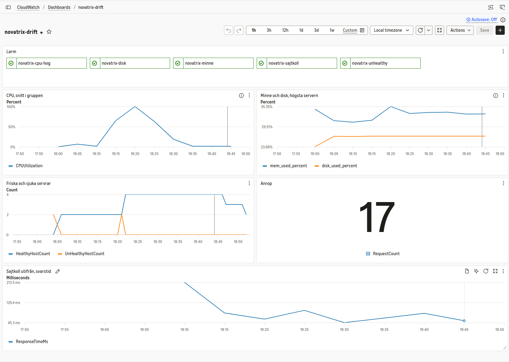
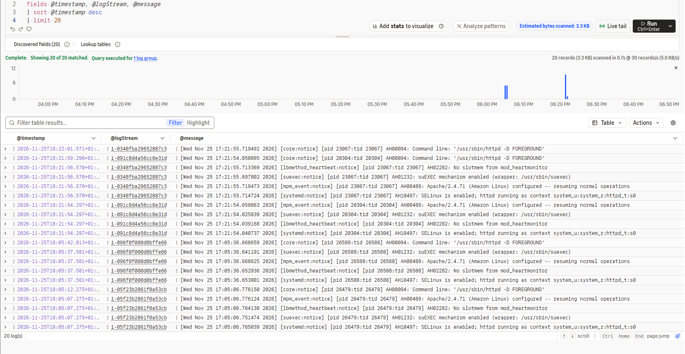
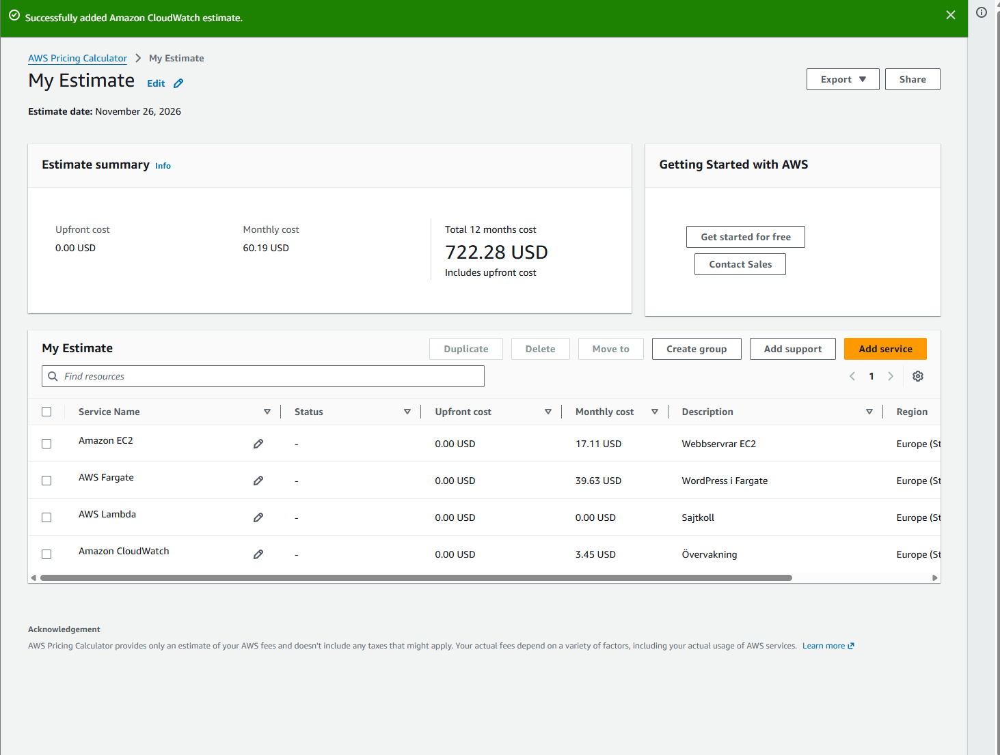
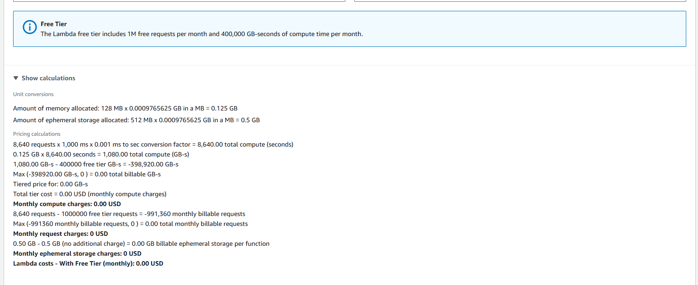

# AWS Uppgift 7 (v48): Monitorering och cloud native

**Namn:** Idris Altun

**Kurs:** AWS, MOV25

**Datum:** 2026-11-26

**Repo:** https://github.com/80idralt/aws/tree/master/v48

## Sammanfattning

I v47 fick Novatrix en sajt som klarar last och fel. Gruppen startar och tar bort servrar själv. Det gav ett nytt problem. Ingen människa vet längre vilka servrar som finns just nu. Apaches loggar låg på servrarna och försvann med dem. Jag kunde inte se hur sajten mådde utan att logga in på servrar som kanske inte fanns om en kvart.

Nu skickar varje server minne, disk och Apaches loggar till CloudWatch. Det sker från första sekunden, utan att någon rör servern. Fem larm bevakar gruppen och skickar mejl både när något går fel och när det är över. En dashboard visar allt på en sida. En liten Lambda kollar sajten utifrån var femte minut, precis som en besökare.

Allt är kod. Övervakningen är ett femte lager, `overvakning.yaml`. Agenten, loggrupperna och agentens inställningar ligger i webblagret. Jag har lasttestat, rivit allt och byggt upp det från noll. Efter tre minuter stod alla fem larmen i OK igen.

Sajtkollen är mitt första steg mot cloud native. Nästa steg är att köra WordPress i Fargate i stället för på egna servrar. Jag har räknat på vad det kostar och vad det ger. Det är dubbelt så dyrt i pengar men sparar arbete. Varför jag ändå tycker att det är rätt väg står under [VG: Cloud native-strategin](#vg-cloud-native-strategin).

## Innehåll

1. [Delmoment 5: Varför central monitorering är viktig](#delmoment-5-varför-central-monitorering-är-viktig)
2. [Så hänger det ihop](#så-hänger-det-ihop)
3. [Delmoment 1: Repo](#delmoment-1-repo)
4. [Delmoment 2: Central monitorering](#delmoment-2-central-monitorering)
5. [Delmoment 3: Central loggning](#delmoment-3-central-loggning)
6. [Delmoment 4: Cloud native i drift, sajtkollen](#delmoment-4-cloud-native-i-drift-sajtkollen)
7. [Lasttestet](#lasttestet)
8. [VG: Övervakningen som kod](#vg-övervakningen-som-kod)
9. [VG: Bevis, riv och bygg från noll](#vg-bevis-riv-och-bygg-från-noll)
10. [VG: Cloud native-strategin](#vg-cloud-native-strategin)
11. [Varför jag har valt som jag gjort](#varför-jag-har-valt-som-jag-gjort)
12. [Det jag lärde mig av mina misstag](#det-jag-lärde-mig-av-mina-misstag)
13. [Det jag skulle göra bättre](#det-jag-skulle-göra-bättre)
14. [Så återskapar du miljön](#så-återskapar-du-miljön)
15. [Filerna i repot](#filerna-i-repot)

## Delmoment 5: Varför central monitorering är viktig

Jag lägger förklaringen först eftersom den förklarar varför resten finns. Dokumentationen av monitoreringen och strategin är resten av den här texten.

I v47 började gruppen starta och ta bort servrar själv. Det är bra för sajten men det gör det svårare att veta vad som händer. Jag kan inte logga in på en server och titta, eftersom servern kanske inte finns om en kvart. Loggarna låg dessutom på servrarna och försvann när gruppen tog bort dem. Därför måste allt som visar hur servrarna mår skickas till ett ställe som finns kvar. Det stället är CloudWatch.

Jag övervakar fyra saker:

- **CPU** visar om servrarna orkar. Gruppen skalar redan på CPU, men bara upp till fyra servrar. Är CPU hög fast gruppen redan har fyra servrar hjälper inte skalningen längre. Då måste någon få veta det.
- **Minne** kan AWS inte se utan agenten, eftersom det finns inne i Linux. En t3.micro har bara 1 GB. Tar minnet slut slutar PHP att svara, även om CPU är låg.
- **Disk** fylls långsamt av loggar och uppladdningar. Det märks inte förrän servern stannar. Med ett larm vid 85 procent hinner jag göra något innan dess.
- **Loggarna** visar vad som hände. Siffrorna visar att något är fel. Loggarna visar varför. När allt ligger i CloudWatch kan jag söka i loggarna från alla servrar på en gång, även från servrar som inte finns längre.

Lastbalanseraren kan också dölja fel. En server som inte svarar får ingen trafik, så besökarna märker inget. Men om ingen vet om det kan vi stå med en frisk server och tro att vi har två.

### Det jag såg själv

Under lasttestet startade gruppen två nya servrar 18:21. Mellan 18:45 och 18:50 tog den bort två servrar igen. 18:53 sökte jag i error-loggen. Där fanns rader från alla fyra servrarna, fast två av dem inte fanns längre. Utan central loggning hade de raderna försvunnit med servrarna. Hade något gått fel på en av dem hade jag aldrig kunnat ta reda på vad.

Samma sak med larmen. Under testet byttes servrarna ut, men larmen fortsatte fungera. De tittar på gruppen och inte på en viss server.

### Tre frågor

Allt jag byggt svarar på en av tre frågor:

| Fråga | Det som svarar |
|---|---|
| Lever den? | Lastbalanserarens health check för varje server. Sajtkollen för hela sajten utifrån |
| Mår den? | CPU, minne och disk för servrarna. Svarstiden från sajtkollen |
| Vad hände? | Loggarna och larmens historik, även för servrar som inte finns längre |

Larmen säger till när svaret på någon av frågorna är fel, så att ingen behöver titta hela tiden. Dashboarden visar alla svar på en sida.

För mig är det viktigaste att jag får veta att något är fel innan en kund hör av sig.

## Så hänger det ihop

1. En server startar. User data installerar CloudWatch-agenten först av allt.
2. Agenten hämtar sina inställningar från Parameter Store, `AmazonCloudWatch-novatrix`.
3. Varje minut skickar den minne och disk till CloudWatch. Varje rad i Apaches loggar går till `/novatrix/httpd/access` och `/novatrix/httpd/error`. Varje server får en egen ström som heter som serverns id.
4. Larmen tittar på gruppen, inte på enskilda servrar. Går ett larm skickar det till SNS-ämnet `novatrix-larm`. Ämnet skickar mejl.
5. Var femte minut startar EventBridge Lambdan `novatrix-sajtkoll`. Den hämtar `wp-login.php` via lastbalanseraren och skickar svaret och svarstiden till CloudWatch.
6. Dashboarden `novatrix-drift` visar larmen, graferna och sajtkollen på en sida.

## Delmoment 1: Repo

Allt ligger i mappen `v48`. Koden ligger i `scripts/`. Nät och data är oförändrade från v47.

| Fil | Vad den gör | Nytt i v48 |
|---|---|---|
| `scripts/natverk.yaml` | Nätet | Inget |
| `scripts/data.yaml` | Databasen, EFS och hemligheterna | Inget |
| `scripts/webb.yaml` | Rollen för servrarna | Agentens rättigheter, agentens inställningar och de två loggrupperna |
| `scripts/skala.yaml` | Lastbalanseraren och gruppen | Agenten i user data och fyra nya exporter |
| `scripts/overvakning.yaml` | Femte lagret | Larmen, SNS, dashboarden och sajtkollen |
| `scripts/deploy.ps1` | Bygger alla fem stackarna | Frågar efter e-postadressen till larmen |
| `scripts/destroy.ps1` | River dem i omvänd ordning | Övervakningen rivs först |
| `scripts/sajtkoll.py` | Lambdans kod som egen fil | Samma kod som i `overvakning.yaml`, lättare att läsa |
| `scripts/logs-insights.txt` | Fyra sökfrågor för loggarna | |
| `scripts/lasttest.sh` | Håller båda kärnorna sysselsatta i 15 minuter | |
| `images/` | Skärmbilder | |

## Delmoment 2: Central monitorering

### Agenten

AWS ser CPU på en server utifrån. Minne och disk ser AWS inte. De finns bara inne i Linux. Därför behövs CloudWatch-agenten. Den installeras först i user data:

```bash
dnf install -y amazon-cloudwatch-agent
/opt/aws/amazon-cloudwatch-agent/bin/amazon-cloudwatch-agent-ctl \
  -a fetch-config -m ec2 -s -c ssm:${AgentConfigName}
```

`${AgentConfigName}` kommer från webbstacken. Agenten startar före allt annat. Går något senare i installationen fel har vi ändå siffror och loggar från servern.

Inställningarna ligger i Parameter Store som `AmazonCloudWatch-novatrix`. Så här ser hela värdet ut i `webb.yaml`:

```json
{
  "agent": {"metrics_collection_interval": 60, "run_as_user": "root"},
  "metrics": {
    "namespace": "CWAgent",
    "append_dimensions": {
      "AutoScalingGroupName": "${!aws:AutoScalingGroupName}",
      "InstanceId": "${!aws:InstanceId}"
    },
    "aggregation_dimensions": [["AutoScalingGroupName"]],
    "metrics_collected": {
      "mem": {"measurement": ["mem_used_percent"]},
      "disk": {"measurement": ["used_percent"], "resources": ["/"]}
    }
  },
  "logs": {
    "logs_collected": {
      "files": {
        "collect_list": [
          {"file_path": "/var/log/httpd/access_log",
           "log_group_name": "${AccessLogGroup}",
           "log_stream_name": "{instance_id}"},
          {"file_path": "/var/log/httpd/error_log",
           "log_group_name": "${ErrorLogGroup}",
           "log_stream_name": "{instance_id}"}
        ]
      }
    }
  }
}
```

Agenten mäter varje minut. Den mäter bara minne och disken `/`. Det är det AWS inte ser själv. Fler mätvärden hade kostat mer utan att svara på någon fråga jag har. `${AccessLogGroup}` och `${ErrorLogGroup}` fyller CloudFormation i med loggruppernas namn från samma stack.

Varje mätvärde får både serverns id och gruppens namn. `aggregation_dimensions` gör att CloudWatch dessutom räknar ihop alla servrar i gruppen. Larmen tittar på gruppen. När jag felsöker tittar jag på en server.

Rollen fick AWS egen policy `CloudWatchAgentServerPolicy`. Den låter agenten skicka mätvärden och loggar. Den låter den också läsa parametrar som börjar med `AmazonCloudWatch-`. Därför heter parametern så.

Så här kontrollerade jag att agenten skickar, med två servrar igång:

```powershell
$Asg = aws cloudformation describe-stacks --stack-name novatrix-skala `
  --query "Stacks[0].Outputs[?OutputKey=='AsgName'].OutputValue" --output text
aws cloudwatch list-metrics --namespace CWAgent `
  --dimensions "Name=AutoScalingGroupName,Value=$Asg" --recently-active PT3H `
  --query "Metrics[].[MetricName,length(Dimensions)]" --output table
```

```
----------------------------
|        ListMetrics       |
+---------------------+----+
|  disk_used_percent  |  1 |
|  mem_used_percent   |  2 |
|  disk_used_percent  |  5 |
|  disk_used_percent  |  5 |
|  mem_used_percent   |  2 |
|  mem_used_percent   |  1 |
+---------------------+----+
```

Siffran är antalet dimensioner. 1 är värdet för hela gruppen. Det är det larmen tittar på. 2 är minnet för en server, med gruppen och serverns id. 5 är disken för en server, med gruppen, serverns id, sökväg, enhet och filsystem. Två servrar ger två av varje.

### Larmen

| Larm | Vad det tittar på | När det larmar |
|---|---|---|
| `novatrix-cpu-hog` | CPU, snittet i gruppen | Över 70 % i 5 minuter |
| `novatrix-minne` | Minne, den server som har mest | Över 85 % i 5 minuter |
| `novatrix-disk` | Disken `/`, den server som har mest | Över 85 % i 5 minuter |
| `novatrix-unhealthy` | Servrar som inte klarar lastbalanserarens health check | Minst 1 i 3 minuter i rad |
| `novatrix-sajtkoll` | Om sajten svarar utifrån | Inget svar 2 gånger i rad, alltså 10 minuter |

Alla larm skickar mejl både vid ALARM och när de går tillbaka till OK. Varför jag valde just de här gränserna står under [Varför jag har valt som jag gjort](#varför-jag-har-valt-som-jag-gjort).

Larmen i kontot 26 november, med skalningens två larm under:

```powershell
aws cloudwatch describe-alarms --alarm-name-prefix novatrix- `
  --query "MetricAlarms[].[AlarmName,StateValue,Threshold]" --output table
```

```
--------------------------------------
|           DescribeAlarms           |
+---------------------+-----+--------+
|  novatrix-cpu-hog   |  OK |  70.0  |
|  novatrix-disk      |  OK |  85.0  |
|  novatrix-minne     |  OK |  85.0  |
|  novatrix-sajtkoll  |  OK |  1.0   |
|  novatrix-unhealthy |  OK |  1.0   |
+---------------------+-----+--------+
```

```
+---------------------------------------------------------+--------------------+--------+
|  TargetTracking-novatrix-web-asg-AlarmHigh-33d33fbb-... |  OK                |  50.0  |
|  TargetTracking-novatrix-web-asg-AlarmLow-e91f4d2c-...  |  INSUFFICIENT_DATA |  45.0  |
+---------------------------------------------------------+--------------------+--------+
```

Här syns skillnaden mellan de två sorterna. Skalningen agerar vid 50 % CPU. Mitt larm säger till först vid 70 %, när skalningen inte hinner med. AlarmLow stod i INSUFFICIENT_DATA eftersom det nyss hade skapats.

### Test av larmkedjan

Ett larm är inte klart förrän mejlet har kommit fram. Jag tvingade `novatrix-cpu-hog` till ALARM utan att något var fel:

```powershell
aws cloudwatch set-alarm-state --alarm-name novatrix-cpu-hog `
  --state-value ALARM --state-reason "Test av larmkedjan"
```

Mejlet kom direkt. Så här såg det ut, utan kontonummer och e-postadress:

```
Ämne: ALARM: "novatrix-cpu-hog" in EU (Stockholm)

Alarm Details:
- Name:                    novatrix-cpu-hog
- Description:             Average CPU in the web group is above 70 percent.
                           Check Activity in the group, is it at max 4?
                           Then decide if max should be raised.
- State Change:            OK -> ALARM
- Reason for State Change: Test av larmkedjan
- Timestamp:               Thursday 26 November, 2026 17:15:29 UTC
```

Orsaken "Test av larmkedjan" står i mejlet, så den som läser vet att inget är fel. Beskrivningen med vad man ska göra kommer också med. Larmets historik visar testet, som jag körde tre gånger:

```powershell
aws cloudwatch describe-alarm-history --alarm-name novatrix-cpu-hog `
  --history-item-type StateUpdate --max-items 5 `
  --query "AlarmHistoryItems[].[Timestamp,HistorySummary]" --output table
```

```
------------------------------------------------------------------------
|                         DescribeAlarmHistory                         |
+-----------------------------------+----------------------------------+
|  2026-11-26T18:18:33.023000+01:00 |  Alarm updated from OK to ALARM  |
|  2026-11-26T18:18:02.892000+01:00 |  Alarm updated from ALARM to OK  |
|  2026-11-26T18:17:08.313000+01:00 |  Alarm updated from OK to ALARM  |
|  2026-11-26T18:16:40.813000+01:00 |  Alarm updated from ALARM to OK  |
|  2026-11-26T18:15:29.244000+01:00 |  Alarm updated from OK to ALARM  |
+-----------------------------------+----------------------------------+
```

Varje gång gick larmet tillbaka till OK av sig självt inom någon minut. Vid nästa kontroll såg det att CPU egentligen var låg. Larmets riktiga test kom under [lasttestet](#lasttestet), när CPU gick upp på riktigt.

### Symptom och orsak

Larmen är av två slag:

| Slag | Larm | Vad det betyder |
|---|---|---|
| Symptom | `novatrix-sajtkoll`, `novatrix-unhealthy` | Något är fel nu. Besökare kan märka det |
| Orsak | `novatrix-cpu-hog`, `novatrix-minne`, `novatrix-disk` | Något håller på att bli fel. Besökarna märker inget än |

Båda behövs. Orsakslarmen ger tid att göra något innan det blir ett problem. Symptomlarmen är ändå viktigast. Ett mejl om att sajten inte svarar ska man läsa direkt. Ett mejl om att en disk är 85 % full kan vänta till morgonen.

### Varje larm säger vad man ska göra

Ett larm som bara säger att något är fel hjälper inte den som får mejlet. Därför står det i varje larms beskrivning vad man ska göra. Beskrivningen kommer med i mejlet.

| Larm | Beskrivningen i `overvakning.yaml` |
|---|---|
| `novatrix-cpu-hog` | Check Activity in the group, is it at max 4? Then decide if max should be raised. |
| `novatrix-minne` | Find the server in mem_used_percent per InstanceId, log in and check what uses the memory. |
| `novatrix-disk` | Find the server in disk_used_percent per InstanceId, look for growing files such as logs. |
| `novatrix-unhealthy` | Read Reason under Targets in the target group, then the error log. |
| `novatrix-sajtkoll` | Open the site, check the target group and the Lambda log for the error. |

### Två sorters larm

I kontot finns fler larm än mina fem. Skalningsregeln från v47 skapar två egna, `TargetTracking-...-AlarmHigh` och `AlarmLow`. De larmen gör något själva. De startar och tar bort servrar. Ingen människa behöver veta när de går.

Mina fem larm gör ingenting själva. De säger till en människa. Det är med flit. Att en server läggs till är normalt. Att gruppen har nått taket och CPU ändå är över 70 % är inte normalt. Då behöver någon tänka.

AlarmLow står nästan alltid i ALARM. Det betyder bara att CPU är låg och att gruppen gärna skulle skala in om den inte redan låg på min 2. Därför skickar jag inga mejl från de larmen. Det hade varit ett mejl i timmen som alla till slut slutar läsa.

### Dashboarden



Överst står de fem larmen. Det är det första man vill se. Är allt grönt behöver man inte läsa resten. Sedan kommer CPU, minne och disk, friska och sjuka servrar, antal anrop och sist svarstiden utifrån.

## Delmoment 3: Central loggning

### Loggrupperna

| Loggrupp | Innehåll | Sparas |
|---|---|---|
| `/novatrix/httpd/access` | Varje anrop till Apache | 14 dagar |
| `/novatrix/httpd/error` | Apaches fel och meddelanden | 14 dagar |
| `/aws/lambda/novatrix-sajtkoll` | Sajtkollens utskrifter | 14 dagar |

Varje server skriver till en egen ström som heter som serverns id. Då vet jag alltid vilken server en rad kommer ifrån, även när servern är borta.

### Sökningar i Log Analytics

Loggarna söks i CloudWatch Log Analytics, som tidigare hette Logs Insights. Frågorna finns i `logs-insights.txt`. Alla fyra filtrerar bort lastbalanserarens health checks. De är flera i minuten och dränker annars de riktiga besökarna.

**Fråga 1, anrop per svarskod.** Den här körde jag 24 november, en timme bakåt i `/novatrix/httpd/access`:

```
filter @message not like /ELB-HealthChecker/
| parse @message '* - - [*] "* * *" * * *' as ip, time, method, path, proto, status, bytes, rest
| stats count(*) as requests by status
| sort requests desc
```

```
Complete: Showing 2 of 35 matched. 377 records scanned.

status  requests
200     32
404     3
```

377 rader i loggen men bara 35 riktiga anrop. Resten var health checks. Det visar varför filtret behövs. 200 betyder att sidorna svarade. 404 är adresser som inte finns. Det är en snabb koll på om sajten mår bra.

**Fråga 2, anrop per server.** Samma tid:

```
filter @message not like /ELB-HealthChecker/
| stats count(*) as requests by @logStream
```

```
Complete: Showing 2 of 35 matched. 390 records scanned.

@logStream            requests
i-0a41e6b897699ed70   18
i-035cba3178bc5a56c   17
```

Lastbalanseraren delar alltså jämnt mellan de två servrarna.

**Fråga 3, de senaste serverfelen.** Den letar efter svar mellan 500 och 599. Den körde jag 25 november, tre timmar bakåt med hela lasttestet:

```
filter @message not like /ELB-HealthChecker/
| parse @message '* - - [*] "* * *" * * *' as ip, time, method, path, proto, status, bytes, rest
| filter status like /^5/
| sort @timestamp desc
| limit 20
| display @timestamp, @logStream, path, status
```

```
Complete: Showing 0 of 0 matched. 1144 records (156.1 KB) scanned.

No results.
```

Servrarna gav inte ett enda serverfel, inte ens när CPU låg på 100 %.

**Fråga 4, error-loggen.** Samma kväll i `/novatrix/httpd/error`:

```
fields @timestamp, @logStream, @message
| sort @timestamp desc
| limit 20
```

Ett urval av de 20 raderna, en per server:

```
Complete: Showing 20 of 20 matched.

Tid       @logStream           @message (förkortat, 25 november)
18:22:01  i-0348fba29652887c3  [core:notice] AH00094: Command line: '/usr/sbin/httpd ...'
18:21:59  i-091c8d4a56cc8e31d  [core:notice] AH00094: Command line: '/usr/sbin/httpd ...'
18:05:42  i-096f0f000d0bffe66  [core:notice] AH00094: Command line: '/usr/sbin/httpd ...'
18:05:12  i-05f23b2861f0a53cb  [core:notice] AH00094: Command line: '/usr/sbin/httpd ...'
```

Här syns fyra olika servrar i samma loggrupp. Två startade 18:05 när jag byggde miljön. Två startade 18:21 när gruppen skalade ut under lasttestet. Stapeldiagrammet i konsolen har två toppar, en för varje tillfälle:



Det är det viktigaste beviset för loggningen. Ingen loggade in på de nya servrarna. De startade, hämtade inställningen och började skicka loggar till samma ställe. Loggningen följer med när gruppen växer. När jag körde frågan 18:53 hade gruppen dessutom redan tagit bort två av servrarna. Deras rader fanns kvar ändå.

Två saker syns också i bilden. Alla rader är `notice`, vanliga startmeddelanden. Det finns inga `error`. Tiderna skiljer sig dessutom med en timme. `@timestamp` visar svensk tid. Apaches egen text visar UTC, eftersom servrarna går på UTC. Det är bra att veta när man jämför tider.

## Delmoment 4: Cloud native i drift, sajtkollen

Jag valde att köra en del av lösningen serverless direkt. Det är sajtkollen, en Lambda i Python 3.12:

```python
def lambda_handler(event, context):
    url = os.environ["SITE_URL"] + "/wp-login.php"
    start = time.time()
    try:
        with urllib.request.urlopen(url, timeout=10) as answer:
            ok = 1 if answer.status == 200 else 0
    except Exception as error:
        print("Check failed:", error)
        ok = 0
    ms = (time.time() - start) * 1000
    ...
    cloudwatch.put_metric_data(Namespace="Novatrix/SiteCheck", ...)
```

Den frågar `wp-login.php` via lastbalanseraren, precis som en besökare. Den skickar två värden till CloudWatch, `Available` som är 1 eller 0 och `ResponseTimeMs`. Adressen står inte i koden. Den kommer från skalningsstacken som miljövariabeln `SITE_URL`. Byggs lastbalanseraren om pekar sajtkollen ändå rätt.

En EventBridge-regel startar den var femte minut. Mellan körningarna finns ingenting som går. Ingen server, ingen process.

Första körningen startade jag själv. Den andra kom från klockan:

```
17:10:57 INIT_START Runtime Version: python:3.12...
17:10:58 START RequestId: 0192ac46-...
17:10:58 http://novatrix-alb-2110788239.eu-north-1.elb.amazonaws.com/wp-login.php ok=1 367 ms
17:10:58 REPORT Duration: 576.85 ms  Billed Duration: 993 ms  Memory Size: 128 MB
         Max Memory Used: 89 MB  Init Duration: 415.17 ms
17:11:51 START RequestId: 7ff3c249-...
17:11:51 http://novatrix-alb-2110788239.eu-north-1.elb.amazonaws.com/wp-login.php ok=1 60 ms
17:11:51 REPORT Duration: 261.13 ms  Billed Duration: 262 ms  Memory Size: 128 MB
         Max Memory Used: 90 MB
```

Skillnaden mellan raderna är intressant. Första gången fick AWS starta Python från början, en kallstart. Det tog 415 ms extra och den debiterade tiden blev 993 ms. Andra gången var miljön redan varm. Då blev det 262 ms. För en koll var femte minut spelar en kallstart ingen roll.

Varför jag valde just sajtkollen som första steg står under [VG: Cloud native-strategin](#vg-cloud-native-strategin).

## Lasttestet

Jag startade två `yes` på varje server, en per kärna, i 15 minuter. Det är samma sak som `lasttest.sh`. Jag startade dem med en loop från min dator så att jag slapp ha två fönster öppna:

```powershell
$Last = "nohup timeout 15m yes > /dev/null 2>&1 &"
foreach ($Ip in $Ips -split "\s+") {
    ssh -i "$HOME\.ssh\novatrix-key.pem" ec2-user@$Ip "$Last $Last"
}
```

`nohup` gör att lasten fortsätter när SSH stänger. `timeout` stoppar den efter 15 minuter även om jag glömmer.

Bilden högst upp under [Dashboarden](#dashboarden) visar hela förloppet, svensk tid:

1. **18:05.** Två servrar startar. De räknas som sjuka en kort stund medan de installerar WordPress. Sedan är båda friska.
2. **Cirka 18:15.** Lasten startar. CPU går mot 100 %.
3. **18:21.** Mejlet om `novatrix-cpu-hog` kommer. Samma minut har skalningen redan startat två servrar till.
4. **18:21.** De nya servrarna syns som en kort orange topp, sjuka medan de installerar sig. `novatrix-unhealthy` larmade ändå inte.
5. **18:20 till 18:35.** CPU sjunker när fyra servrar delar på lasten. Sedan tar lasten slut.
6. **18:45 till 18:50.** Gruppen tar bort en server i taget. Fyra blir tre och sedan två.
7. **Hela tiden.** Sajtkollen utifrån visade 45 till 100 ms. En besökare hade inte märkt något.

Mejlet i inkorgen:

```
Från:   AWS Notifications
Ämne:   ALARM: "novatrix-cpu-hog" in EU (Stockholm)
Tid:    18:21
```

Punkt 4 är den jag är mest nöjd med. Två servrar var sjuka i ungefär en minut. Ett larm som slår till direkt hade väckt någon för något helt normalt. Mitt larm kräver tre minuter i rad. Det fick ett riktigt test och gjorde rätt.

Punkt 3 visar skillnaden mellan de två sorters larm. Skalningen agerade själv. Mitt larm sa till mig. När fyra servrar delade på lasten sjönk snittet under 70 % och larmet gick tillbaka till OK.

## VG: Övervakningen som kod

### Ett femte lager

| Stack | Nytt i v48 | Läser från |
|---|---|---|
| novatrix-natverk | Inget | ingen |
| novatrix-data | Inget | nätet |
| novatrix-webb | Policyn, parametern och de två loggrupperna | data |
| novatrix-skala | Agenten i user data, exporterna `alb-full-name`, `tg-full-name`, `asg-name` och `site-url` | nät, data och webb |
| novatrix-overvakning | SNS, fem larm, dashboarden och sajtkollen | skala |

| Resurs i `overvakning.yaml` | Typ |
|---|---|
| `AlarmTopic`, `AlarmSubscription` | `AWS::SNS::Topic`, `AWS::SNS::Subscription` |
| `CpuAlarm`, `MemoryAlarm`, `DiskAlarm`, `UnhealthyAlarm`, `SiteAlarm` | `AWS::CloudWatch::Alarm` |
| `Dashboard` | `AWS::CloudWatch::Dashboard` |
| `SiteCheckLogGroup` | `AWS::Logs::LogGroup` |
| `SiteCheckRole` | `AWS::IAM::Role` |
| `SiteCheckFunction` | `AWS::Lambda::Function` |
| `SiteCheckSchedule` | `AWS::Events::Rule` |
| `SiteCheckPermission` | `AWS::Lambda::Permission` |

Ordningen är nu nät, data, webb, skala, övervakning. Rivningen går tvärtom och övervakningen går först.

### Först i konsolen, sedan som kod

Jag byggde inte allt som kod direkt. 24 november gjorde jag larmkedjan för hand först, för att se vad varje val betyder:

1. SNS: ämnet `novatrix-larm` och en prenumeration med e-post. Jag bekräftade i mejlet tills den stod som Confirmed.
2. CloudWatch, Create alarm: `novatrix-cpu-hog` på CPUUtilization under By Auto Scaling Group, Average, 5 minuter, över 70. Under Configure actions en notifiering för In alarm och en för OK till samma ämne.
3. Minne, disk och unhealthy med AWS CLI, samma inställningar som i tabellen under [Larmen](#larmen).
4. Test med `set-alarm-state`. Mejlen kom.
5. Dashboards, Create dashboard: `novatrix-drift` med larmen överst. Sedan Actions och View/edit source för att få JSON:en.

När allt fungerade skrev jag om det till `overvakning.yaml`, rev det klickade och lät koden bygga allt. Det var under det här steget jag hittade felet med `$Tg`, se [Ett larm som aldrig kunde gå](#ett-larm-som-aldrig-kunde-gå).

### Hur en ändring når servrarna

Agenten läser sina inställningar när servern startar. En server som redan kör märker alltså inte om jag ändrar något. Det löste jag redan i v47. När user data ändras får launch templaten en ny version. Gruppen har en `UpdatePolicy` som då byter servrarna en i taget och väntar tills den nya är frisk:

```yaml
    UpdatePolicy:
      AutoScalingRollingUpdate:
        MinInstancesInService: 1
        MaxBatchSize: 1
        WaitOnResourceSignals: true
        PauseTime: PT20M
```

Ändrar jag bara parametern i Parameter Store kör jag `.\deploy.ps1 -AppVersion 2`. Det ändrar user data och startar samma utrullning. Då läser alla nya servrar den nya inställningen. Sajten svarar hela tiden.

Beviset för att nya servrar får agenten utan att någon gör något finns i [fråga 4](#sökningar-i-log-analytics). Två servrar som gruppen själv startade under lasttestet skickade loggar direkt.

### Fyra knutar jag fick lösa

**Larmet på sjuka servrar behöver fullständiga namn.** Mätvärdet `UnHealthyHostCount` har två dimensioner, target groupen och lastbalanseraren. Värdet är inte namnet utan en del av ARN:et, till exempel `app/novatrix-alb/abc123`. Det ändras vid varje riv och res. Därför exporterar skalningsstacken det:

```yaml
  LoadBalancerFullName:
    Value: !GetAtt LoadBalancer.LoadBalancerFullName
    Export: {Name: !Sub "${Prefix}-alb-full-name"}
```

Övervakningen läser det med `!ImportValue`. Ingen behöver skriva av något.

**`${aws:...}` i agentens inställningar.** Agenten vill ha `${aws:AutoScalingGroupName}`. Den fyller själv i värdet på varje server. Men parametern skrivs med `!Sub`. `!Sub` tror att allt inom `${}` är dess eget. Utan ändring hade CloudFormation stoppat med ett fel. Lösningen är ett utropstecken:

```yaml
"AutoScalingGroupName": "${!aws:AutoScalingGroupName}",
```

`!Sub` tar bort utropstecknet och lämnar resten orört. I Parameter Store stod det sedan `${aws:AutoScalingGroupName}`, precis som agenten vill.

**Loggrupperna måste finnas före servrarna.** Finns inte loggruppen när agenten startar skapar agenten den själv. Då ägs den inte av någon stack. Den får ingen gräns för hur länge loggarna sparas. Den finns kvar efter rivningen och kostar pengar. Nästa deploy stoppar dessutom med att gruppen redan finns. Därför ligger loggrupperna i webbstacken, som byggs före skalningsstacken.

```yaml
  AccessLogGroup:
    Type: AWS::Logs::LogGroup
    DeletionPolicy: Delete
    UpdateReplacePolicy: Delete
    Properties:
      LogGroupName: !Sub /${Prefix}/httpd/access
      RetentionInDays: 14
```

Samma sak gäller Lambdans loggrupp. Lambda skapar annars `/aws/lambda/novatrix-sajtkoll` själv första gången den kör.

**Dashboarden utan kontonummer.** Konsolens dashboard sparas som JSON. Där står larmens fullständiga ARN med kontonumret i. Jag ville inte ha kontonumret i repot. Jag ville inte heller ha namn som slutar gälla vid nästa riv och res. Därför skrivs dashboarden med `!Sub` i listform:

```yaml
      DashboardBody: !Sub
        - |
          {"widgets": [
            {"type": "alarm", ...
             "properties": {"title": "Larm", "alarms": [
               "${CpuAlarm.Arn}", "${MemoryAlarm.Arn}", ...]}},
            ...
            "metrics": [["AWS/EC2", "CPUUtilization", "AutoScalingGroupName", "${AsgName}"]]
          ]}
        - AsgName: !ImportValue {"Fn::Sub": "${Prefix}-asg-name"}
          TgName: !ImportValue {"Fn::Sub": "${Prefix}-tg-full-name"}
          AlbName: !ImportValue {"Fn::Sub": "${Prefix}-alb-full-name"}
```

`${CpuAlarm.Arn}` fyller CloudFormation i när larmet finns. Listan längst ner hämtar namnen från skalningsstacken. JSON:en byggde jag först i konsolen och kopierade med View source. Sedan bytte jag alla fasta värden mot variabler.

### E-postadressen

Adressen står inte i någon fil. `deploy.ps1` frågar efter den när skriptet startar:

```powershell
param(
    [string]$Prefix = "novatrix",
    [string]$AppVersion = "1",
    [Parameter(Mandatory)][string]$AlarmEmail
)
```

Den skickas vidare som parameter till övervakningsstacken. Efter varje ny stack skickar AWS ett mejl. Prenumerationen måste bekräftas innan larmen kommer fram.

### Sajtkollens rättigheter

Lambdan får skriva i sin egen loggrupp och skicka mätvärden. Mätvärden får den bara skicka till sitt eget namespace:

```yaml
              - Effect: Allow
                Action: cloudwatch:PutMetricData
                Resource: "*"
                Condition:
                  StringEquals: {"cloudwatch:namespace": "Novatrix/SiteCheck"}
```

`PutMetricData` går inte att begränsa med en resurs. Villkoret är det enda sättet att hålla den inom sitt område. Kommer någon åt funktionen kan den inte skriva falska värden i `CWAgent` eller `AWS/EC2`.

## VG: Bevis, riv och bygg från noll

Jag rev allt med `destroy.ps1` och byggde upp det igen med `deploy.ps1`. Jag rörde ingenting i konsolen.

```
PS> .\destroy.ps1
River novatrix-overvakning ...
River novatrix-skala ...
River novatrix-webb ...
River novatrix-data ...
River novatrix-natverk ...
Klart. Kvar finns bara bucketarna och key pairet.
```

```
PS> .\deploy.ps1
natverk.yaml validerad
data.yaml validerad
webb.yaml validerad
skala.yaml validerad
overvakning.yaml validerad
...
Successfully created/updated stack - novatrix-overvakning

Klart. Sidan: http://novatrix-alb-2019584294.eu-north-1.elb.amazonaws.com (version 1)
```

Lastbalanseraren fick ett nytt namn. Dashboarden, larmen och sajtkollen följde med av sig själva.

Fyra larm gick direkt till OK. Sajtkollen gick först till ALARM 19:21 och sedan till OK 19:24:

Inkorgen efter ombyggnaden, alla från AWS Notifications:

```
19:21  OK: "novatrix-disk" in EU (Stockholm)
19:21  OK: "novatrix-cpu-hog" in EU (Stockholm)
19:21  OK: "novatrix-minne" in EU (Stockholm)
19:21  OK: "novatrix-unhealthy" in EU (Stockholm)
19:21  ALARM: "novatrix-sajtkoll" in EU (Stockholm)
19:24  OK: "novatrix-sajtkoll" in EU (Stockholm)
```

Det är precis vad jag ville. Sajtkollen räknar saknade värden som fel. Lambdan hade inte hunnit köra när larmet skapades. Så fort det första värdet kom gick larmet till OK. De andra fyra räknar saknade värden som OK. Mer om det under [Varför saknade värden räknas olika](#varför-saknade-värden-räknas-olika).

```
------------------------------
|       DescribeAlarms       |
+----------------------+-----+
|  novatrix-cpu-hog    |  OK |
|  novatrix-disk       |  OK |
|  novatrix-minne      |  OK |
|  novatrix-sajtkoll   |  OK |
|  novatrix-unhealthy  |  OK |
+----------------------+-----+
```

```
PS> aws lambda invoke --function-name novatrix-sajtkoll svar.json; Get-Content svar.json
{"ok": 1, "ms": 406}
```

Till sist rev jag allt igen och kontrollerade att kontot var tomt. Stackar, larm och Lambda-funktioner gav tomma svar.

## VG: Cloud native-strategin

### Vad cloud native betyder för Novatrix

För mig betyder cloud native att låta AWS sköta så mycket som möjligt. Då kan Novatrix lägga tiden på sajten i stället för på servrarna. Det finns tre nivåer:

| Nivå | Det vi sköter själva | Hos Novatrix |
|---|---|---|
| Server (EC2) | Linux, uppdateringar, agenten och installationen | WordPress i dag |
| Container (Fargate) | Bara vår image med appen | WordPress, nästa steg |
| Serverless (Lambda) | Bara koden | Sajtkollen, gjort |

Ju längre ner i tabellen, desto mindre behöver vi sköta själva. Vi betalar AWS för resten.

### Där Novatrix är i dag

Mycket är redan tjänster som AWS sköter. Databasen ligger i RDS och filerna på EFS. Lastbalanseraren, Auto Scaling, Secrets Manager och nu CloudWatch sköts också av AWS. Det enda vi fortfarande sköter själva är webbservrarna. Därför handlar nästa steg om dem.

### Min plan i tre steg

**Steg 1: små jobb i Lambda. Gjort.** Jag valde sajtkollen som första steg för att den inte rör sajten. Om något går fel med Lambdan fungerar sajten ändå. Jag kunde lära mig Lambda, EventBridge och rättigheter utan att riskera något. Den behövdes också på riktigt, eftersom inget av de andra larmen ser sajten som en besökare gör.

**Steg 2: WordPress i Fargate.** Det är det stora steget. Det beskriver jag nedan.

**Steg 3: händelser.** När bilder laddas upp kan en Lambda göra mindre versioner av dem. Då slipper webbservrarna det jobbet. Men det kräver att WordPress sparar bilderna i S3 i stället för på EFS, med ett tillägg. Därför tar jag det sist.

Varje steg tas först när det förra har sina loggar och larm på plats. Sajtkollen fick sin loggrupp och sitt larm innan jag gick vidare.

### Hur ofta och hur länge

Två frågor avgör vilken nivå en del passar för:

| Del | Hur ofta | Hur länge | Nivå |
|---|---|---|---|
| Sajtkollen | Var femte minut | Under en sekund | Serverless. Den kör nästan aldrig, så det vore slöseri att ha något igång mellan gångerna |
| WordPress | Hela tiden | Varje sidvisning, dygnet runt | Container. Den måste alltid vara igång och svara direkt |

Lambda tar betalt per körning. Det är perfekt för något som kör en sekund i taget. För något som ska gå dygnet runt blir det fel verktyg.

### Varför Fargate

Jag jämförde tre sätt att köra WordPress utan att sköta servrar på samma sätt som i dag:

| Alternativ | Mitt val | Varför |
|---|---|---|
| Lambda | Nej | WordPress är byggt för att köras hela tiden med en webbserver och filer. Lambda är gjord för korta jobb som startar, gör en sak och slutar. Jag hade behövt bygga om hur WordPress körs |
| ECS på egna EC2-servrar | Nej | Då kör vi containrar men har kvar servrarna under dem. Det är just servrarna jag vill bli av med |
| Fargate | Ja | Containrar utan servrar. AWS sköter allt under. Det passar en app som ska gå hela tiden |

### Så skulle flytten gå till

Jag har inte byggt det här, men så här skulle jag göra:

1. **En image.** Jag utgår från den officiella WordPress-imagen med Apache och lägger till samma `wp-config.php` som user data skriver i dag. Imagen läggs i ECR, som är AWS lager för images.
2. **En task definition.** 0,5 vCPU och 1 GB minne, port 80. Lösenorden hämtas från Secrets Manager som i dag. EFS monteras på `wp-content`, så bilder, teman och salts finns kvar.
3. **En ECS-tjänst.** Två tasks i två zoner, precis som min 2 i dag. Den kopplas till samma lastbalanserare med en ny target group. Fargate kräver att target groupen pekar på IP-adresser i stället för servrar. Health checken är `wp-login.php` som förut.
4. **Skalning.** Samma regel som i dag, CPU 50 %, min 2 och max 4.
5. **Flytta trafiken lite i taget.** Lastbalanseraren kan dela trafiken mellan två target groups. Jag börjar med 10 % till Fargate och 90 % till de gamla servrarna. Fungerar det flyttar jag mer. Blir det fel flyttar jag tillbaka. Besökarna märker inget.
6. **Ta bort det gamla.** När all trafik går till Fargate tar jag bort launch templaten och gruppen.

### Vad som händer med data, loggar och larm

**Data.** Ingenting ändras. Databasen och EFS är desamma. Servrarna har redan inget eget sedan v47. Det är det som gör flytten möjlig.

**Loggar.** Agenten behövs inte längre. WordPress-imagen skriver Apaches loggar direkt ut. ECS skickar dem till en loggrupp i CloudWatch. Sökfrågorna i `logs-insights.txt` fungerar på samma sätt.

**Larm.**

| Larm | I Fargate |
|---|---|
| `novatrix-cpu-hog` | Byts mot CPU för tjänsten i `AWS/ECS` |
| `novatrix-minne` | Byts mot minne för tjänsten i `AWS/ECS`. Ingen agent behövs |
| `novatrix-disk` | Behövs inte. En task har ingen egen disk som växer. Den får en ny varje gång den startar |
| `novatrix-unhealthy` | Som förut, fast mot den nya target groupen |
| `novatrix-sajtkoll` | Inget ändras |

Sajtkollen bryr sig inte om vad som körs bakom lastbalanseraren. Den fungerar före, under och efter flytten. Det var ett av skälen till att jag byggde den.

### Skalbarhet

I v47 tog det 6 till 7 minuter från att lasten började till att nya servrar fick trafik. En del av tiden är att larmet väntar, med flit. Resten är att servern ska starta Linux, installera paket, hämta WordPress och skriva `wp-config.php`.

En task i Fargate startar från en färdig image där allt redan är installerat. Den kan oftast ta emot trafik inom någon minut. Då hinner skalningen med snabbare toppar.

### Kostnad

Jag räknade i AWS Pricing Calculator: [länk](https://calculator.aws/#/estimate?id=b724b5f4eeba03e62b5b70272d6a9eee08f443e5). Jag tog bara med det som skiljer. Lastbalanseraren, databasen och EFS kostar lika mycket i båda fallen.

| Del | USD per månad | Antaganden |
|---|---|---|
| WordPress på EC2, i dag | 17,11 | 2 st t3.micro, On-Demand, 8 GB gp3 var |
| WordPress i Fargate, steg 2 | 39,63 | 2 tasks dygnet runt, 0,5 vCPU och 1 GB var |
| Sajtkollen i Lambda | 0,00 | 8 640 körningar i månaden, 1 000 ms, 128 MB |
| Övervakningen i CloudWatch | 3,45 | Se [Vad kostar övervakningen?](#vad-kostar-övervakningen) |



Summan överst, 60,19, gäller aldrig. Kalkylatorn lägger ihop både EC2 och Fargate, men Novatrix kör det ena eller det andra. I dag är det 17,11 + 3,45 för servrarna och övervakningen. Efter steg 2 vore det 39,63 + 3,45, minus det agenten kostar.

Allt är räknat i Stockholm, alla 730 timmar i månaden. Fargate fick 1 GB minne så att jämförelsen blir rättvis, eftersom t3.micro också har 1 GB.

Fargate kostar drygt dubbelt så mycket. Det är 22,52 USD mer i månaden, ungefär 270 USD om året. Det är vad det kostar att AWS sköter servrarna åt oss.

Sajtkollen kostar ingenting. Den använder 1 080 av 400 000 gratis GB-sekunder i månaden, alltså under en halv procent. Utan gratisnivån hade den kostat ungefär 0,02 USD i månaden. En egen t3.micro bara för sajtkollen hade kostat drygt 8 USD.



I kalkylen lät jag Provisioned Concurrency och SnapStart vara tomma. Båda finns för att slippa eller korta kallstarter. För en koll var femte minut spelar en halv sekunds kallstart ingen roll, så det hade bara kostat pengar i onödan.

### Drift

Det är här Fargate vinner. Det här försvinner:

- Uppdateringar av Linux. Det sköter AWS.
- CloudWatch-agenten, dess rättigheter och dess inställningar.
- Över 130 rader user data som installerar allt på varje ny server. Det är där jag har fått flest fel under kursen.
- SSH-nyckeln och SSH-regeln.
- Väntan på att en ny server ska installera sig.

En ny version blir en ny image. Den testas en gång och körs sedan likadant överallt. I dag installerar varje server sig själv. Det kan bli olika om något på internet har ändrats.

Felet i v47, när två servrar startade samtidigt och krockade, hittade jag bara genom att läsa konsolutskriften från servrar som redan var borta. Med en färdig image hade det felet inte funnits.

### Nackdelar

- **Det kostar mer,** drygt dubbelt så mycket som i dag, se [Kostnad](#kostnad).
- **Något nytt att lära sig.** Någon måste kunna bygga images med Docker och lägga dem i ECR. Det kan jag inte än.
- **Ingen SSH.** Felsökning sker via loggarna eller ECS Exec. Det är ovant, men nu finns loggarna i CloudWatch.
- **WordPress vill uppdatera sig själv.** En uppdatering i wp-admin hamnar i en task som snart byts ut. Uppdateringar måste göras i imagen i stället. Samma problem finns redan i dag när vi har flera servrar.

### Mitt val

Jag väljer Fargate som nästa steg. Det kostar ungefär 22 USD mer i månaden men vi slipper sköta servrarna. 22 USD är bara några timmars arbete. Novatrix är ett litet företag där det kanske bara är en person som sköter IT. Då är tiden dyrare än pengarna.

Om Novatrix i stället har ont om pengar men gott om tid kan EC2 vara kvar. Det fungerar, det skalar och nu är det också övervakat.

## Varför jag har valt som jag gjort

### Varför agenten i user data och inte för hand?

Ett vanligt sätt är att göra en ny version av launch templaten i konsolen och byta servrarna. Men launch templaten ägs av `skala.yaml`. En ändring för hand hade CloudFormation inte känt till. Vid nästa deploy hade den skrivits över och agenten hade försvunnit. Med agenten i koden får varje ny server den, alltid.

### Varför inställningarna i Parameter Store?

Alla servrar läser samma parameter. Inställningen finns på ett ställe. Hade den legat i user data hade varje server haft en egen kopia. Parametern är dessutom en resurs i webbstacken. Den byggs och rivs med resten.

### Varför larm på gruppen och inte på servrar?

Servrarna byts ut hela tiden. Ett larm som pekar på ett server-id slutar fungera när servern försvinner. Det kan inte heller larma för nya servrar som gruppen startar senare. Gruppen finns kvar. Därför larmar jag på gruppen och felsöker på servern. Varje mätvärde har båda, så jag kan alltid gå ner till den enskilda servern i graferna.

### Varför snitt för CPU men max för minne och disk?

CPU är något gruppen delar på. Lastbalanseraren sprider anropen. Om snittet är högt har hela gruppen för mycket att göra. Det är också snittet skalningen styr på.

Minne och disk delas inte. Har en server 95 % minne och den andra 30 % blir snittet 62 %. Det ser lugnt ut men den ena servern är på väg att sluta svara. Därför tittar jag på den server som har mest.

### Varför 70, 85 och 85?

Skalningen siktar på 50 % CPU. Ligger snittet på 70 % i fem minuter hänger skalningen inte med, eller så har gruppen nått taket på fyra servrar. Det är då en människa behövs. Hade jag satt 50 hade larmet gått varje gång gruppen skalade ut. Det är normalt och ingen behöver veta det.

85 % för minne ger 150 MB kvar på en t3.micro. Det räcker för att hinna titta innan PHP slutar svara. 85 % för disk ger flera GB kvar. Disken fylls långsamt, så det ger dagar att agera.

### Varför tre minuter för sjuka servrar?

En ny server är sjuk en kort stund medan den installerar sig. Det är normalt. Ett larm på första minuten hade gått vid varje utskalning. Det visade lasttestet. Två nya servrar var sjuka i ungefär en minut och larmet gick inte. Tre minuter i rad betyder att något är fel på riktigt.

### Varför saknade värden räknas olika

`novatrix-unhealthy` räknar saknade värden som OK. Finns inga servrar i target groupen, till exempel precis efter en deploy, kommer inga värden. Det betyder inte att något är sjukt. Hade saknade värden räknats som fel hade larmet gått vid varje bygge.

`novatrix-sajtkoll` räknar saknade värden som fel. Om sajtkollen själv slutar köra, till exempel för att regeln försvunnit eller rollen saknar rätt, slutar värdena komma. Då vill jag också veta det. Annars kan sajtkollen sluta fungera utan att någon märker det. Det syntes vid båda ombyggnaderna. Larmet gick till ALARM tills Lambdan körde första gången. Mejlet förklarar varför:

```
- State Change:            INSUFFICIENT_DATA -> ALARM
- Reason for State Change: Threshold Crossed: no datapoints were received for
                           2 periods and 2 missing datapoints were treated as [Breaching].
```

Inga värden i två perioder räknades som fel. Precis så som jag ville.

### Varför en sajtkoll utifrån?

Alla andra larm tittar inifrån. Servrarna kan vara friska och CPU låg, men sajten kan ändå vara nere för besökarna. Det kan vara en security group som ändrats eller en lastbalanserare som inte svarar. Sajtkollen mäter det besökaren upplever. Det är den enda som säkert märker att sajten är nere.

### Varför Lambda och inte ett skript på en server?

Ett skript på en av webbservrarna hade kollat sajten inifrån. Är det den servern som är nere kollar ingen. En egen server bara för kollen hade kostat drygt 8 USD i månaden och behövt skötas. Lambdan kostar ingenting och har inget att sköta.

### Varför mejl både vid ALARM och OK?

Utan OK-mejlet vet jag inte om problemet är över. Jag måste logga in och titta. Med det får jag hela historien i inkorgen, både när det började och när det tog slut. Tiden mellan mejlen visar hur länge problemet pågick.

Jag valde OK-mejl på alla fem eftersom alla fem byter tillstånd sällan. Hade jag haft ett larm på antalet felsvar från servrarna hade jag valt bort OK-mejlet där. Det larmet kan gå fram och tillbaka många gånger om dagen. Då blir OK-mejlen mest brus.

### Varför loggarna sparas i 14 dagar

Utan gräns sparas loggar för alltid och kostnaden växer varje månad. 14 dagar räcker för att felsöka något som hände förra veckan. Ska loggar sparas längre för att de krävs, till exempel för säkerhet, kan de exporteras till S3. Det är billigare.

### Varför ett eget lager för övervakningen?

Övervakningen läser från alla andra lager. Den måste byggas sist. Låg larmen i skalningsstacken hade jag inte kunnat ändra ett larm utan att CloudFormation tittade på gruppen och lastbalanseraren. Nu kan jag riva och bygga om övervakningen utan att sajten märker något.

### Varför detailed monitoring är kvar

Launch templaten har sedan v47 detailed monitoring påslaget. Då mäts CPU varje minut i stället för var femte. Skalningen reagerar några minuter tidigare. Det kostar ungefär 2 USD per server och månad. Jag behöll det för skalningens skull. Mina egna larm tittar på femminuterssnitt och hade klarat sig utan.

För Novatrix behövs det egentligen inte. Sajten är liten och trafiken ändras inte på en minut. Skulle kostnaden behöva sänkas är det här det första jag stänger av. Då skalar gruppen några minuter senare, men inget annat ändras.

### Vad kostar övervakningen?

Jag lade till CloudWatch i samma kalkyl som Fargate och EC2. Det blev 3,45 USD i månaden med de här antagandena:

| Del i kalkylen | Värde | Varför |
|---|---|---|
| Metrics | 8 | Agentens minne och disk, för gruppen och för två servrar, plus sajtkollens två |
| Dashboards | 1 | `novatrix-drift`. De tre första är gratis |
| Standard resolution alarms | 5 | Mina fem larm |
| Standard logs, data ingested | 1 GB per månad | Apaches två loggar och Lambdans. I överkant för en liten sajt |
| Log storage | 1 månad | Kalkylatorn räknar med en månad. Jag sparar 14 dagar, så det är i överkant |
| Logs Insights, data scanned | 1 GB per månad | Några sökningar i veckan |

Det mesta är mätvärdena. Varje ny server ger nya mätvärden, eftersom serverns id är en ny dimension. De räknas per timme, så en server som bara fanns en kvart kostar nästan ingenting. Under en månad med många utskalningar blir det ändå lite mer.

Detailed monitoring på servrarna ingår inte i siffran, se [ovan](#varför-detailed-monitoring-är-kvar).

Det som håller kostnaden nere är tre val. Loggarna sparas i 14 dagar i stället för för alltid. Agenten samlar bara minne och disk. Jag söker i korta tidsintervall.

3,45 USD i månaden. Jag tycker att det är värt det för att få veta om fel innan kunderna gör det.

## Det jag lärde mig av mina misstag

### Ett larm som aldrig kunde gå

Innan jag skrev larmen som kod skapade jag dem med CLI. Larmet för sjuka servrar skrev jag så här:

```powershell
--dimensions Name=TargetGroup,Value=$Tg Name=LoadBalancer,Value=$Alb
```

Larmet skapades utan fel. Men när jag tittade på det stod det bokstavligen `$Tg` och `$Alb` som värden. PowerShell fyller inte i variabler i argument med kommatecken om de saknar citattecken. Larmet tittade alltså på en target group som inte fanns. Den fick aldrig några värden. Saknade värden räknas som OK för det larmet. Det hade stått grönt för alltid, även om alla servrar var sjuka.

Rätt sätt:

```powershell
--dimensions "Name=TargetGroup,Value=$Tg" "Name=LoadBalancer,Value=$Alb"
```

Jag kontrollerade sedan att larmet tittade på något som fanns. `HealthyHostCount` för samma dimensioner gav 2,0. Lärdomen är att ett grönt larm inte bevisar något. Man måste kontrollera att det tittar på riktiga värden. I koden kan det här felet inte hända. `!ImportValue` ger alltid det riktiga namnet.

### Å och ö blev fel

Rubrikerna på dashboarden blev "högsta" och "utifrÃ¥n". AWS CLI på Windows läser filer med Windows teckenkodning, fast mina filer är UTF-8. Bara de två rubrikerna hade svenska tecken, så inget annat märktes. Rättningen är en rad i `deploy.ps1`:

```powershell
$env:AWS_CLI_FILE_ENCODING = "UTF-8"
```

### En sökfråga som inte fungerade

Fråga 3 i `logs-insights.txt` stoppade med "Failed". Den nya Log Analytics godtog inte `fields` efter `parse` och `filter`. Med `display` sist fungerade den:

```
filter @message not like /ELB-HealthChecker/
| parse @message '* - - [*] "* * *" * * *' as ip, time, method, path, proto, status, bytes, rest
| filter status like /^5/
| sort @timestamp desc
| limit 20
| display @timestamp, @logStream, path, status
```

### Larmrutan visade bara fyra larm

Rutan för larmen på dashboarden var två rader hög. Fem larm fick inte plats och det femte gömdes. Jag gjorde den tre rader hög och flyttade ner allt under ett steg. Det märktes bara för att jag tittade på resultatet och räknade.

## Det jag skulle göra bättre

- **HTTPS.** Lastbalanseraren tar bara emot HTTP. Ett certifikat från Certificate Manager är gratis men kräver ett eget domännamn. Port 443 står redan öppen.
- **Mejl räcker inte på natten.** SNS kan skicka till fler mottagare, till exempel SMS eller en chatt. Det är bara en ny prenumeration på samma ämne.
- **Larm på svarstiden.** Dashboarden visar sajtkollens svarstid men inget larm tittar på den. Ett larm vid till exempel 2 sekunder hade fångat en sajt som är långsam men inte nere.
- **Databasen.** RDS har egna mätvärden, till exempel lediga anslutningar och diskutrymme. Ett larm på dem hade varit nästa steg.

## Så återskapar du miljön

Det här behövs i kontot först:

- Key pair `novatrix-key`
- Bucketarna `novatrix-data-80idralt-01` och `novatrix-backup-80idralt-01`

Bygg allt:

```powershell
aws login
cd v48/scripts
.\deploy.ps1
```

Skriptet frågar efter en e-postadress till larmen. Bekräfta mejlet från AWS. Det tar ungefär 20 minuter. Sajtkollen står i ALARM de första minuterna tills Lambdan har kört.

Kontrollera larmen:

```powershell
aws cloudwatch describe-alarms --alarm-name-prefix novatrix- `
  --query "MetricAlarms[].[AlarmName,StateValue]" --output table
```

Kör sajtkollen själv:

```powershell
aws lambda invoke --function-name novatrix-sajtkoll svar.json
Get-Content svar.json
Remove-Item svar.json
```

Riv allt:

```powershell
.\destroy.ps1
```

Övervakningen rivs först, nätet sist. Loggrupperna försvinner med stackarna.

## Filerna i repot

| Fil | Innehåll |
|---|---|
| [natverk.yaml](https://github.com/80idralt/aws/blob/master/v48/scripts/natverk.yaml) | VPC, subnät, NACL och security groups |
| [data.yaml](https://github.com/80idralt/aws/blob/master/v48/scripts/data.yaml) | Databasen, EFS och hemligheterna |
| [webb.yaml](https://github.com/80idralt/aws/blob/master/v48/scripts/webb.yaml) | Rollen, agentens inställningar och loggrupperna för Apache |
| [skala.yaml](https://github.com/80idralt/aws/blob/master/v48/scripts/skala.yaml) | Lastbalanseraren, gruppen och user data med agenten |
| [overvakning.yaml](https://github.com/80idralt/aws/blob/master/v48/scripts/overvakning.yaml) | SNS, larmen, dashboarden och sajtkollen |
| [deploy.ps1](https://github.com/80idralt/aws/blob/master/v48/scripts/deploy.ps1) | Validerar och bygger de fem stackarna |
| [destroy.ps1](https://github.com/80idralt/aws/blob/master/v48/scripts/destroy.ps1) | River stackarna i omvänd ordning |
| [sajtkoll.py](https://github.com/80idralt/aws/blob/master/v48/scripts/sajtkoll.py) | Sajtkollens kod |
| [logs-insights.txt](https://github.com/80idralt/aws/blob/master/v48/scripts/logs-insights.txt) | Sökfrågorna för loggarna |
| [lasttest.sh](https://github.com/80idralt/aws/blob/master/v48/scripts/lasttest.sh) | Lasttestet |
